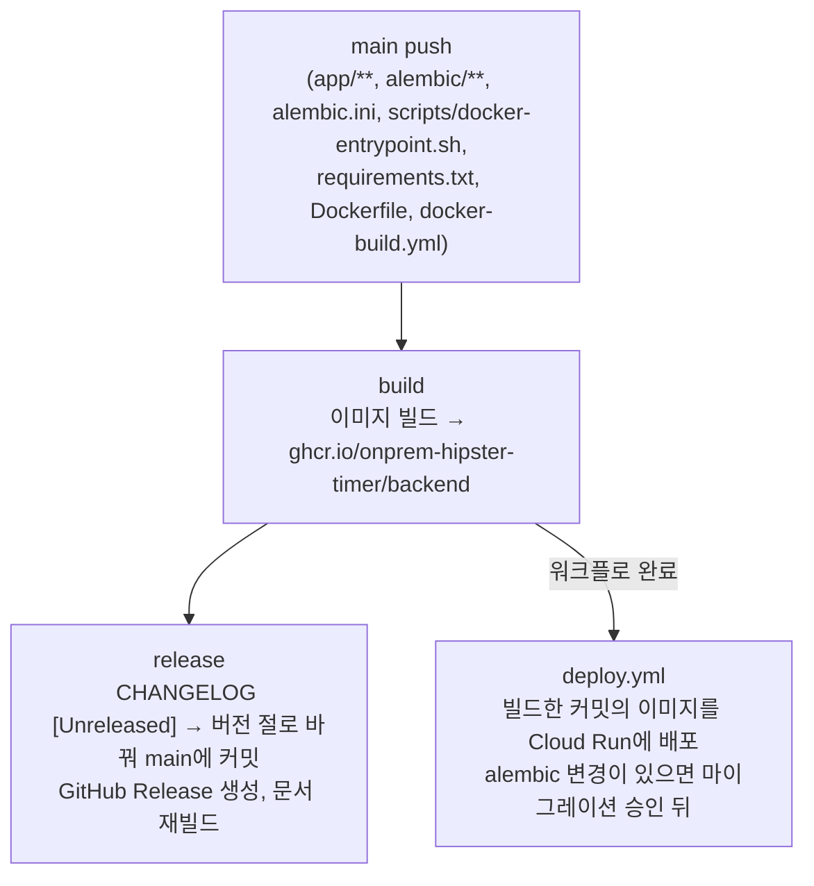

# 릴리스

`main`에 머지되면 이미지 빌드, CHANGELOG 갱신, GitHub Release, Cloud Run 배포가 이어집니다. 사람이 하는 일은 DB 마이그레이션 승인뿐입니다([프로덕션 배포](production.md#cloud-run-github-actions)). 워크플로는 `.github/workflows/docker-build.yml`(빌드·릴리스)과 `deploy.yml`(배포)입니다.

## 흐름

- 버전은 `v<YYYY.MM.DD>-<짧은 커밋 sha>`입니다 (예: `v2026.11.07-90d3145`).
- 이미지 태그는 버전, `sha-<전체 sha>`, `latest`(main push), `weekly`(월요일 스케줄 빌드)입니다. 배포는 `sha-` 태그로 빌드한 커밋의 이미지를 찾습니다.
- 다시 배포하거나 되돌릴 때는 Actions에서 `Deploy to Cloud Run`을 수동 실행하고 버전 태그를 줍니다.

## CHANGELOG

`CHANGELOG.md`의 `[Unreleased]` 절에 영어로 적습니다. release 잡이 그 절 제목을 `[<버전>] - <날짜>`로 바꾸고 새 `[Unreleased]`를 위에 추가하며, 하단의 비교 링크를 갱신합니다. `[Unreleased]`가 `_No unreleased changes._`뿐이면 아무것도 바꾸지 않습니다.

이 커밋(`chore: update CHANGELOG for <버전>`)은 `main`에 직접 올라갑니다. `main`은 ruleset으로 PR·승인 1·CODEOWNERS·SonarCloud를 요구하므로, 조직 GitHub App `hipster-release`의 토큰으로 push하고 ruleset이 이 App만 예외로 둡니다.

## GitHub App `hipster-release`

| 항목 | 값 |
|---|---|
| 소유 | 조직 `onprem-hipster-timer` |
| 권한 | Repository → Contents: Read and write (Metadata: Read) |
| 설치 | `backend` 저장소에만 |
| 저장소 변수 `RELEASE_APP_ID` | App ID |
| 저장소 시크릿 `RELEASE_APP_PRIVATE_KEY` | App의 private key (`.pem` 내용) |

- 변수가 없으면 release 잡은 CHANGELOG 갱신을 건너뛰고 GitHub Release만 만듭니다.
- 토큰은 잡마다 새로 발급되고 1시간 뒤 만료됩니다.
- 키 회전: App 설정에서 새 private key를 만들고 시크릿을 갱신한 뒤 옛 키를 지웁니다.
- 키가 새면 할 수 있는 것은 `backend`의 `main`에 직접 push하는 것입니다. 그때는 키를 지우고 `main` 이력을 확인합니다.
