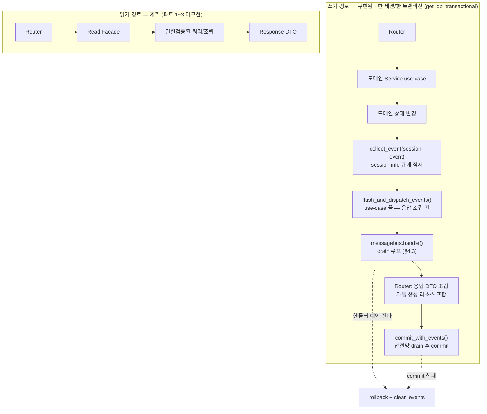
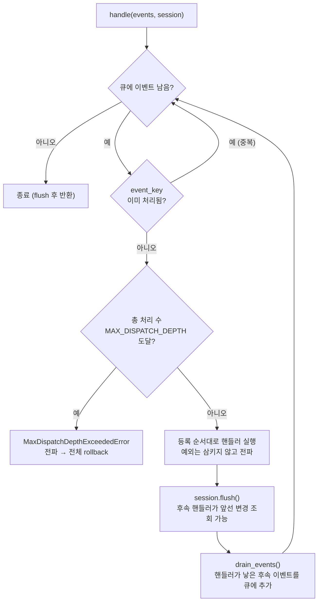
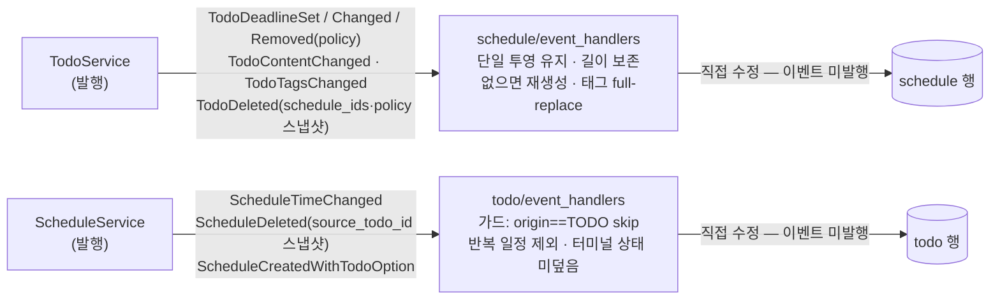

# 읽기/쓰기 분리 & 도메인 이벤트 아키텍처

> **상태**: 쓰기 경로 구현 완료 — Message Bus 인프라([#54](https://github.com/onprem-hipster-timer/backend/issues/54)),
> Todo↔Schedule 양방향 전파([#55](https://github.com/onprem-hipster-timer/backend/issues/55),
> [#44](https://github.com/onprem-hipster-timer/backend/issues/44) 해결,
> [#61](https://github.com/onprem-hipster-timer/backend/issues/61) 정책 포함).
> 읽기 경로(파트 1~3)는 미구현 · 추적: [#50](https://github.com/onprem-hipster-timer/backend/issues/50)
>
> 구현 모듈: `app/shared/{events,uow,messagebus}.py` · 이벤트: `app/domain/{todo,schedule}/events.py` ·
> 핸들러: `app/domain/{schedule,todo}/event_handlers.py` · 테스트: `tests/shared/test_messagebus.py`,
> `tests/domain/todo/test_projection_policy.py`, `tests/domain/schedule/test_backpropagation.py`

이 문서는 읽기 경로와 쓰기 경로의 책임을 분리하고, 도메인 간 전파를 **외부 broker 없이** in-process Message Bus로 처리하기 위한 설계를 설명합니다. 대상 환경은 **단일 프로세스 · 단일 DB · 요청당 단일 세션 · 단일 트랜잭션 · 강한 일관성**입니다.

---

## 1. 배경

현재 구조에는 두 가지 결합 문제가 있습니다.

| 문제 | 현재 동작 | 영향 |
|------|-----------|------|
| 읽기가 DB를 변경 | GET이 `get_db_transactional`(commit 세션)을 사용. Timer 조회는 `elapsed_time`을 ORM에 누적 | RUNNING 타이머를 조회할 때마다 경과시간이 누적 커밋 ([#51](https://github.com/onprem-hipster-timer/backend/issues/51)) |
| 도메인 간 직접 호출 | `TodoService` ↔ `ScheduleService`를 서로 직접 호출 | 강결합, 순환 import, 양방향 전파 누락 ([#44](https://github.com/onprem-hipster-timer/backend/issues/44)) |

목표는 **공개 동작(계약)을 바꾸지 않고 구현 결합도만 낮추는** 것입니다.

초기 마이그레이션 범위는 Todo/Schedule 전파와 read path 정리입니다. `TagService.delete_tag_group()`처럼 다른 도메인 쓰기를 호출하는 경로도 존재하지만, 이 문서의 초기 이벤트 카탈로그에는 포함하지 않고 후속 정리 범위로 둡니다.

---

## 2. 전체 그림



- **쓰기**: 도메인 상태를 바꾼 뒤 이벤트를 수집하고, **응답을 조립하기 전에**(use-case 메서드 끝) 핸들러를 dispatch하여 자동 생성 리소스가 응답에 즉시 보이게 합니다. 모든 핸들러는 **같은 세션/트랜잭션**에서 실행되고, 하나라도 실패하면 전체 rollback + `clear_events`합니다. `commit_with_events`는 미처리 이벤트를 한 번 더 drain하는 안전망입니다.
- **읽기**: 현재는 라우터가 직접 조립합니다. read-only 세션 전환과 Read Facade 분리는 파트 1~3(§6)의 계획입니다.

---

## 3. 읽기 경로

### 3.1 read-only 세션

GET은 `get_db`(commit 없음, rollback만)를 사용합니다. 단, 다음은 read-only 전환 전에 정리해야 합니다.

- **Timer `elapsed_time`**: 조회 시 ORM을 변경하지 않습니다. 계산을 둘로 나눕니다.
    - `calculate_display_elapsed(timer, now)` — read-only 표시용 계산
    - `accumulate_elapsed_until(timer, now)` — pause/stop 등 **write transition 전용** 누적
- **인증 parent dependency**: 모든 인증 라우터에 걸린 `get_current_user_synced`가 자체 `get_db_transactional` + 프로필 JIT sync를 엽니다. **auth-only 게이트**와 **profile-sync write 경로**로 분리해야 GET이 진짜 read-only가 됩니다.

!!! tip "쓰기 경로 구현이 읽기 전환에 주는 순풍"
    - [#52](https://github.com/onprem-hipster-timer/backend/issues/52): `get_db`의 rollback 경계에
      `clear_events`가 이미 들어가 있어(§4.5), GET이 실수로 이벤트를 수집해도 누수되지 않습니다.
      read-only 전환 시 이벤트 위생은 추가 조치 불필요.
    - [#53](https://github.com/onprem-hipster-timer/backend/issues/53): `TodoService`가 더는
      `ScheduleService`를 import하지 않아 계층 분리가 깨끗해졌고, status 자동 불변조건
      (`SCHEDULED` ⇔ 투영 존재)으로 Facade가 조립하는 데이터의 일관성이 보장됩니다.

### 3.2 Read Facade

라우터의 다중 리소스 조립 로직(`_build_timer_read_with_relations`, `_get_related_schedule_reads`)을 `app/application/read/*`(신규 레이어)로 옮깁니다. 라우터는 Facade 호출만 합니다.

!!! note "Facade가 전제해야 할 계약"
    "자동 생성 리소스가 응답에 즉시 보인다"는 계약(§2)은 각 쓰기 use-case 끝의
    `flush_and_dispatch_events` 타이밍에 의해 성립합니다. Facade는 서비스 메서드 반환 후의
    세션 상태를 신뢰하고 조립하면 됩니다.

!!! warning "권한 불변조건 (위반 시 정보 노출)"
    Read Facade는 raw CRUD/lazy load로 연관 리소스를 응답에 넣지 않습니다. 권한 판정은 `CurrentUser`에 강결합돼 있으므로, **연관 리소스마다** `try_get_schedule_read`/`get_*_with_access_check`로 개별 권한검증을 거칩니다. **부모 리소스 접근권한은 자식/연결 리소스 접근권한을 보장하지 않습니다** (공유 Timer를 봐도 연결 Schedule이 PRIVATE이면 숨김).

---

## 4. 쓰기 경로 — 도메인 이벤트 + Message Bus

### 4.1 이벤트

이벤트는 **발생한 도메인 사실**만 담는 불변 값 객체입니다.

```python
# app/shared/events.py
class EventOrigin(str, Enum):
    TODO = "todo"
    SCHEDULE = "schedule"


@dataclass(frozen=True, kw_only=True)
class DomainEvent:
    owner_id: str
    origin: EventOrigin  # 이벤트를 촉발한 source 도메인

    def event_key(self) -> tuple: ...  # 타입 + 주요 식별자 (중복 dispatch 억제)


# app/domain/schedule/events.py — 실제 구현 예
@dataclass(frozen=True, kw_only=True)
class ScheduleTimeChanged(ScheduleEvent):  # ScheduleEvent가 schedule_id + event_key 제공
    """일정 시간이 변경됨 → source-linked·비반복 일정이면 Todo.deadline 역투영"""
```

!!! danger "payload 금지 사항"
    이벤트에 API DTO, ORM instance, response DTO, handler 이름, target service를 넣지 않습니다. **식별자와 도메인 사실만** 담습니다.

!!! tip "payload 최소화 원칙 (구현 채택)"
    핸들러는 이벤트의 식별자로 **같은 트랜잭션에서 현재 상태를 조회**해 투영하므로,
    대부분의 이벤트는 식별자만 운반합니다. 예외는 **dispatch 시점에 원본이 사라지는 사실**
    — `TodoDeleted.linked_schedule_ids`(FK SET NULL로 사후 조회 불가),
    `ScheduleDeleted.source_todo_id`, 클라이언트 정책(`policy`) 등 — 만 스냅샷으로 담습니다.

### 4.2 이벤트 보관 — 세션 스코프 수집

도메인 모델이 SQLModel ORM 클래스의 alias라, 엔티티에 `.events` 리스트를 직접 붙이면 SQLAlchemy 로드 시 초기화 문제가 생깁니다. 그래서 1차 구현은 **세션 스코프 수집**을 사용합니다.

| helper (`app/shared/uow.py`) | 역할 |
|------------------------------|------|
| `collect_event(session, event)` | `session.info`에 이벤트 적재 (직접 접근 금지, helper로만) |
| `drain_events(session)` | 수집된 이벤트를 꺼내 반환 |
| `clear_events(session)` | 이벤트 큐 비우기 |
| `flush_and_dispatch_events(session)` | `flush → drain/handle loop → flush` (commit 없음) |
| `commit_with_events(session)` | 위를 한 번 더 보장 후 commit |

!!! important "`session.info`는 트랜잭션 aware가 아님"
    DB rollback이 돼도 `session.info`의 이벤트 큐는 자동으로 비워지지 않습니다. SAVEPOINT/내부 예외와 섞이면 이미 취소된 변경의 이벤트가 남을 수 있으므로, **rollback 경계에서 반드시 `clear_events(session)`**를 호출하고, **SAVEPOINT(`begin_nested`) 내부에서는 이벤트를 수집하지 않습니다** (§4.5).

### 4.3 Message Bus



```python
# app/shared/messagebus.py
def handle(events, session):
    queue = list(events)
    seen = set()
    depth = 0

    while queue:
        if depth > MAX_DISPATCH_DEPTH:
            raise RuntimeError("Max event dispatch depth exceeded")

        event = queue.pop(0)
        key = event_key(event)  # 타입 + 주요 식별자
        if key in seen:
            continue
        seen.add(key)

        for handler in HANDLERS[type(event)]:
            handler(event, session)          # 예외는 삼키지 않고 전파

        session.flush()                       # 후속 핸들러가 앞선 변경을 조회 가능
        queue.extend(drain_events(session))   # 핸들러가 낳은 후속 이벤트 재수집
        depth += 1
```

- `register(event_type)` 데코레이터로 consumer 모듈이 핸들러를 등록합니다. 누가 들을지는 **중앙 registry**가 정하며, 이벤트 발행자는 모릅니다.
- `register_handlers()`는 **idempotent**해야 합니다(앱 startup·테스트 fixture 양쪽에서 호출되므로). 테스트용 `reset_handlers()`도 제공합니다.

### 4.4 cascade 무한루프 방지

`TodoDeadlineChanged → ScheduleTimeChanged → TodoDeadlineChanged` 같은 왕복 전파를 차단합니다.

- 이벤트 `origin` 필드 + `max_dispatch_depth` 상한 병행
- 보강: 동일 이벤트(타입+식별자) 중복 dispatch 방지

### 4.5 적용 범위와 안전 경계

이 메커니즘은 범용 이벤트 버스나 transactional outbox가 아니라
**"동기 트랜잭션 내 도메인 이벤트 투영 큐"**입니다. 안전 보장은
**동기 HTTP 요청 · 같은 DB 세션 · DB 행만 갱신하는 핸들러** 범위에
한정됩니다 — 이 범위 안에서는 핸들러 예외·commit 실패 시 투영 변경이
도메인 변경과 함께 원자적으로 rollback됩니다.

이벤트 drain/clear가 어느 진입점에서 보장되는지의 현황:

| 진입점 | commit | 이벤트 처리 | 상태 |
|--------|--------|-------------|------|
| REST 쓰기 (`get_db_transactional`) | `commit_with_events` | ✅ 안전망 drain 후 commit, 예외 시 rollback + `clear_events` | 구현됨 |
| REST 읽기 (`get_db`) | 없음 (항상 rollback) | ✅ rollback 경계에서 `clear_events` (누수 위생) | 구현됨 |
| WebSocket per-message (`timers_ws.py`) | 맨 `session.commit()` | ❌ **drain/clear 없음** | [#49](https://github.com/onprem-hipster-timer/backend/issues/49) 범위 |
| AsyncSession (`get_async_db`, background tasks) | 맨 `await session.commit()` | ❌ **drain/clear 없음** — 이벤트 발행 금지 | async 이벤트가 필요해지면 별도 async UoW 설계 |

!!! danger "핸들러에 외부 부작용 금지"
    핸들러는 **commit 전에** 실행됩니다. 트랜잭션이 rollback돼도 외부 효과는
    취소할 수 없으므로, 핸들러에서 알림 발송·메시지 브로커·외부 HTTP 호출을
    하면 안 됩니다 — **DB 행 수정만** 허용됩니다. commit 이후 실행이 보장돼야
    하는 부작용이 필요해지면 transactional outbox로 확장합니다 (장기 방향,
    [#50](https://github.com/onprem-hipster-timer/backend/issues/50) 참조 문서).

!!! warning "SAVEPOINT 내부에서 이벤트 수집 금지"
    이벤트 큐는 중첩 트랜잭션(SAVEPOINT) rollback을 알지 못합니다.
    `begin_nested()` 블록 안에서 `collect_event`를 호출하면 savepoint가
    rollback돼도 취소된 변경의 이벤트가 큐에 남아 dispatch됩니다.
    savepoint 내부에서는 이벤트를 수집하지 않습니다 (필요해지면
    savepoint별 큐 checkpoint 구현이 선행돼야 함).

!!! note "`MAX_DISPATCH_DEPTH`의 실제 의미"
    이 상한은 재귀 "깊이"가 아니라 **한 drain 루프에서 처리하는 총 이벤트
    수**입니다. 한 요청이 정당하게 많은 이벤트를 발행하는 배치성 유스케이스가
    생기면 체인 깊이와 총량을 분리해야 합니다.

!!! danger "WS 경로의 이벤트 유실 함정 (#49 스코프)"
    WS per-message 커밋은 `commit_with_events`를 타지 않습니다. 현재 WS는 타이머 연산만
    수행하고 타이머는 이벤트를 발행하지 않아 무해하지만, **WS에서 도달하는 코드가
    `collect_event`를 호출하는 순간 이벤트가 드레인 없이 커밋되고 세션이 닫히면서
    조용히 유실**됩니다. WS 도달 경로에 이벤트 발행을 추가하는 변경(예: 타이머 완료
    전파 [#62](https://github.com/onprem-hipster-timer/backend/issues/62))은
    **#49(WS 커밋 → `commit_with_events`, rollback 경계 → `clear_events`) 선행이 필수**입니다.

### 4.6 핸들러의 권한 불변조건

이벤트 핸들러는 내부 projection이므로 사용자 권한 검증을 우회합니다. 대신 **owner 불변조건**을 강제합니다.

- 핸들러는 변경 대상의 `owner_id == event.owner_id`를 확인한 뒤에만 수정합니다.
- `current_user`를 요구하는 기존 Service를 그대로 호출하지 않고, `owner_id` 기반 lower-level operation을 사용합니다.
- 자동 생성 리소스에 **visibility를 복사하지 않습니다** (생성 후 별도 `/visibility` API로 관리, 기본 PRIVATE).
- 삭제 핸들러는 `delete_visibility_by_resource` cleanup을 유지합니다(orphan visibility 방지).

---

## 5. 이벤트 카탈로그 (초기)

실제 모듈 간 전파가 필요한 것만 우선 정의합니다.

| 이벤트 | 상태 |
|--------|------|
| `TodoDeadlineSet/Changed/Removed`, `TodoContentChanged`, `TodoTagsChanged`, `TodoDeleted` | ✅ 구현 (`app/domain/todo/events.py` → 핸들러 `app/domain/schedule/event_handlers.py`) |
| `ScheduleTimeChanged`, `ScheduleDeleted`, `ScheduleCreatedWithTodoOption` | ✅ 구현 (`app/domain/schedule/events.py` → 핸들러 `app/domain/todo/event_handlers.py`) |

!!! note "반복 일정 × source_todo (결정)"
    source-linked Schedule이 반복 일정으로 전환된 경우 **시간 역투영을 하지 않습니다** —
    반복 일정은 시점 마감의 투영이 아니게 되기 때문입니다.
    `tests/domain/schedule/test_backpropagation.py::test_recurring_source_linked_schedule_does_not_backpropagate`로 고정.
    반복 시리즈 소진으로 원본이 자동 삭제되는 경로(recurring_service)도 `ScheduleDeleted`를
    발행하고 접근권한 cleanup을 수행합니다.

- `TodoContentChanged`: 제목·설명 변경의 투영 반영 (기존에는 전파 자체가 없던 공백)
- `TodoDeadlineRemoved`/`TodoDeleted`는 클라이언트가 지정한 `linked_schedule_policy`(`delete`|`unlink`)를 payload로 운반 ([#61](https://github.com/onprem-hipster-timer/backend/issues/61))
- `TodoDeleted`는 삭제 전 스냅샷한 `linked_schedule_ids`를 운반 (`source_todo_id`가 `ondelete=SET NULL`이라 삭제 flush 후에는 조회 불가)

### 5.0 전파 토폴로지

발행자는 Service, 수신자는 상대 도메인의 `event_handlers`입니다. 핸들러는
대상 행을 **직접 수정하고 이벤트를 발행하지 않으므로** 반대 방향이 재발화하지
않습니다 — 왕복(A→B→A)은 구조적으로 차단되고, origin 가드는 이중 안전장치입니다.



### 5.1 필드 소유권 (source of record)

핸들러 스펙은 이 표에서 도출됩니다. 수신 핸들러는 이벤트의 식별자로 **같은 트랜잭션에서 현재 상태를 조회**해 소유 필드만 투영합니다(전체 상태 덮어쓰기 금지).

| 논리 필드 | 원본 | 전파 규칙 |
|-----------|------|-----------|
| 제목·설명 | **Todo** | Todo→Schedule 항상 반영 (`TodoContentChanged`) |
| 마감 시점 | Todo.deadline ⇔ Schedule.start_time | **양방향** (origin 가드) |
| 일정 길이 (end−start) | **Schedule** | 전파 안 함. deadline 변경 시 start만 이동, 길이 보존. 생성 시 초기값 1시간 |
| 태그 | **Todo** | full-replace Todo→Schedule (일정 태그는 할일 태그의 투영 — 계약) |
| 상태 | 자동화 (명시가 우선) | status **미지정 시에만** 투영 존재를 따라감: 생성→`SCHEDULED`, 소멸→`UNSCHEDULED` (터미널 상태 미덮음). **명시 status는 항상 우선** — 비터미널 명시(`UNSCHEDULED`+투영 공존 등)도 허용 (재오픈 흐름 지원). status 변경은 핸들러 직접 쓰기(이벤트 미발행)로 drain 재수집 방지 |
| 수명주기 | **Todo 주도 + 클라이언트 정책** | `linked_schedule_policy` — 디폴트 없음, 미지정 422 ([#61](https://github.com/onprem-hipster-timer/backend/issues/61)) |
| 연결(source_todo_id) | **전용 흐름 전유** | 공개 Schedule Create/Update DTO에서 제외 — 일반 API로 연결/해제/재연결 불가 (단일 투영·status 불변조건 보호, `TestProjectionLinkImmutability`로 고정) |
| 완료 상태 전파 | 미정 | 별도 정책 결정 ([#62](https://github.com/onprem-hipster-timer/backend/issues/62)). 구현 시 이 인프라 위 핸들러로 추가하되, `stop_timer`가 WS에서도 불리므로 **WS 커버리지는 #49 선행 필수**(§4.5)이고 터미널 상태 가드(DONE/CANCELLED 미덮음) 패턴을 따라야 함 |

!!! note "source of truth"
    Todo `deadline`이 원본, Schedule `start_time`은 그 투영입니다. `ScheduleTimeChanged`는 **`source_todo_id`가 있는(=Todo가 만든) Schedule**에 한해 Todo로 역전파하고, `origin`이 Todo면 다시 전파하지 않습니다.

!!! note "Schedule 삭제 정책 (확정·구현됨)"
    Todo `deadline` 제거·Todo 삭제 시 연결 Schedule 처리는 클라이언트가 `linked_schedule_policy`로
    명시합니다([#61](https://github.com/onprem-hipster-timer/backend/issues/61)).
    반대 방향 — `source_todo_id`가 있는 Schedule을 삭제한 경우 — 는 **Todo와 `deadline`을 유지**하고
    (삭제는 캘린더 표시 제거일 뿐) `status`만 투영 부재를 반영해 `UNSCHEDULED`로 되돌립니다
    (터미널 상태 보호). `tests/domain/schedule/test_backpropagation.py::test_deleting_projected_schedule_keeps_todo_and_deadline`으로 고정.

---

## 6. 단계별 적용

| 파트 | 내용 | 이슈 | 상태 |
|------|------|------|------|
| 1 | 읽기가 DB를 바꾸는 문제 수정 (Timer `elapsed_time`) | [#51](https://github.com/onprem-hipster-timer/backend/issues/51) | 미착수 |
| 2 | GET을 진짜 read-only로 (인증 의존성 분리 포함) | [#52](https://github.com/onprem-hipster-timer/backend/issues/52) | 미착수 |
| 3 | 읽기 조립을 Read Facade로 | [#53](https://github.com/onprem-hipster-timer/backend/issues/53) | 미착수 |
| 4 | 이벤트 버스를 테스트로 고정 | [#54](https://github.com/onprem-hipster-timer/backend/issues/54) | ✅ 완료 |
| 5 | Todo/Schedule 직접 호출을 이벤트로 이전 (양방향) | [#55](https://github.com/onprem-hipster-timer/backend/issues/55) | ✅ 완료 |
| 6 | WebSocket을 같은 commit/rollback 규칙으로 — **버스 도입으로 스코프 추가**: WS 커밋 → `commit_with_events`, rollback 경계 → `clear_events` (§4.5 유실 함정) | [#49](https://github.com/onprem-hipster-timer/backend/issues/49) | 미착수 |

각 파트는 **기존 테스트 그린 유지**가 1차 게이트입니다. 특히 `tests/test_shared_resource_filtering.py`(부모 공유/자식 PRIVATE 은닉)는 Read Facade 이전 후에도 통과해야 합니다.

---

## 7. 새 이벤트/핸들러 추가 가이드

1. **이벤트 정의** — 발행 도메인의 `app/domain/<domain>/events.py`에 `DomainEvent`
   서브클래스를 추가합니다. frozen dataclass, `kw_only=True`, payload는 식별자 +
   사라지는 사실만(§4.1). `event_key()`가 주요 식별자를 포함하는지 확인합니다.
2. **발행** — 서비스 use-case에서 상태 변경 후 `collect_event(self.session, 이벤트)`,
   메서드 끝에서 `flush_and_dispatch_events(self.session)`. 응답 조립 전에 dispatch돼야
   자동 생성 리소스가 응답에 보입니다(§2).
3. **핸들러** — 수신 도메인의 `app/domain/<domain>/event_handlers.py`에
   `@register(이벤트타입)` 함수 추가. 시그니처 `(event, session)`, owner 불변조건 확인,
   low-level 연산 사용, status류 직접 쓰기는 이벤트 미발행(§4.6, §5.1).
   **DB 행 수정만 허용** — 알림·브로커·외부 HTTP 등 외부 부작용 금지(§4.5).
4. **등록 배선** — 새 `event_handlers.py` 모듈이면
   `app/shared/messagebus.py::register_handlers()`에 lazy import 한 줄 추가.
   (앱 lifespan과 테스트 conftest가 이 함수를 공유하므로 다른 배선은 불필요)
5. **테스트** — 행동을 테스트명으로 고정(red→green). 왕복 가능성이 있으면
   origin 가드/구조적 차단을 함께 검증. 버스 자체 동작은 `tests/shared/test_messagebus.py`가
   이미 커버하므로 재검증하지 않습니다.
6. **주의** — WS에서 도달하는 경로에 발행을 추가한다면 §4.5의 유실 함정 확인
   ([#49](https://github.com/onprem-hipster-timer/backend/issues/49) 선행 필요).

---

## 8. 참고

- [Cosmic Python — Events and the Message Bus](https://www.cosmicpython.com/book/chapter_08_events_and_message_bus.html)
- [SQLAlchemy — ORM/Session Events](https://docs.sqlalchemy.org/en/20/orm/session_events.html)
- 관련 가이드: [Todo](../guides/todo.md), [Visibility](../guides/visibility.md), [WebSocket](../api/websocket.md)
