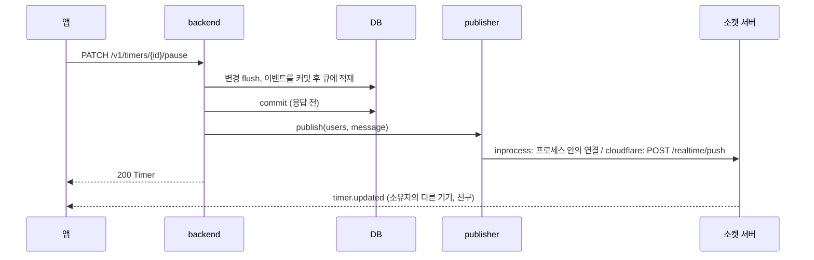

# 실시간 전달 (어댑터 구조)

> 구현: `app/shared/uow.py`(커밋 후 큐) · `app/db/session.py`(`get_db_committing`) ·
> `app/realtime/publisher.py`(publisher) · `app/domain/timer/realtime.py`(타이머 이벤트) ·
> `app/domain/visibility/service.py`(`get_realtime_recipients`) · `app/api/v1/timers_ws.py`(inprocess 소켓) ·
> `app/api/oidc_discovery.py`(JWKS)

타이머 변경은 소유자의 다른 기기와, 공개 범위상 받을 수 있는 친구에게 실시간으로 전달됩니다.
명령·접근 판정·상태는 어느 배포에서나 backend가 결정하고, **소켓을 들고 메시지를 전달하는 부분만** 배포 모드에 따라 바뀝니다.
클라이언트는 두 모드에서 같은 계약을 쓰고 소켓 주소만 다릅니다.

---

## 1. 흐름



- 명령은 REST로만 받습니다. 소켓은 **수신 전용**입니다.
- 이벤트는 트랜잭션이 커밋된 뒤에만 나갑니다. rollback되면 나가지 않습니다.
- 커밋과 publish는 응답을 보내기 전에 끝납니다. 응답을 받은 클라이언트가 곧바로 조회해도 변경이 보입니다.

---

## 2. 두 모드

`REALTIME_BACKEND`로 고릅니다.

| | `inprocess` (기본) | `cloudflare` |
|---|---|---|
| 소켓 주소 | `wss://<api>/v1/ws/timers` | `wss://<api>/realtime/ws` |
| 소켓을 드는 곳 | backend 프로세스 (`ConnectionManager`) | realtime Worker와 사용자별 Durable Object (`UserHub`) |
| 전달 | 같은 프로세스의 연결로 보냄 | Worker에 `POST /realtime/push` |
| JWT 검증 | backend | Worker가 `GET /auth/.well-known/jwks.json`의 키로 검증 |
| 인증 실패 | 핸드셰이크를 HTTP 403으로 거부 (브라우저에는 close code 1006) | 101로 받은 뒤 1008로 닫음 |
| 소켓 수명 | 제한 없음 | 24시간. 지나면 다음 전달 때 4000으로 닫음 |
| 추가로 필요한 것 | 없음 | realtime-worker 배포, `REALTIME_PUSH_URL`, `REALTIME_PUSH_SECRET` |

- `inprocess`는 이벤트를 **명령을 처리한 프로세스에 붙은 소켓에만** 보냅니다. backend를 한 프로세스로 운영할 때의 모드입니다(온프레미스 `compose.yaml`).
- `cloudflare`는 소켓이 backend 밖에 있으므로 backend 인스턴스 수와 무관하게 전달되고, 열린 소켓이 backend 인스턴스를 붙잡지 않습니다. Worker의 코드·배포·설정은 [realtime-worker](https://github.com/onprem-hipster-timer/realtime-worker) 저장소에 있습니다.
- 모드를 바꿀 때 backend는 `REALTIME_BACKEND`(와 push 설정)만, 클라이언트는 소켓 주소만 바꿉니다.

---

## 3. 계약

### 3.1 메시지 봉투

서버 → 클라이언트 메시지는 모두 같은 봉투입니다 (`app/websocket/base.py` `WSServerMessage`).

```json
{
  "id": "6f1c0c1e-8a53-4d6e-9d0a-2b1f5f0c9a11",
  "type": "timer.updated",
  "from_user": "<행위자 sub>",
  "timestamp": "2026-11-06T10:30:00+0000",
  "payload": {
    "action": "pause",
    "actor_name": "<행위자 표시명 또는 null>",
    "timer": { "id": "…", "status": "PAUSED", "elapsed_time": 1800, "updated_at": "2026-11-06T10:30:00+0000", "…": "…" }
  }
}
```

| 필드 | 설명 |
|---|---|
| `id` | 메시지 ID (UUID). 클라이언트가 중복 제거에 씁니다 |
| `type` | 아래 표 |
| `from_user` | 변경을 일으킨 사용자의 `sub`. `connected`는 `null` |
| `timestamp` | 메시지를 만든 시각 (UTC) |
| `payload.action` | 아래 표 |
| `payload.actor_name` | 행위자의 표시명 (JWT `name` 클레임). 없으면 `null` |
| `payload.timer` | 커밋된 타이머 (`app/domain/timer/schema/ws.py` `TimerData`). 시각은 모두 UTC |
| `payload.timer_id` | `timer.deleted`에만 있음 |

| `type` | `action` | `payload.timer` |
|---|---|---|
| `timer.created` | `start` | 타이머 |
| `timer.updated` | `pause`, `resume`, `stop`, `cancel`, `update` | 타이머 |
| `timer.deleted` | `delete` | `null` (`timer_id`로 식별) |
| `connected` | — | — (`payload`는 `{}`) |

- 시각은 REST 응답(`timezone=UTC`)과 같은 형식(`2026-11-06T10:30:00+0000`, `CustomModel`)으로 직렬화합니다. 같은 타이머 상태면 이벤트와 REST 응답의 `updated_at` 문자열이 같습니다.
- `elapsed_time`은 저장된 누적값입니다. RUNNING이면 클라이언트가 `now - started_at`을 더해 표시합니다 ([타이머 가이드](../guides/timer.ko.md)의 elapsed_time 계산 규칙).
- 클라이언트 → 서버 메시지는 문자열 `ping`뿐이고 서버는 `pong`으로 답합니다. 그 외는 무시합니다.
- 연결 직후 서버가 `connected`를 보냅니다. 연결 시 타이머 목록을 보내지 않으므로 클라이언트가 REST로 맞춥니다 (5장).

### 3.2 받는 사람

받는 사람은 **소유자 본인**(다른 기기 동기화)과 `VisibilityService.get_realtime_recipients`가 돌려주는 사용자입니다.

| 타이머 공개 범위 | 받는 친구 |
|---|---|
| 설정 없음, `PRIVATE`, `ALLOWED_EMAILS` | 없음 |
| `FRIENDS`, `PUBLIC` | 소유자의 친구 전원 |
| `SELECTED_FRIENDS` | 소유자의 친구 중 허용 목록에 있는 사용자 |

- 결과는 항상 `can_access`가 허용하는 사용자의 부분집합입니다. 친구가 아닌 사용자는 `PUBLIC`이어도 실시간으로 받지 않고 REST 조회로만 봅니다.
- 삭제 이벤트의 받는 사람은 공개 범위 설정을 지우기 **전에** 계산합니다.
- 받는 사람은 이벤트를 만들 때 정해집니다. 공개 범위를 바꿔도 이미 보낸 이벤트는 그대로이고, 범위 변경 자체는 이벤트를 보내지 않습니다.

### 3.3 push (backend → Worker, `cloudflare` 모드)

```http
POST <REALTIME_PUSH_URL>
Authorization: Bearer <REALTIME_PUSH_SECRET>
Content-Type: application/json

{"users": ["<sub>", "…"], "message": { …봉투… }}
```

- `users`는 1~40명입니다. publisher가 40명씩 나눠 보냅니다.
- Worker 응답: `202` 접수, `400` 형식 오류, `401` 시크릿 불일치, `413` 41명 이상. `202`는 접수만 뜻하고, 각 사용자의 Durable Object가 `message`를 JSON 그대로 소켓에 보냅니다.
- 연결 오류·5xx는 한 번 재시도하고 4xx는 재시도하지 않습니다. 이벤트 하나에 쓰는 시간은 재시도를 포함해 약 2초(`PUSH_DEADLINE_SECONDS`)입니다.
- 실패는 요청을 실패시키지 않고 `realtime_push_failed id=… users=… status=… error=…` 경고 로그만 남깁니다. 다시 보내지 않으므로 클라이언트 재동기화가 이를 메웁니다.

### 3.4 OIDC discovery·JWKS

Worker가 Kratos JWT를 직접 검증할 수 있게 backend가 공개 키를 내줍니다. 인증은 없습니다.

| 경로 | 응답 |
|---|---|
| `GET /auth/.well-known/jwks.json` | `OIDC_JWKS` 그대로 |
| `GET /auth/.well-known/openid-configuration` | `issuer`(= `OIDC_ISSUER_URL`), `jwks_uri` 등 최소 discovery 문서 |

- 둘 다 `Cache-Control: public, max-age=3600`이고, `OIDC_JWKS`가 비어 있으면 404입니다.
- 발급자가 `/`로 끝나므로 `/auth//.well-known/...` 경로도 같은 응답을 줍니다.
- `OIDC_JWKS`에 비밀 키 성분(`d`)이나 대칭 키가 있으면 기동이 실패합니다.
- 키를 바꿀 때는 새 키를 서명에 쓰기 1시간 이상 전에 `OIDC_JWKS`에 추가하고, 옛 키는 그 키로 서명한 토큰이 만료될 때까지 남겨 둡니다(응답 캐시와 Worker의 JWKS 캐시 때문).

---

## 4. backend에서 이벤트 보내기

```python
# 서비스: 변경을 flush한 뒤 적재
from app.shared.uow import enqueue_after_commit

enqueue_after_commit(session, {"users": {"<sub>", ...}, "message": envelope_dict})
```

```python
# 라우트: 응답 전에 커밋
session: Session = CommittingSession
```

- `enqueue_after_commit`의 항목은 **루트 트랜잭션이 커밋된 뒤에만** sink로 넘어갑니다. rollback·close면 버려집니다.
- SAVEPOINT(`begin_nested`) 안에서는 적재하지 않습니다. SAVEPOINT만 rollback돼도 항목이 남아 바깥 커밋 때 나갑니다.
- 도메인 이벤트 큐(`collect_event`, 커밋 전에 같은 트랜잭션에서 처리)와는 별개입니다 ([도메인 이벤트](domain-events.ko.md)).
- 쓰기 라우트는 `CommittingSession`(`Depends(get_db_committing, scope="function")`, `app/db/session.py`)을 씁니다. `scope="function"`이 빠지면 커밋과 publish가 응답 뒤로 밀립니다. `get_db_transactional` 자체에 `scope`를 주면 세션이 둘로 나뉘므로 그러지 않습니다.
- `message`는 JSON 그대로 보낼 수 있는 dict여야 합니다 (`WSServerMessage(...).model_dump(mode="json")`). 타이머 이벤트 조립은 `app/domain/timer/realtime.py`를 참고합니다.
- sink는 lifespan에서 `REALTIME_BACKEND`에 맞는 publisher로 연결됩니다 (`app/main.py`). 테스트에서는 `after_commit_items` fixture(`tests/conftest.py`)가 sink를 기록용 리스트로 바꿉니다.

---

## 5. 클라이언트 규칙

- **연결·재연결 직후 REST로 다시 맞춥니다.** 소켓은 연결 전이나 끊긴 동안의 메시지를 다시 보내지 않습니다.
- `id`가 이미 처리한 메시지면 버립니다.
- `payload.timer.updated_at`이 가진 값보다 이전이면 버리고, 같거나 나중이면 반영합니다. REST 응답에도 같은 규칙을 씁니다.
- `timer.deleted`를 받으면 그 `timer_id`를 지운 것으로 기록하고, 이후 같은 ID의 이전 이벤트는 버립니다.
- 모든 타이머 REST 호출에 `timezone=UTC`를 붙입니다. 이벤트의 시각은 항상 UTC입니다.
- 친구 알림은 `from_user`가 내 `sub`가 아닌 이벤트로 띄웁니다.
- 연결을 유지하려면 주기적으로 `ping`을 보냅니다.
- 닫힘 코드: `1008`(인증 실패)은 토큰을 갱신하기 전까지 재연결하지 않고, `4000`(소켓 수명 만료)은 바로 재연결하고, 그 외(`4029` 연결 한도 포함)는 지수 백오프와 지터를 두고 재연결합니다.

---

## 6. 설정

| 변수 | 기본값 | 설명 |
|---|---|---|
| `REALTIME_BACKEND` | `inprocess` | `inprocess` 또는 `cloudflare` |
| `REALTIME_PUSH_URL` | (빈 값) | `cloudflare`: Worker의 push 엔드포인트 (예: `https://api.example.com/realtime/push`). 비어 있으면 push하지 않음 |
| `REALTIME_PUSH_SECRET` | (빈 값) | `cloudflare`: Worker의 `PUSH_SECRET`과 같은 값 |

- `ENVIRONMENT=production`에서 `REALTIME_BACKEND=cloudflare`인데 URL이나 시크릿이 비어 있으면 기동이 실패합니다.
- JWKS 서빙은 `OIDC_JWKS`와 `OIDC_ISSUER_URL`을 씁니다 ([설정](../getting-started/configuration.md)).
- inprocess 소켓의 연결 한도는 `WS_CONNECT_MAX`/`WS_CONNECT_WINDOW`입니다 (넘으면 `4029`).

### 6.1 `cloudflare` 모드 켜기

1. [realtime-worker](https://github.com/onprem-hipster-timer/realtime-worker)를 배포합니다. Worker의 `JWKS_URL`은 이 backend의 `/auth/.well-known/jwks.json`, `JWT_ISSUER`·`JWT_AUDIENCE`는 `OIDC_ISSUER_URL`·`OIDC_AUDIENCE`와 같은 값이어야 합니다. route는 api 호스트의 `/realtime/*`입니다.
2. backend에 `REALTIME_BACKEND=cloudflare`, `REALTIME_PUSH_URL=https://<api 호스트>/realtime/push`, `REALTIME_PUSH_SECRET=<Worker의 PUSH_SECRET>`을 넣고 다시 띄웁니다.
3. 클라이언트는 `wss://<api 호스트>/realtime/ws`로 연결합니다. 메시지 계약은 `/v1/ws/timers`와 같습니다 (3절).

Worker가 받지 못하면(배포 전, 시크릿 불일치) backend는 `realtime_push_failed`를 로그로 남기고 응답은 정상입니다. 되돌릴 때는 `REALTIME_BACKEND=inprocess`로 바꾸고 클라이언트가 `/v1/ws/timers`로 연결하면 됩니다.

---

## 7. 테스트

| 대상 | 위치 |
|---|---|
| 커밋 후 큐 (루트 커밋, rollback, SAVEPOINT, sink 예외) | `tests/shared/test_after_commit.py` |
| 응답 전 커밋, 같은 세션 공유 | `tests/db/test_get_db_committing.py` |
| publisher (inprocess 전달, push 형식·분할·재시도·기한) | `tests/realtime/test_publisher.py` |
| 받는 사람과 `can_access`의 일치 | `tests/domain/visibility/test_realtime_recipients.py` |
| 타이머 이벤트 봉투와 받는 사람, REST 응답과 같은 시각 형식 | `tests/domain/timer/test_realtime_events.py` |
| REST 명령, 라우트의 `scope="function"`, 응답 시작 전 publish | `tests/test_timers_rest_commands.py` |
| 수신 전용 소켓 (`connected`, `ping`/`pong`, 이벤트 수신) | `tests/test_websocket_timers.py` |
| OIDC discovery·JWKS | `tests/test_oidc_discovery.py` |
