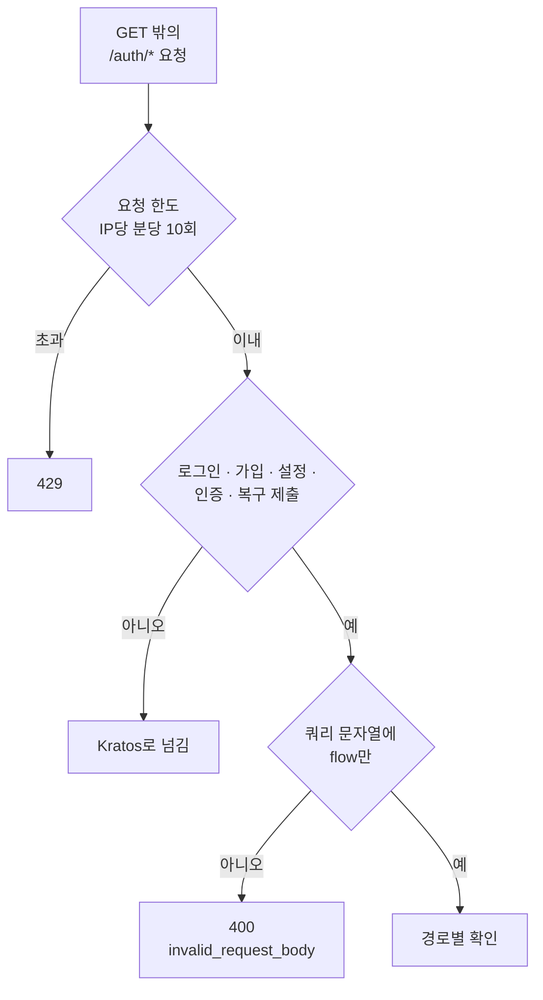
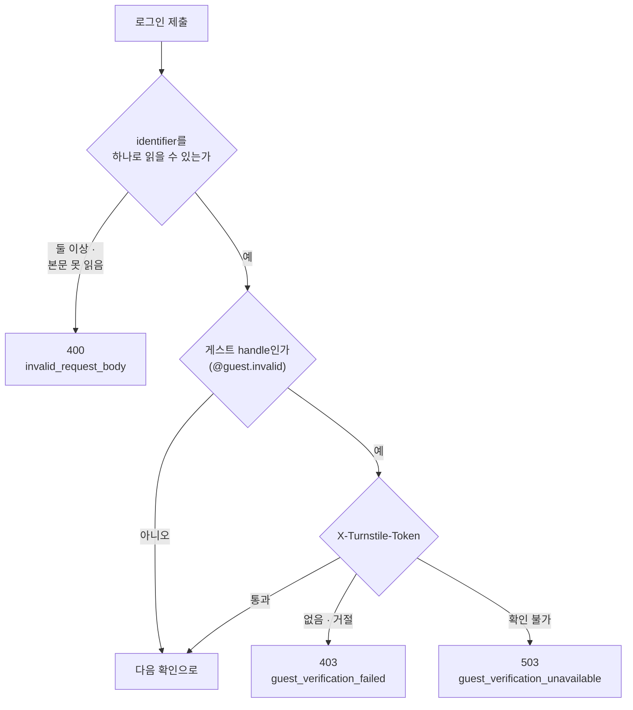
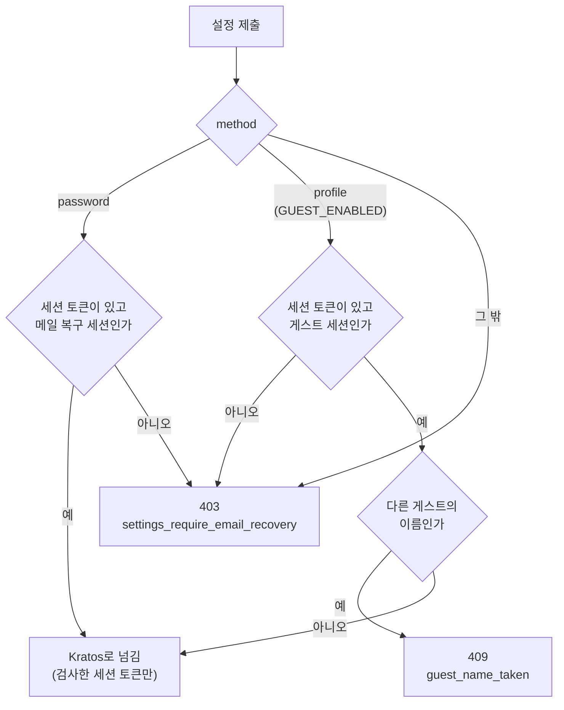

# `/auth` 프록시

backend의 `/auth/*`는 Kratos 공개 API로 가는 프록시입니다. Kratos는 backend 옆에서만 닿고 밖에 직접 열려 있지 않으므로, 로그인·가입·인증·복구·설정·세션 조회·JWT 발급은 모두 이 경로를 지납니다. 이 문서는 프록시가 요청을 넘기는 방식, 넘기기 전에 하는 확인과 그 순서, 프록시가 직접 답하는 응답을 설명합니다.

- 회원 인증의 구조는 [인증 가이드](auth.ko.md), 게스트 계정은 [게스트 계정 가이드](guest.ko.md)에 있습니다.
- `KRATOS_PUBLIC_URL`이 비어 있으면 `/auth/*`는 `404`입니다.
- `/auth/.well-known/jwks.json`과 `/auth/.well-known/openid-configuration`은 프록시가 아니라 backend가 직접 답합니다.

## 넘기는 방식

| 항목 | 동작 |
|------|------|
| 경로 | `/auth` 접두사를 떼고 `KRATOS_PUBLIC_URL`로 넘긴다. 예: `/auth/sessions/whoami` → `/sessions/whoami`. 쿼리 문자열은 그대로 |
| 메서드 | `GET`, `POST`, `PUT`, `PATCH`, `DELETE` |
| 넘기는 요청 헤더 | `X-Session-Token`, `Authorization`, `Accept`, `Content-Type`, `X-Forwarded-Host`, `X-Forwarded-Proto`, `Cf-Connecting-IP`. 그 밖의 헤더는 넘기지 않는다 |
| 쿠키 | 요청의 `Cookie`는 넘기지 않고, 응답의 `Set-Cookie`는 버린다. 인증은 세션 토큰과 JWT로만 한다 |
| 리다이렉트 | 따라가지 않고 클라이언트에 그대로 돌려준다 |
| 가는 곳 | `KRATOS_PUBLIC_URL` 한 곳. Kratos admin API에는 닿지 않는다 |
| 시간 제한 | 연결 3초, 전체 15초. Kratos에 닿지 않으면 `502` |
| 응답 | Kratos의 상태 코드와 본문을 그대로 돌려준다 |

## 판정 순서

GET은 아래 확인 없이 넘깁니다. 경로는 Kratos로 실제 나갈 경로(`..`와 인코딩을 정리한 뒤, 소문자, 끝의 `/` 제외)로 비교하므로, 같은 Kratos 경로에 닿는 다른 표기도 같은 확인을 받습니다.

**공통 단계.** GET 밖의 모든 `/auth/*` 요청이 지납니다.

**경로별 확인.** 위에서 아래 순서로 하고, 모두 지나면 Kratos로 넘깁니다.

| 제출 경로 | 확인 | 거절 응답 |
|-----------|------|-----------|
| 인증, 복구 | 본문을 읽을 수 있고 `email`이 하나인가 | `400` `invalid_request_body` |
| | `email`이 `@guest.invalid`로 끝나지 않는가 | `400` `address_not_accepted` |
| 로그인 | 아래 "로그인 제출" 그림 (`GUEST_ENABLED`일 때) | |
| 로그인, 가입 | `method: oidc`면 본문을 읽을 수 있는가. 읽으면 `traits.email`을 버리고 넘긴다 | `400` `invalid_request_body` |
| 설정 | 아래 "설정 제출" 그림 | |

**로그인 제출** (`GUEST_ENABLED=true`일 때만. 꺼져 있으면 `identifier`를 읽지 않는다)

**설정 제출**

설정 제출이 넘어갈 때는 검사한 `X-Session-Token`의 세션으로만 처리되도록 `Authorization` 헤더를 빼고 넘깁니다.

## 넘긴 뒤에 하는 일

| 조건 | 하는 일 |
|------|---------|
| `POST`이고 Kratos 응답이 `200`·`303`이며 경로가 가입·인증·복구·설정 제출 | 응답하기 전에 메일 잡(`KRATOS_COURIER_JOB`) 실행을 요청한다 |
| `POST`이고 Kratos 응답이 `200`이며 경로가 로그인·가입 제출 | identity id와 클라이언트 IP를 접근 기록으로 남긴다 |

두 경우 모두 클라이언트가 받는 응답은 바뀌지 않습니다.

## 프록시가 직접 답하는 응답

아래 응답은 Kratos에 넘기지 않고 프록시가 답합니다. `502` 밖의 본문은 `{"error": {"id": "<id>", "code": <상태>, "status": "...", "reason": "..."}}` 모양입니다.

| 상태 | `id` | 언제 |
|------|------|------|
| `429` | | GET 밖의 요청이 IP당 분당 10회를 넘었다 (레이트 리밋 미들웨어) |
| `400` | `invalid_request_body` | 검사하는 제출의 쿼리 문자열에 `flow` 밖의 키가 있다. 본문을 읽을 수 없거나 같은 값을 둘 이상 보냈다 (`method`, `email`, `identifier`) |
| `400` | `address_not_accepted` | 인증·복구 제출의 `email`이 `@guest.invalid`로 끝난다 |
| `403` | `settings_require_email_recovery` | 설정 제출이 메일 복구 세션의 비밀번호 변경도, 게스트 세션의 이름 변경도 아니다 |
| `403` | `guest_verification_failed` | 게스트 handle의 로그인 제출에 `X-Turnstile-Token`이 없거나 Turnstile이 받지 않았다 |
| `503` | `guest_verification_unavailable` | 게스트 handle의 로그인 제출인데 Turnstile을 확인할 수 없다 |
| `409` | `guest_name_taken` | 게스트의 이름 변경이 같은 리소스의 다른 게스트 이름이다 |
| `502` | (본문 `{"detail": "Authentication service unavailable"}`) | Kratos 공개 API에 닿지 않는다 |

게스트 handle 로그인의 Turnstile 확인과 게스트 이름 변경은 `GUEST_ENABLED=true`일 때만 합니다. 요청 한도, 쿼리 문자열 규칙, `@guest.invalid` 주소 거절, 설정 제출 제한, 소셜 제출의 `traits.email` 버리기는 `GUEST_ENABLED`와 상관없이 합니다.

## 관련 코드

| 확인 | 코드 | 테스트 |
|------|------|--------|
| 프록시 전체 | `app/api/auth_proxy.py` (`kratos_proxy`) | `tests/test_auth_proxy.py` |
| 넘기는 요청 헤더 | `FORWARD_REQUEST_HEADERS` (쿠키와 `X-Turnstile-Token`은 넘기지 않는다) | `tests/test_auth_proxy.py`, `tests/domain/guest/test_guest_login_turnstile.py` |
| 요청 한도 | `app/ratelimit/config.py` (`/auth/*` 규칙, `per_ip`) | `tests/ratelimit/`, `tests/domain/guest/test_rate_limits.py` |
| 게스트 로그인의 Turnstile | `app/core/turnstile.py` | `tests/domain/guest/test_guest_login_turnstile.py` |
| 게스트 이름 변경 | `app/domain/guest/service.py` (`name_taken_by_other`) | `tests/domain/guest/test_rename_proxy.py` |
| 메일 잡 | `app/core/courier.py` | `tests/core/test_courier.py` |
| 접근 기록 | `app/core/audit.py` | `tests/test_auth_proxy.py` |
| OIDC discovery·JWKS | `app/api/oidc_discovery.py` | |
