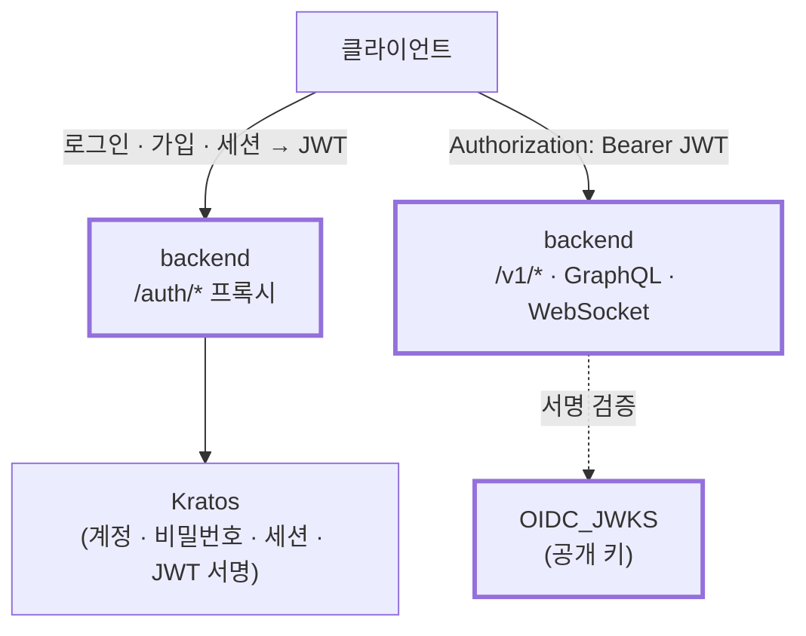
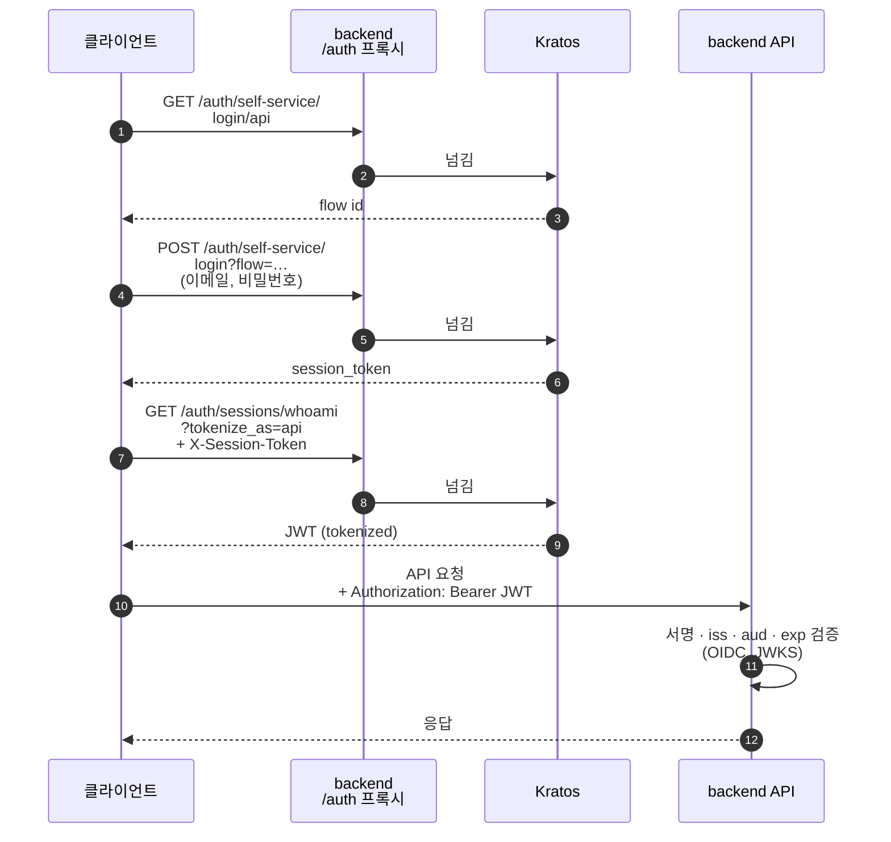
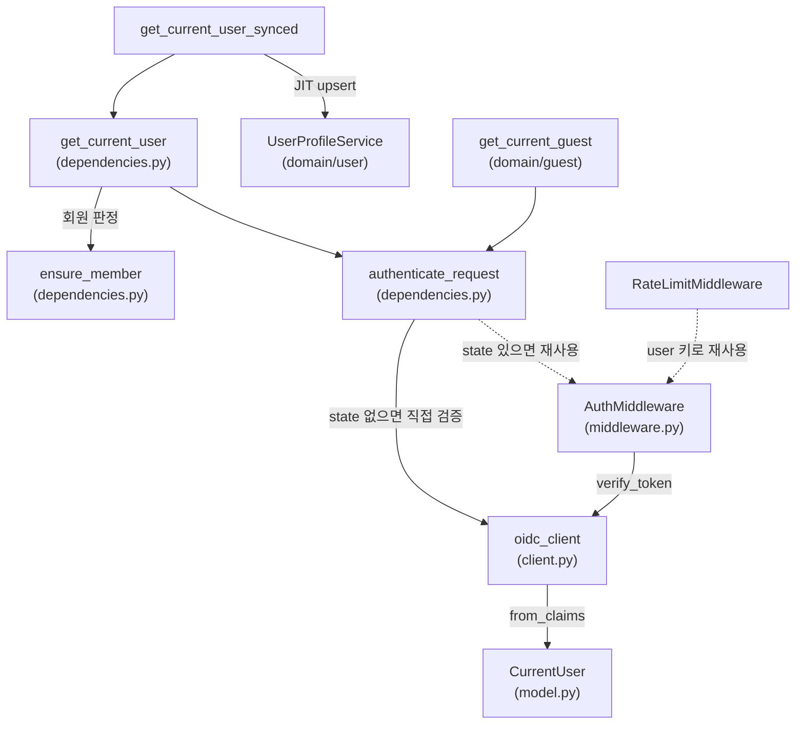

# 인증 가이드 (Ory Kratos)

이 서비스의 인증은 [Ory Kratos](https://www.ory.sh/kratos/)(v26.2.0)가 맡습니다. 계정, 비밀번호, 이메일 인증, 세션, JWT 서명이 모두 Kratos의 일이고, backend는 Kratos 앞의 통로(`/auth/*`)가 되어 주고 Kratos가 서명한 JWT를 검증합니다. 이 문서는 그 구조, Kratos의 계정 흐름과 설정, backend의 토큰 검증을 설명합니다.

## 1. Kratos 기반 인증 구조




### Kratos가 맡는 것과 backend가 맡는 것

| 일 | Kratos | backend |
|----|--------|---------|
| 계정(identity)과 비밀번호 저장 | 한다 | 저장하지 않는다 |
| 가입, 이메일 인증, 로그인, 비밀번호 복구, Google 로그인 | 플로우를 처리한다 | `/auth/*`로 넘기고, 넘기기 전에 일부 제출을 거른다([`/auth` 프록시](auth-proxy.ko.md)) |
| 세션 | 만들고 끝낸다 (세션 토큰) | 저장하지 않는다 |
| JWT | 세션에서 만들어 서명한다 | 서명과 `iss`·`aud`·`exp`를 `OIDC_JWKS`로 검증한다. 요청마다 Kratos에 묻지 않는다 |
| 메일 발송 | 인증·복구 코드 메일을 만든다 | 메일 잡 실행을 요청한다 |
| 사용자 데이터 | 없다 | `owner_id`(JWT의 `sub`)로 격리해 저장한다 |
| 표시 프로필(이름, 아바타) | 원본 (traits) | JWT 클레임으로 받아 `UserProfile`에 맞춘다 |
| 회원 탈퇴 | 세션과 identity가 지워진다 | admin API로 지우기를 요청하고 데이터를 파기한다 |
| [게스트 계정](guest.ko.md) | 게스트 schema의 identity와 세션 | 리소스와의 연결, 접근 판정, Kratos 훅 응답 |

- Kratos는 backend 옆에서만 닿습니다. 밖에서 Kratos에 닿는 길은 backend의 `/auth/*` 하나입니다.
- 쿠키는 쓰지 않습니다. 클라이언트는 Kratos의 API 플로우로 **세션 토큰**을 받고, 세션 토큰으로 **JWT**를 받습니다.
- 로그인은 이메일 인증을 마친 계정만 됩니다(Kratos `require_verified_address`).

### 로그인에서 API 요청까지




- 세션 토큰은 Kratos 세션을 가리키고(기본 수명 720시간), JWT는 세션에서 만든 짧은 수명의 토큰입니다(Kratos tokenizer `ttl`, 기본 10분).
- JWT가 만료되면 클라이언트가 7번을 다시 불러 새 JWT를 받습니다. 리프레시 토큰은 없습니다.
- 가입, 이메일 인증, 비밀번호 복구, Google 로그인도 같은 방식으로 `/auth/*`의 Kratos 플로우를 씁니다.

### 용어

| 용어 | 설명 |
|------|------|
| **Kratos** | 계정·세션을 맡는 identity 서버. backend 옆에서만 닿는다 |
| **세션 토큰** | Kratos API 플로우 로그인의 결과(`ory_st_…`). `/auth/*` 요청의 `X-Session-Token` 헤더로 보낸다 |
| **JWT** | 세션 토큰으로 받은 토큰(`whoami?tokenize_as=api`의 `tokenized`). API 요청의 `Authorization: Bearer`로 보낸다 |
| **JWKS** | JWT 서명 검증에 쓰는 공개 키 (`OIDC_JWKS`) |
| **sub claim** | JWT 내 사용자 고유 식별자(Kratos identity id), 데이터 소유권(owner_id)에 사용 |
| **schema_id claim** | Kratos identity schema id. 회원과 [게스트 계정](guest.ko.md)을 가린다. 모든 토큰에 있어야 하고, 없으면 `401`이다 |

---

## 2. 계정 흐름 (Kratos 플로우)

모든 흐름은 `/auth/*`로 Kratos의 API 플로우를 부릅니다. 플로우를 만들고(`GET …/api`), 받은 `flow` id로 제출합니다(`POST …?flow=<id>`).

| 흐름 | 호출 | 결과 |
|------|------|------|
| 가입 | `GET /auth/self-service/registration/api` → `POST /auth/self-service/registration?flow=…` (`method: password`, `password`, `traits.email`, `traits.name`) | identity가 생기고 인증 코드 메일이 간다. 세션은 생기지 않는다 |
| 이메일 인증 | `GET /auth/self-service/verification/api` → `POST …/verification?flow=…` (`method: code`, `email`로 코드 요청 → `code`로 제출) | 주소가 인증됨이 된다 |
| 로그인 | `GET /auth/self-service/login/api` → `POST …/login?flow=…` (`method: password`, `identifier`, `password`) | `session_token`. 이메일 인증 전이면 `400`과 인증 플로우 정보 |
| JWT 받기·갱신 | `GET /auth/sessions/whoami?tokenize_as=api` + `X-Session-Token` | `tokenized`가 JWT. 세션이 끝났으면 `401` |
| 로그아웃 | `DELETE /auth/self-service/logout/api` (`session_token`) | 세션이 끝난다. 이미 받은 JWT는 만료까지 유효하다 |
| 비밀번호 복구 | `GET /auth/self-service/recovery/api` → `POST …/recovery?flow=…` (`method: code`, `email` → `code`) → `POST /auth/self-service/settings?flow=…` (`method: password`) | 복구 코드로 만든 세션에서만 비밀번호를 바꿀 수 있다. 기존 세션은 모두 끝난다 |
| Google 로그인 | 로그인·가입 플로우에 `method: oidc`, `provider: google` | Google이 인증해 준 이메일만 쓴다. 처음이면 가입으로 이어지고 세션이 생긴다 |
| 회원 탈퇴 | `POST /v1/users/me/deletion` (backend) | 계정이 휴면이 되고 Kratos 세션이 모두 끝난다. 유예 기간 뒤 데이터와 identity가 지워진다 |

- 설정 플로우(`/auth/self-service/settings`)로 이메일을 바꾸거나 소셜 계정을 연결하는 제출은 프록시가 넘기지 않습니다.
- 프록시가 제출을 거르는 규칙과 요청 한도는 [`/auth` 프록시](auth-proxy.ko.md)에 있습니다.

---

## 3. Kratos 설정

저장소의 로컬 설정은 `dev/kratos/kratos.yml`이고 `compose.kratos.yaml`이 그 설정으로 Kratos를 띄웁니다. 운영에서도 아래 값이 backend와 맞아야 합니다([프로덕션 배포](../deployment/production.ko.md)).

| Kratos 설정 | 로컬 값 | backend와의 관계 |
|-------------|---------|------------------|
| `serve.public.base_url` | `http://localhost:2614/auth/` | backend의 `/auth/` 주소. JWT의 `iss`가 되고 `OIDC_ISSUER_URL`과 같아야 한다 |
| `serve.public.cors.enabled` | `false` | CORS는 backend가 응답한다 (`CORS_ALLOWED_ORIGINS`) |
| `serve.admin` | `127.0.0.1:4434` | backend만 닿는다 (`KRATOS_ADMIN_URL`) |
| `selfservice.methods` | `password`, `code` 켬. `oidc`(Google)는 설정했을 때만 | `code`는 인증·복구 코드에 쓴다 |
| `selfservice.flows.login.after.password.hooks` | `require_verified_address` | 이메일 인증 전에는 로그인할 수 없다 |
| `selfservice.flows.registration.after.password.hooks` | `show_verification_ui` | 가입 직후 세션을 주지 않고 인증으로 보낸다 |
| `selfservice.flows.verification.use`, `recovery.use` | `code` | 링크가 아니라 코드로 확인한다 |
| `selfservice.flows.settings.after.password.hooks`, `recovery.after.hooks` | `revoke_active_sessions` | 비밀번호를 바꾸거나 복구하면 기존 세션이 끝난다 |
| `session.lifespan` | `720h` | 세션 토큰의 수명 |
| `session.whoami.tokenizer.templates.api.ttl` | `10m` | JWT의 수명. 클라이언트가 이 주기로 다시 받는다 |
| `session.whoami.tokenizer.templates.api.jwks_url` | 서명 키 (비밀) | 그 공개 키가 backend의 `OIDC_JWKS`다 |
| `session.whoami.tokenizer.templates.api.claims_mapper_url` | `api-jwt.claims.jsonnet` | JWT에 `aud`(= `OIDC_AUDIENCE`), `schema_id`, `email`, `email_verified`, `name`을 넣는다. `schema_id`는 모든 identity에 넣어야 한다(없으면 backend가 `401`) |
| `identity.schemas` | `default` (`identity.schema.json`) | traits는 `email`(로그인 식별자, 인증·복구 주소)과 `name` |
| `courier.smtp` | 로컬 mailpit | 인증·복구 코드 메일 |

- 템플릿 이름 `api`는 클라이언트가 `tokenize_as=api`로 고르는 이름입니다.
- 게스트 계정을 켜면 게스트 schema와 훅이 더해집니다([게스트 계정 설정 (Kratos)](../deployment/kratos-guest.ko.md)).

---

## 4. backend 설정

### 환경변수 목록

| 환경변수 | 필수 | 기본값 | 설명 |
|----------|------|--------|------|
| `OIDC_ENABLED` | O | `true` | 인증 활성화 여부 |
| `OIDC_ISSUER_URL` | O | - | JWT의 `iss`. Kratos tokenizer가 넣는 값으로, backend의 `/auth/` 주소다 (예: `https://api.example.com/auth/`) |
| `OIDC_AUDIENCE` | O | - | JWT의 `aud`. Kratos 클레임 매퍼가 넣는 값과 같아야 한다 (예: `https://api.example.com`) |
| `OIDC_JWKS` | O (Kratos) | - | Kratos가 JWT 서명에 쓰는 키의 공개 JWKS JSON. 비밀 키 성분이 있으면 기동하지 않는다 |
| `KRATOS_PUBLIC_URL` | O (Kratos) | - | `/auth/*`를 넘길 Kratos 공개 API 주소. 비우면 `/auth/*`는 404 |
| `KRATOS_ADMIN_URL` | X | - | 회원 탈퇴의 세션 폐기·identity 삭제, 게스트 identity 생성·삭제 |
| `OIDC_JWKS_CACHE_TTL_SECONDS` | X | `3600` | JWKS 캐시 TTL (초) |

`O (Kratos)`는 Kratos를 쓸 때 필수인 값입니다(9장).

전체 목록과 Kratos 쪽 설정은 [환경 변수](../getting-started/configuration.ko.md)와 [프로덕션 배포](../deployment/production.ko.md)에 있습니다.

### 예시 설정 (.env)

```bash
OIDC_ENABLED=true
OIDC_ISSUER_URL=https://api.example.com/auth/
OIDC_AUDIENCE=https://api.example.com
OIDC_JWKS='{"keys":[{"kty":"EC","crv":"P-256","kid":"...","x":"...","y":"..."}]}'
KRATOS_PUBLIC_URL=http://127.0.0.1:4433
```

로컬에서는 `compose.kratos.yaml`이 같은 구성의 Kratos를 띄웁니다. 서명 키는 `python scripts/gen_dev_jwks.py`로 만들고, 출력된 공개 JWKS를 `OIDC_JWKS`에 넣습니다.


---

## 5. Well-Known 엔드포인트

backend가 `OIDC_JWKS`의 공개 키와 최소 discovery 문서를 인증 없이 내줍니다. backend 밖에서 같은 JWT를 검증하는 서비스가 씁니다.

| 경로 | 내용 |
|------|------|
| `GET /auth/.well-known/jwks.json` | `OIDC_JWKS`의 공개 키 |
| `GET /auth/.well-known/openid-configuration` | `issuer`와 `jwks_uri`가 든 discovery 문서 |

- `OIDC_JWKS`가 비어 있으면 두 경로 모두 404입니다.
- backend 자신은 discovery를 거치지 않고 `OIDC_JWKS`로 바로 검증합니다. 서명 키를 바꾸는 순서는 [실시간 전달](../development/realtime-adapter.ko.md)에 있습니다. 키를 바꾸면 backend를 다시 배포합니다.


---

## 6. backend의 토큰 검증

### 인증 모듈 구성 (객체 의존성과 역할)

인증 로직은 `app/core/auth/` 패키지에 책임별로 분리되어 있습니다. 하위호환을 위해
`from app.core.auth import X` 형태의 기존 import 경로는 그대로 동작합니다.

| 모듈 | 객체 | 역할 |
|------|------|------|
| `model.py` | `CurrentUser` | 검증된 JWT 클레임에서 추출한 인증 주체. **DB에 영속되지 않는 휘발성 값 객체**(영속 표시 프로필 `UserProfile`과 별개 개념). `from_claims()`(클레임→객체 단일 매핑)·`mock()`(OIDC 비활성화 시 주입) 제공. |
| `client.py` | `OIDCClient` / `oidc_client` (싱글톤) | JWT 검증 전담. `OIDC_JWKS`의 공개 키(없으면 discovery의 `jwks_uri`)를 TTL 캐싱하고, `verify_token()`으로 서명·표준 클레임(exp/nbf/iat)·issuer·audience를 검증. |
| `dependencies.py` | `authenticate_request` | 토큰 검증만 한다(회원·게스트 구분 없음). `AuthMiddleware`가 채운 `request.state.current_user`가 있으면 재사용하고, 없으면 `oidc_client`로 직접 검증. `get_current_user`와 게스트 의존성이 쓴다. |
| `dependencies.py` | `ensure_member` | **회원 판정**. 토큰의 `schema_id`가 게스트 schema면 `403`, `schema_id`가 비어 있지 않은 문자열이 아니면 `GUEST_ENABLED`와 상관없이 `401`(`require_schema_id`). REST·GraphQL·WebSocket의 회원 인증이 모두 거친다([게스트 계정](./guest.ko.md#회원-경로)). |
| `dependencies.py` | `get_current_user` | **인증 게이트**(실패 시 `401`). 검증한 토큰을 `ensure_member`로 넘겨 회원만 통과시킨다. `AuthMiddleware`가 채운 `request.state.current_user`가 있으면 재사용하고, 없으면 `oidc_client`로 직접 검증. |
| `dependencies.py` | `get_optional_current_user` | 선택적 인증(미인증 허용 엔드포인트용). 토큰이 없으면 `None` 반환. |
| `dependencies.py` | `get_current_user_synced` | 인증 게이트 + 최소 표시 프로필 JIT 동기화. 인증 REST 라우터 dependency 전용(아래 「인증 라우터 구성」 참고). |
| `middleware.py` | `AuthMiddleware` | 라우팅 이전 단계에서 토큰을 **best-effort로 검증**해 `request.state.current_user`를 사전 설정(거부하지 않음). 실패/무토큰이면 `None`. |

??? info "CurrentUser와 UserProfile의 차이"

    | 구분 | `CurrentUser` | `UserProfile` |
    |------|---------------|---------------|
    | 성격 | 검증된 JWT에서 만든 요청 범위 인증 주체 | DB에 저장되는 표시 프로필/JIT 캐시 |
    | 생명주기 | 매 요청마다 토큰 검증 결과로 생성 | 로그인한 사용자의 클레임으로 upsert되어 유지 |
    | 정본성 | 인증·인가 판단의 현재 정본 | 친구 목록, 친구코드, 표시명, 아바타, 검증 이메일 인덱스용 보조 데이터 |
    | 대표 필드 | `sub`, `email`, `email_verified`, `name`, `picture`, `schema_id`, `raw_claims` | `sub`, `iss`, `display_name`, `avatar_url`, `friend_code`, `verified_email` |
    | 실패 영향 | 없으면 인증 실패(`401`) | 동기화 실패 시 요청은 진행하고 표시정보만 degrade |
    | 게스트 계정 | 만들어진다. 유효한 게스트 토큰이면 `schema_id`가 게스트 schema이고 `email`은 없다 | 만들어지지 않는다 |

    회원의 기본 흐름은 `JWT -> CurrentUser -> 회원 판정(ensure_member) -> UserProfile JIT 동기화 -> 도메인 서비스`입니다.
    도메인 소유권과 인가 판단은 계속 `CurrentUser.sub`를 기준으로 하고, `UserProfile`은
    다른 사용자에게 보여줄 최소 표시정보와 친구 추가용 인덱스를 제공하는 역할만 맡습니다.

    [게스트 계정](guest.ko.md)의 토큰도 `AuthMiddleware`가 검증해 `CurrentUser`로 만듭니다. 회원 경로에서는 회원 판정이
    `403`으로 거절하므로 JIT 동기화에 닿지 않고, `UserProfile` 행이 생기지 않습니다. 게스트를 받는 경로는
    `get_current_guest`가 같은 `CurrentUser`를 받아 `guest` 테이블의 행(Kratos identity id, 속한 리소스, 이름)으로
    접근을 판정합니다. 게스트 도메인이 저장하는 것은 그 행뿐입니다. 게스트를 받는 리소스는 게스트가 남긴 데이터를 따로 저장할 수 있습니다.

    | | 회원 | 게스트 |
    |---|---|---|
    | `CurrentUser` | 만들어진다 | 만들어진다 (`is_guest`가 참) |
    | 통과하는 의존성 | `get_current_user`, `get_current_user_synced` | `get_current_guest`, `require_guest_access` |
    | `UserProfile` | JIT 동기화로 upsert | 없음 |
    | backend에 저장되는 것 | `UserProfile`, `owner_id`로 격리한 데이터 | `guest` 테이블의 행 |
    | 요청 한도의 키 | `sub` (`per_ip` 규칙은 IP) | `sub` (`per_ip` 규칙은 IP) |

    확장 기준:

    - 인증·인가 판단에 필요한 클레임은 `CurrentUser` 또는 `raw_claims`에서 읽습니다.
    - `request.state.current_user`가 있다고 회원인 것은 아닙니다. 회원만 받는 코드는 `get_current_user`(또는 `ensure_member`)를 거칩니다.
    - 화면 표시, 친구 검색, 외부 공유 식별자처럼 요청 밖에서도 재사용할 값은 `UserProfile`에 저장합니다.
    - API 응답 형태가 필요하면 `CurrentUser`나 `UserProfile`을 그대로 노출하지 말고 도메인 DTO를 둡니다.

    프론트엔드에서 `GET /v1/users/me`로 본인 표시정보와 `friend_code`를 사용하는 흐름은
    [친구 추가 가이드](add-friend.ko.md)와 [Friend & Visibility API 가이드](friend.ko.md)를 참고하세요.

#### 객체 의존성



토큰 검증은 `authenticate_request` 한 곳에서 합니다. 회원 경로(`get_current_user`)는 그 결과를 `ensure_member`로 넘기고, 게스트를 받는 경로(`get_current_guest`)는 `ensure_member`를 거치지 않고 같은 `CurrentUser`를 받습니다. `schema_id` 클레임이 없는 토큰은 두 경로 모두 `401`입니다(`require_schema_id`). 그 뒤의 의존성은 [게스트 계정 가이드의 객체 의존성](guest.ko.md#객체-의존성)에 있습니다.

#### 요청 수명주기에서의 협력

미들웨어는 `app/main.py`에서 **AuthMiddleware가 RateLimitMiddleware보다 먼저 실행**되도록 등록됩니다.

1. **AuthMiddleware** — 토큰을 best-effort 검증해 `request.state.current_user`를 채웁니다(거부하지 않음).
2. **RateLimitMiddleware** — `request.state.current_user`를 **그대로 재사용**해 사용자 단위로 레이트 리밋을 키잉합니다(중복 토큰 검증 없음). 미인증이면 IP 기반. 규칙에 `per_ip`가 있으면(게스트 이름 찾기·생성) 토큰이 있어도 IP로 셉니다. `/auth` 제출은 이 미들웨어가 아니라 게스트 관문이 셉니다.
3. **게스트 관문** (`app/middleware/guest_gate.py`) — `/auth` 제출의 요청 한도를 세고, 게스트 단계(이름 찾기·생성·자기 삭제, 게스트 로그인·설정 제출)면 Turnstile 토큰을 확인합니다([게스트 계정 가이드](guest.ko.md#turnstile-토큰)).
4. **`get_current_user` / `get_current_user_synced`** — 엔드포인트(또는 부모 라우터) 의존성으로서 실제 `401` 게이트를 담당하며, 역시 `request.state`를 재사용합니다. 토큰이 유효해도 `ensure_member`가 게스트 토큰을 `403`으로 거절합니다.

결과적으로 토큰 검증은 사실상 1회(`AuthMiddleware`)만 수행되고, 미들웨어와 의존성이
`request.state.current_user`를 공유해 중복 검증을 피합니다. `AuthMiddleware`는 게이트가
아니므로 인증 강제는 **항상 의존성 계층**에서 일어납니다.

### 인증 라우터 구성 (게이트 + JIT 프로필 동기화)

인증이 필요한 모든 REST 경로는 개별 엔드포인트마다 `Depends`를 반복하지 않고,
**부모 라우터에 인증 의존성을 한 번만 선언**하여 보호합니다.

```python
# app/api/v1/__init__.py
authed = APIRouter(prefix="/v1", dependencies=[Depends(get_current_user_synced)])
for r in (schedules_router, timers_router, tags_router, todos_router,
          meetings_router, friends_router, users_router, visibility_router):
    authed.include_router(r)
api_router.include_router(authed)
```

부모 라우터에 선언된 `get_current_user_synced`는 두 가지 일을 합니다.

1. **토큰 검증 게이트** — `get_current_user`에 위임하여 토큰을 검증합니다. 실패 시
   `401`을 반환하며, 하위 모든 인증 REST 경로에 자동으로 적용됩니다.
2. **최소 사용자 프로필 JIT 동기화** — 인증된 사용자의 표준 OIDC 클레임으로
   `UserProfile`을 upsert합니다. 덕분에 프론트가 별도 프로필 조회를 호출하지 않아도
   활성 사용자의 표시정보(이름·아바타)와 **이메일 친추 인덱스**가 준비됩니다.

동기화는 `SAVEPOINT`(`begin_nested`) 안에서 best-effort로 수행되므로, 동기화가
실패하더라도 엔드포인트 트랜잭션을 오염시키지 않고 요청을 그대로 진행합니다
(표시정보만 `None`으로 degrade). 또한 PK 조회 후 신규이거나 값이 바뀐 경우에만
기록하여 write 증폭을 방지합니다.

!!! note "공개(무인증) 라우터"
    `holidays`, `timers_ws`(WebSocket), `graphql`, `ws_playground`, `guests`는 이 게이트 밖에
    별도로 등록됩니다. GraphQL은 컨텍스트 단계에서 인증을 처리합니다(7장 참고).
    `guests`(`/v1/guests/*`)는 게스트 전용 의존성을 쓰고 회원 토큰을 받지 않습니다([게스트 계정](./guest.ko.md)).

### 데이터 격리

모든 사용자 데이터는 `owner_id` 필드로 격리됩니다:
- Schedule, Todo, Tag, Timer 등 모든 모델에 `owner_id` 필드 존재
- `owner_id`는 JWT의 `sub` claim 값과 매칭
- 다른 사용자의 데이터에는 접근 불가 (404 반환)

### 기존 데이터 마이그레이션

마이그레이션 시 기존 데이터에 할당할 `owner_id`를 환경변수로 지정할 수 있습니다:

```bash
# 개발환경 (기본값: test-user-id)
# OIDC_ENABLED=false 시 mock 사용자와 일치하여 기존 데이터에 접근 가능
alembic upgrade head

# 프로덕션 (특정 사용자 ID 지정)
MIGRATION_DEFAULT_OWNER_ID=admin-user-oidc-sub alembic upgrade head
```

| 환경 | MIGRATION_DEFAULT_OWNER_ID | 설명 |
|------|---------------------------|------|
| 개발 | `test-user-id` (기본값) | Mock 사용자와 일치 |
| 프로덕션 | 실제 OIDC sub | 관리자 또는 기존 사용자의 sub claim |


---

## 7. 프론트엔드 통합 가이드

### 인증 헤더 형식

모든 API 요청에 Bearer 토큰을 포함해야 합니다:

```
Authorization: Bearer <access_token>
```

### REST API 요청 예시

#### JavaScript (fetch)

```javascript
const accessToken = 'your-access-token';

const response = await fetch('http://localhost:2614/v1/schedules', {
  method: 'GET',
  headers: {
    'Authorization': `Bearer ${accessToken}`,
    'Content-Type': 'application/json',
  },
});

if (response.status === 401) {
  // 토큰 만료 또는 유효하지 않음 → 재로그인 필요
  redirectToLogin();
}

const data = await response.json();
```

#### Axios 인터셉터

```javascript
import axios from 'axios';

const api = axios.create({
  baseURL: 'http://localhost:2614/v1',
});

// 요청 인터셉터: 토큰 자동 추가
api.interceptors.request.use((config) => {
  const token = localStorage.getItem('access_token');
  if (token) {
    config.headers.Authorization = `Bearer ${token}`;
  }
  return config;
});

// 응답 인터셉터: 401 처리
api.interceptors.response.use(
  (response) => response,
  (error) => {
    if (error.response?.status === 401) {
      // 토큰 갱신 또는 재로그인
      handleTokenRefresh();
    }
    return Promise.reject(error);
  }
);
```

### GraphQL 요청 예시

```javascript
const query = `
  query GetCalendar($startDate: Date!, $endDate: Date!) {
    calendar(startDate: $startDate, endDate: $endDate) {
      days {
        date
        events {
          id
          title
        }
      }
    }
  }
`;

const response = await fetch('http://localhost:2614/v1/graphql', {
  method: 'POST',
  headers: {
    'Authorization': `Bearer ${accessToken}`,
    'Content-Type': 'application/json',
  },
  body: JSON.stringify({
    query,
    variables: {
      startDate: '2026-01-01',
      endDate: '2026-01-31',
    },
  }),
});
```

### 에러 응답 처리

#### 401 Unauthorized

```json
{
  "detail": "Authorization header missing"
}
```
또는
```json
{
  "detail": "Invalid token: Signature verification failed"
}
```

**처리 방법**: 
1. 세션 토큰으로 JWT를 다시 받는다 (`GET /auth/sessions/whoami?tokenize_as=api`)
2. 그 요청도 `401`이면 세션이 끝난 것이므로 로그인 화면으로 보낸다

`schema_id` 클레임이 없거나 비어 있지 않은 문자열이 아닌 토큰도 `401`입니다. 게스트 계정을 켰는지와 상관없습니다.

```json
{
  "detail": "Token missing 'schema_id' claim"
}
```

**처리 방법**: Kratos의 클레임 매퍼가 `schema_id`를 넣는지 확인합니다([게스트 계정 설정](../deployment/kratos-guest.ko.md)).

#### 403 Forbidden (게스트 토큰)

게스트 계정의 토큰으로 회원 경로를 부르면 `GUEST_ENABLED`와 상관없이 `403`입니다. WebSocket은 `1008`로 닫습니다.

```json
{
  "detail": "Guest accounts cannot use this endpoint"
}
```

#### 403 Forbidden (GraphQL)

GraphQL에서 인증 없이 보호된 쿼리 실행 시:

```json
{
  "data": null,
  "errors": [
    {
      "message": "인증이 필요합니다. Authorization 헤더에 Bearer 토큰을 제공해주세요."
    }
  ]
}
```

### 토큰 받기와 갱신

JWT는 Kratos 세션 토큰으로 받습니다. 만료가 가까우면 같은 요청을 다시 보내 새 JWT를 받습니다.

```javascript
// 로그인 (Kratos API 플로우)
const flow = await (await fetch('/auth/self-service/login/api')).json();
const login = await (await fetch(`/auth/self-service/login?flow=${flow.id}`, {
  method: 'POST',
  headers: { 'Content-Type': 'application/json' },
  body: JSON.stringify({ method: 'password', identifier: email, password }),
})).json();
const sessionToken = login.session_token;   // 안전한 저장소에 보관

// JWT 받기 · 갱신
async function fetchJwt() {
  const res = await fetch('/auth/sessions/whoami?tokenize_as=api', {
    headers: { 'X-Session-Token': sessionToken },
  });
  if (res.status === 401) return null;       // 세션이 끝났다 → 다시 로그인
  return (await res.json()).tokenized;
}
```

- 제출 요청의 쿼리 문자열에는 `flow`만 넣습니다. 다른 값이 있으면 프록시가 `400`으로 거절합니다. 제출 경로로 가는 GET도 같고, 인증 메일의 링크(`GET /auth/self-service/verification?flow=…&code=…`)만 `code`를 더 담습니다.
- 제출 본문은 JSON 객체(`Content-Type: application/json`)나 URL 인코딩 폼(`application/x-www-form-urlencoded`)으로 보냅니다. JSON에서는 `traits`를 객체로(`{"traits": {"email": …}}`), 폼에서는 `traits.email`처럼 점으로 이은 필드로 보냅니다. 그 밖의 형식(`multipart/form-data`, `"traits.email"` 같은 JSON 키, 문자열 `traits`, 겹치는 키)은 프록시가 `400` `invalid_request_body`로 거절합니다.
- 로그인 `identifier`, 가입 `traits.email`, 인증·복구 `email`에는 ASCII 문자만 씁니다. ASCII 밖의 문자가 있으면 프록시가 Kratos에 넘기지 않고 `400` `invalid_identifier`로 답합니다.
- `/auth`로 가는 GET 밖의 요청과 제출 경로로 가는 GET은 IP당 분당 60회이고, 로그인·가입·인증·복구 제출은 같은 IP에서 같은 식별자로 분당 5회까지입니다. 설정 제출은 identity당 분당 10회입니다. JWT 갱신(`GET`)은 이 한도에 들지 않습니다.
- 로그아웃은 `DELETE /auth/self-service/logout/api`에 세션 토큰을 보냅니다. 세션은 바로 끝나고, 이미 받은 JWT는 만료까지 유효합니다.
- 이메일 인증 전의 계정으로 로그인하면 Kratos가 `400`과 함께 인증 플로우 정보를 돌려줍니다.


---

## 8. 개발 환경: 인증 비활성화

로컬 개발이나 테스트에서는 Kratos 없이 backend만 띄울 수 있습니다. `OIDC_ENABLED=false`면 토큰을 검증하지 않고 고정된 사용자로 처리합니다.

### 방법 1: 환경변수 설정

```bash
# .env 파일
OIDC_ENABLED=false
```

### 방법 2: 환경변수 직접 지정

=== "Linux/Mac"
    ```bash
    OIDC_ENABLED=false uvicorn app.main:app --reload
    ```

=== "Windows (PowerShell)"
    ```powershell
    $env:OIDC_ENABLED="false"; uvicorn app.main:app --reload
    ```

### 인증 비활성화 시 동작

인증이 비활성화되면 모든 요청에 아래의 **Mock 사용자**가 자동으로 주입됩니다:

```json
{
  "sub": "test-user-id",
  "email": "test@example.com",
  "name": "Test User"
}
```

!!! warning "주의"
    프로덕션 환경에서는 반드시 `OIDC_ENABLED=true`로 설정하세요!

### 테스트 환경

pytest 실행 시 자동으로 인증이 비활성화됩니다 (`tests/conftest.py`에서 설정):

```python
import os
os.environ["OIDC_ENABLED"] = "false"
```


---

## 9. Kratos가 아닌 OIDC Provider

backend의 토큰 검증은 표준 OIDC JWT를 받으므로 다른 Provider의 토큰도 검증할 수 있습니다. `OIDC_JWKS`를 비우면 `OIDC_ISSUER_URL`의 discovery(`/.well-known/openid-configuration`, 또는 `OIDC_DISCOVERY_URL`)에서 `jwks_uri`를 읽습니다.

다만 아래 기능은 Kratos를 전제로 합니다.

| 기능 | Kratos가 필요한 이유 |
|------|----------------------|
| `/auth/*` 프록시 | Kratos 공개 API로 넘긴다 |
| 회원 탈퇴의 세션 폐기·identity 삭제 | Kratos admin API를 부른다 |
| [게스트 계정](guest.ko.md) | Kratos identity schema, 훅, admin API를 쓴다 |
| JWT의 `schema_id`·`email_verified` | Kratos 클레임 매퍼가 넣는다. `schema_id`가 없는 토큰은 `401`이므로, 다른 Provider를 쓰면 그 Provider가 `schema_id` 클레임(게스트 schema id가 아닌 값)을 넣어야 한다 |


---

## 관련 코드 참조

| 파일 | 설명 |
|------|------|
| `app/core/auth/` | 인증 패키지 (model·client·dependencies·middleware) |
| `app/api/auth_proxy.py` | `/auth/*` Kratos 프록시 ([`/auth` 프록시](auth-proxy.ko.md)) |
| `app/api/oidc_discovery.py` | `/auth/.well-known/*` |
| `dev/kratos/` | 로컬 Kratos 설정 (identity schema, 클레임 매퍼) |
| `app/core/auth/model.py` | `CurrentUser` 인증 주체 값 객체 |
| `app/core/auth/client.py` | `OIDCClient` / `oidc_client` (discovery·JWKS·토큰 검증) |
| `app/core/auth/dependencies.py` | `get_current_user` / `get_current_user_synced` 의존성, `ensure_member` |
| `app/domain/guest/dependencies.py` | 게스트를 받는 경로의 의존성 (`get_current_guest`, `require_guest_access`) |
| `app/core/auth/middleware.py` | `AuthMiddleware` (request.state 사전 설정) |
| `app/api/v1/__init__.py` | 인증·공개 라우터 구성 (게이트 + JIT 동기화 선언) |
| `app/core/config.py` | 환경변수 설정 |
| `app/api/v1/graphql.py` | GraphQL 컨텍스트 인증 처리 |

### CurrentUser 모델

```python
class CurrentUser(BaseModel):
    sub: str                      # 사용자 고유 식별자 (owner_id로 사용)
    email: str | None = None
    email_verified: bool = False  # 이메일 기반 친추 인덱싱 조건 (OIDC email_verified)
    name: str | None = None
    picture: str | None = None    # avatar_url 출처 (OIDC picture)
    schema_id: str | None = None  # Kratos identity schema id. 게스트 구분에 쓴다 (is_guest)
    raw_claims: dict = {}         # 전체 JWT 클레임 (필요시 확장용)
```

### FastAPI Dependency 사용법

```python
from app.core.auth import CurrentUser, get_current_user

@router.get("/protected")
async def protected_endpoint(
    current_user: CurrentUser = Depends(get_current_user),
):
    return {"user_id": current_user.sub}
```

---

## FAQ

### Q: 인증 없이 빠르게 테스트하고 싶어요

`.env` 파일에 `OIDC_ENABLED=false` 추가 후 서버 재시작

### Q: 다른 사용자의 데이터가 보이지 않아요

정상입니다. 모든 데이터는 `owner_id`로 격리되어 있습니다.

### Q: 토큰 만료 시간은 어떻게 되나요?

Kratos 설정에 따릅니다. 저장소의 로컬 설정(`dev/kratos/kratos.yml`) 기준:
- JWT: 10분 (`session.whoami.tokenizer.templates.api.ttl`)
- 세션: 720시간 (`session.lifespan`)
- 리프레시 토큰은 없습니다. JWT는 세션 토큰으로 다시 받습니다.

### Q: JWKS 캐시가 갱신되지 않아요

서버 재시작 또는 캐시 TTL(기본 1시간) 만료를 기다리세요.
