# 게스트 계정 흐름도

게스트 계정의 요청이 어디를 지나고, 각 지점에서 무엇을 확인하는지를 그림으로 정리한 문서입니다. API와 규칙은 [게스트 계정 가이드](guest.ko.md), 설정은 [게스트 계정 설정 (Kratos)](../deployment/kratos-guest.ko.md)에 있습니다.

각 그림 아래의 표는 그 확인을 하는 코드와 그 동작을 지키는 테스트의 위치입니다.

## 1. 구성 요소와 경계

화살표의 글자는 그 구간에서 상대를 확인하는 수단입니다.

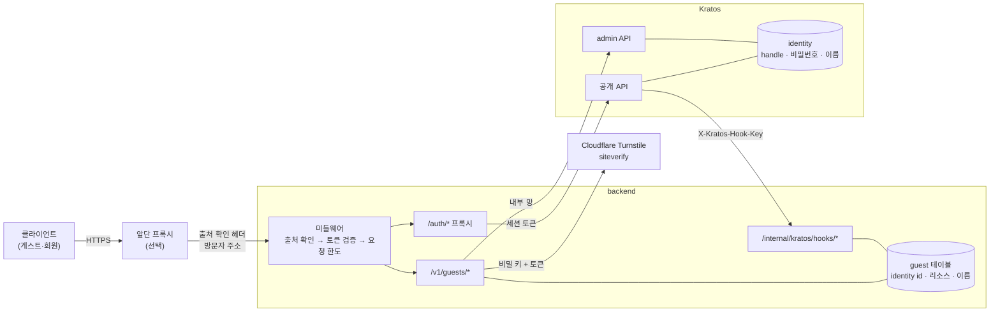

| 구간 | 확인 수단 | 없거나 틀리면 |
|------|-----------|---------------|
| 클라이언트 → `/v1/guests/lookup`, `POST /v1/guests` | 없음(인증 없는 경로). 생성은 Turnstile 토큰 | 생성 `403`/`422` |
| 클라이언트 → 게스트 경로 | 게스트 JWT (`Authorization: Bearer`) | `401`/`403` |
| 클라이언트 → `/auth/*` | Kratos 세션 토큰 (`X-Session-Token`) 또는 없음(로그인 전) | Kratos가 판정 |
| 앞단 프록시 → backend | `ORIGIN_VERIFY_HEADER`·`ORIGIN_VERIFY_SECRET` (설정했을 때) | `403` |
| backend → Kratos admin API | 망 분리(밖에 열지 않는다) | — |
| backend → Turnstile | `TURNSTILE_SECRET_KEY` | 생성 `403`/`503` |
| Kratos → backend 훅 | `X-Kratos-Hook-Key` = `KRATOS_HOOK_API_KEY` | `401`, Kratos는 그 요청을 거절 |

- 게스트의 비밀번호는 backend에 저장되지 않습니다. 생성 요청 한 번에서만 backend를 지나 Kratos admin API로 갑니다.
- backend는 게스트 대신 로그인하지 않습니다. 세션 토큰과 JWT는 클라이언트가 `/auth/*`로 직접 받습니다.

## 2. 요청이 backend에 들어온 뒤의 공통 순서

HTTP 요청이 라우트에 닿기 전에 지나는 순서입니다(`app/main.py`). `/health`는 출처 확인을 하지 않습니다.

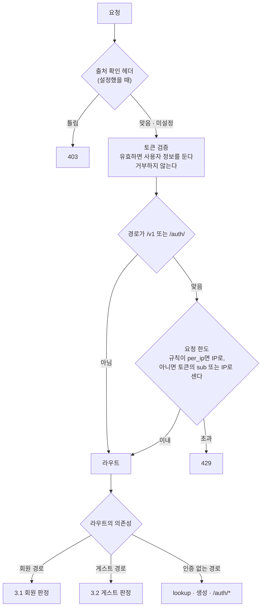

| 확인 | 코드 | 테스트 |
|------|------|--------|
| 출처 확인 | `app/middleware/origin_verify.py` | `tests/core/test_origin_verify.py` |
| 토큰 검증 | `app/core/auth/middleware.py`, `app/core/auth/client.py` | `tests/core/` |
| 요청 한도와 `per_ip` | `app/ratelimit/middleware.py`, `app/ratelimit/config.py` | `tests/ratelimit/`, `tests/domain/guest/test_rate_limits.py` |

## 3. 토큰 판정

### 3.1 회원 경로

REST의 인증 경로, GraphQL, WebSocket이 모두 `ensure_member`를 거칩니다.

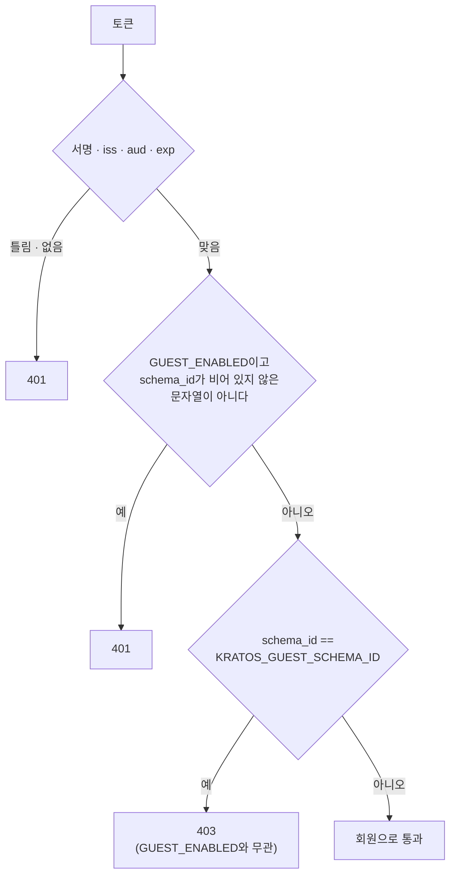

### 3.2 게스트 경로

`require_guest_access(resource_type, id_param)`을 명시한 경로만 게스트를 받습니다. 판정은 요청마다 다시 합니다.

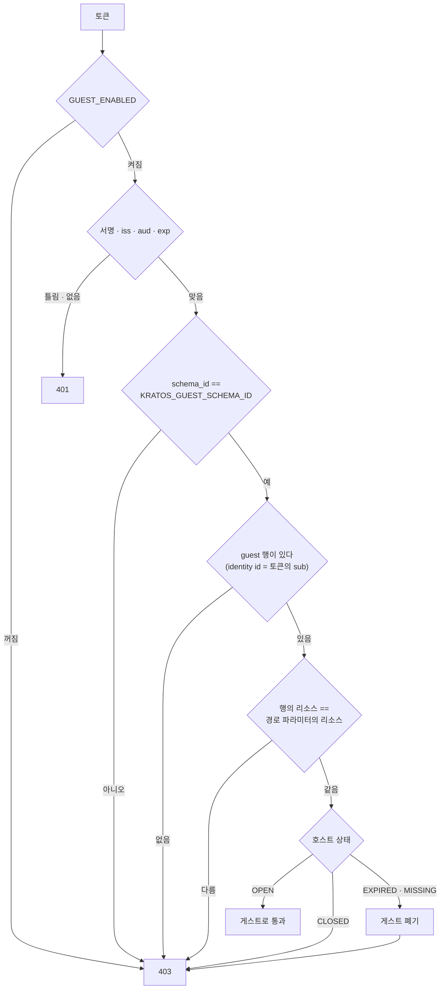

| 확인 | 코드 | 테스트 |
|------|------|--------|
| `ensure_member` | `app/core/auth/dependencies.py` | `tests/core/test_auth_guest_token.py` |
| `schema_id` 읽기 | `app/core/auth/model.py` (`CurrentUser.from_claims`, `is_guest`) | `tests/core/test_auth_guest_token.py` |
| 게스트 의존성 | `app/domain/guest/dependencies.py` | `tests/domain/guest/test_dependencies.py` |
| 행·리소스·호스트 상태 | `app/domain/guest/service.py` (`authorize`, `check_access`) | `tests/domain/guest/test_policy.py` |
| 모든 경로가 게스트 토큰을 거부하는지 | 경로 전체 | `tests/domain/guest/test_route_guard.py` (받는 경로는 허용 목록에 올린다) |

## 4. 게스트 생성

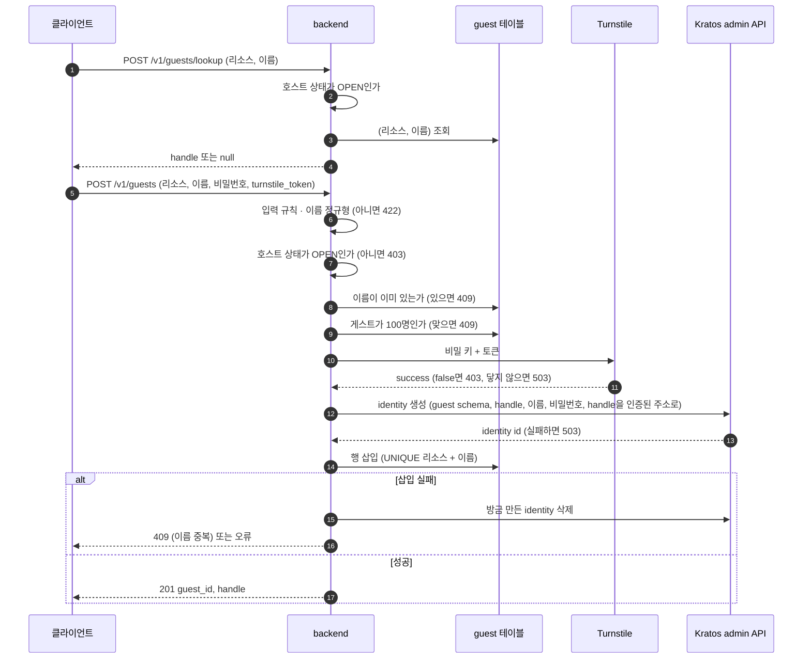

- `handle`은 `<guest_id>@guest.invalid`이고, `guest_id`는 backend가 삽입 전에 만든 행 id입니다.
- 4~6번에서 거절되면 Turnstile 토큰을 쓰지 않고 Kratos를 부르지 않습니다.
- Kratos 호출 동안 DB 트랜잭션을 열어 두지 않습니다. 이름 중복은 9번의 UNIQUE 제약이 최종으로 막습니다.

| 확인 | 코드 | 테스트 |
|------|------|--------|
| 순서 전체 | `app/domain/guest/service.py` (`lookup`, `create`) | `tests/domain/guest/test_lookup_create.py`, `test_guest_api.py` |
| 이름 정규형 | `app/domain/guest/schema/dto.py` (`normalize_guest_name`) | `tests/domain/guest/test_guest_api.py` |
| 100명 상한 | `service.MAX_GUESTS_PER_RESOURCE` | `tests/domain/guest/test_guest_limit.py` |
| Turnstile | `app/core/turnstile.py` | `tests/domain/guest/test_turnstile.py` |
| 동시 생성 | `guest` 테이블의 UNIQUE 제약 | `tests/domain/guest/test_name_concurrency.py` (PostgreSQL) |

## 5. 로그인과 JWT

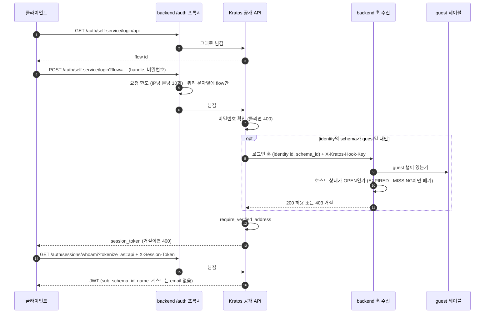

- 회원 로그인에서는 7~10번이 일어나지 않습니다(Kratos 훅 본문의 `error 'cancel'`). 회원은 11번이 판정합니다.
- 게스트는 handle이 처음부터 인증된 주소라 11번을 통과합니다.
- 로그인 훅은 로그인 시점에만 판정합니다. 그 뒤의 게스트 경로 요청은 3.2가 요청마다 다시 확인합니다.
- JWT의 `schema_id`는 Kratos 클레임 매퍼가 identity에서 읽습니다. identity의 schema는 본인이 바꿀 수 없습니다.

| 확인 | 코드 | 테스트 |
|------|------|--------|
| 프록시의 한도·쿼리 문자열 | `app/api/auth_proxy.py`, `app/ratelimit/config.py` | `tests/test_auth_proxy.py`, `tests/domain/guest/test_rate_limits.py` |
| 훅 키 | `app/api/kratos_hooks.py` (`_authorize`) | `tests/domain/guest/test_kratos_hooks.py` |
| 로그인 판정 | `app/domain/guest/service.py` (`login_allowed`) | `tests/domain/guest/test_hook_decisions.py`, `test_client_login.py` |
| Kratos 설정(훅 순서, 게스트만 호출, 클레임) | `dev/kratos/kratos.guest.yml`, `hook.login.jsonnet`, `api-jwt.claims.jsonnet` | `tests/domain/guest/test_kratos_config.py` |

## 6. 이름 변경

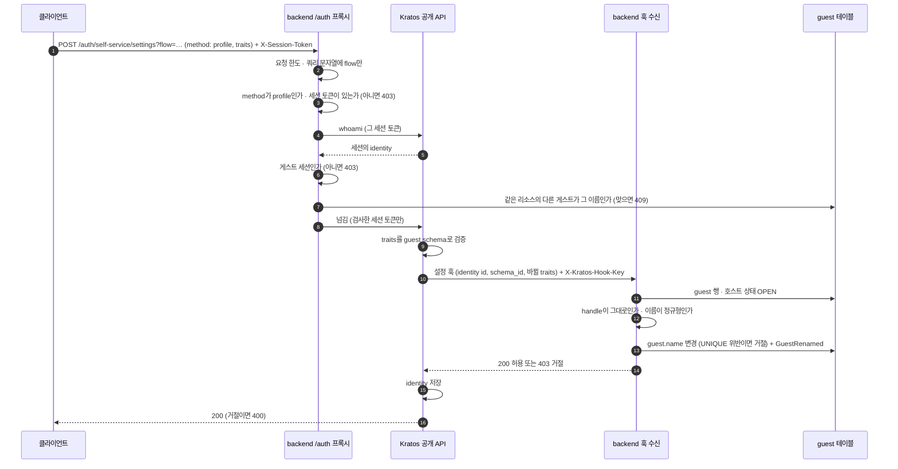

- `method`가 `password`·`oidc`인 게스트의 설정 제출은 프록시에서 `403`이고, Kratos에 직접 닿아도 그 메서드의 설정 훅이 거절합니다.
- 7번은 빠른 응답을 위한 조회이고, 이름 중복을 최종으로 막는 것은 13번의 UNIQUE 제약입니다.
- 13번이 끝난 뒤 15번이 실패하면 `guest.name`과 Kratos의 `traits.name`이 다음 이름 변경까지 다릅니다.

| 확인 | 코드 | 테스트 |
|------|------|--------|
| 프록시의 게스트 처리 | `app/api/auth_proxy.py` (`_settings_rejection`), `service.name_taken_by_other` | `tests/domain/guest/test_rename_proxy.py`, `tests/test_auth_proxy.py` |
| 설정 판정 | `app/domain/guest/service.py` (`settings_change_allowed`) | `tests/domain/guest/test_hook_decisions.py`, `test_kratos_hooks.py` |
| 동시 이름 변경·생성 | `guest` 테이블의 UNIQUE 제약 | `tests/domain/guest/test_name_concurrency.py` (PostgreSQL) |

## 7. `/auth` 프록시의 판정 순서

GET은 아래 확인 없이 넘깁니다. 경로는 Kratos로 실제 나갈 경로(정리한 뒤, 소문자, 끝의 `/` 제외)로 비교합니다.

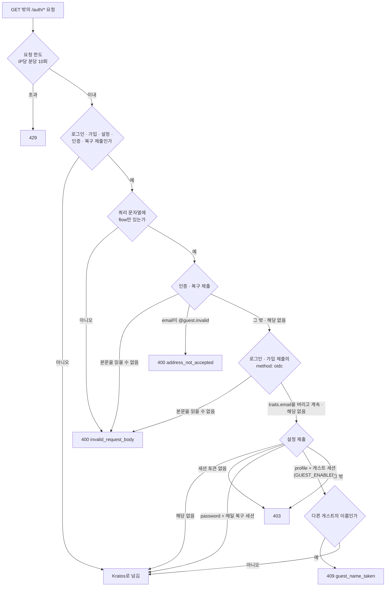

| 확인 | 코드 | 테스트 |
|------|------|--------|
| 순서 전체 | `app/api/auth_proxy.py` (`kratos_proxy`) | `tests/test_auth_proxy.py` |
| 넘기는 요청 헤더 | `FORWARD_REQUEST_HEADERS` (쿠키는 넘기지 않는다) | `tests/test_auth_proxy.py` |

## 8. 게스트의 상태

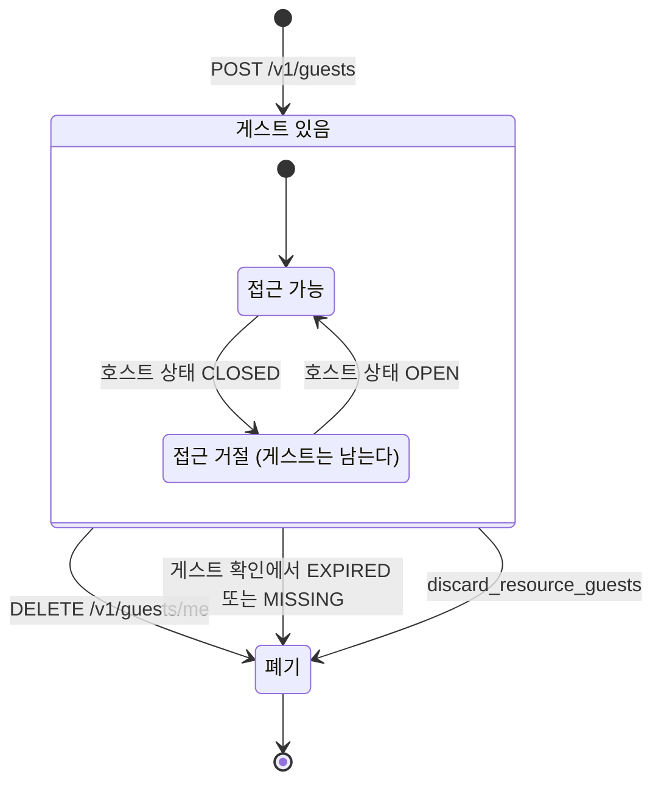

게스트 확인은 로그인 훅, 설정 훅, 게스트 경로 요청, 같은 리소스의 이름 찾기·생성입니다. 호스트 상태는 저장하지 않고 확인할 때마다 리소스에 묻습니다.

폐기는 다음 순서입니다.

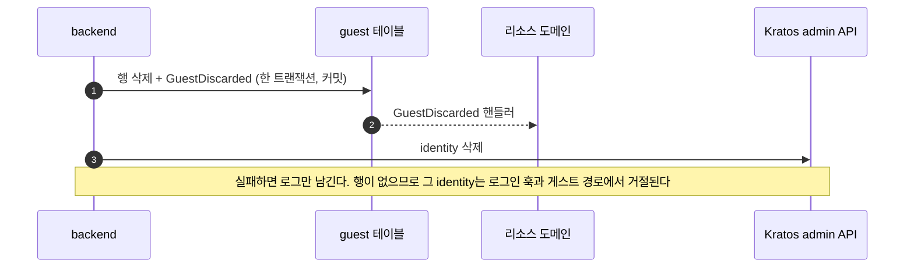

| 폐기 뒤 | 동작 |
|---------|------|
| Kratos 세션 | identity가 지워지면 바로 끊긴다 |
| 이미 받은 JWT | 만료(tokenizer `ttl`, 기본 10분)까지 서명은 유효하다. 게스트 경로는 행이 없어 `403`, 회원 경로는 `schema_id`로 `403` |
| 이름 | 다시 쓸 수 있다 |

| 확인 | 코드 | 테스트 |
|------|------|--------|
| 접근 정책과 폐기 | `app/domain/guest/service.py` (`check_access`, `discard_guest`, `discard_resource_guests`) | `tests/domain/guest/test_policy.py` |
| 호스트 계약 | `app/domain/guest/host.py` | `tests/domain/guest/test_policy.py` |

## 9. 꺼진 상태 (`GUEST_ENABLED=false`)

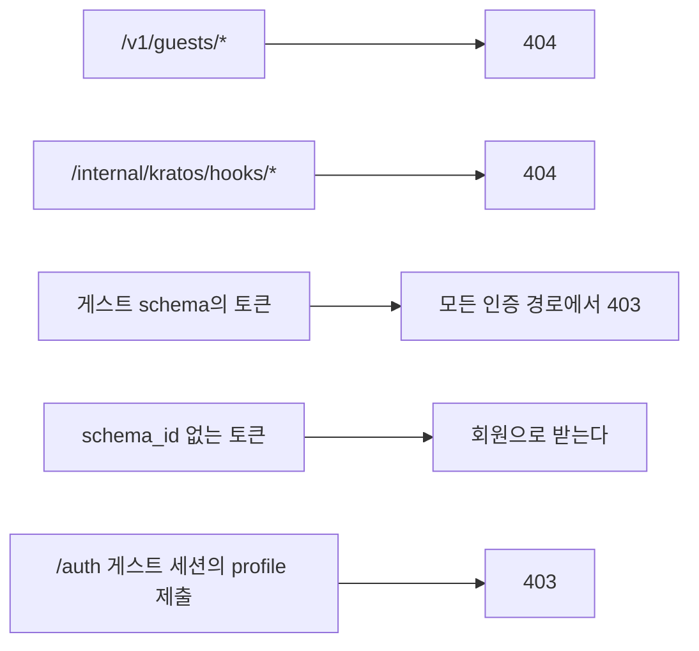

게스트와 상관없이 적용되는 것은 `/auth` 제출의 요청 한도, 쿼리 문자열 규칙, `@guest.invalid` 주소의 인증·복구 제출 거절입니다(7장).

| 확인 | 테스트 |
|------|--------|
| 꺼진 상태 | `tests/domain/guest/test_guest_api.py`, `test_kratos_hooks.py`, `tests/test_auth_proxy.py` |
