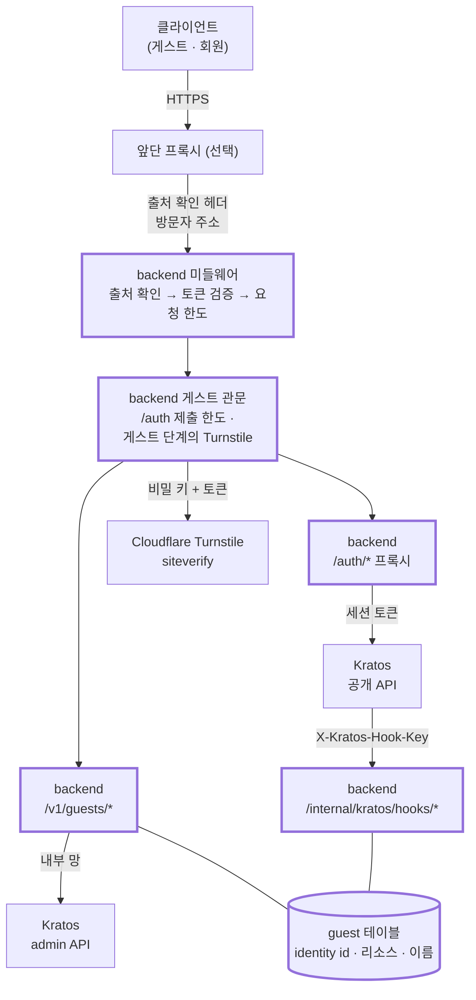
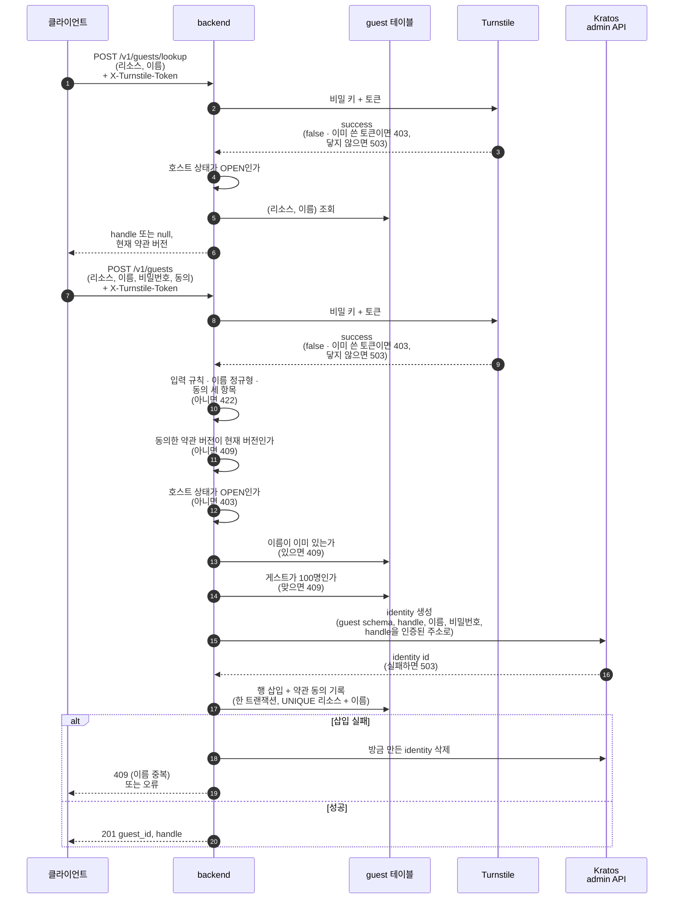
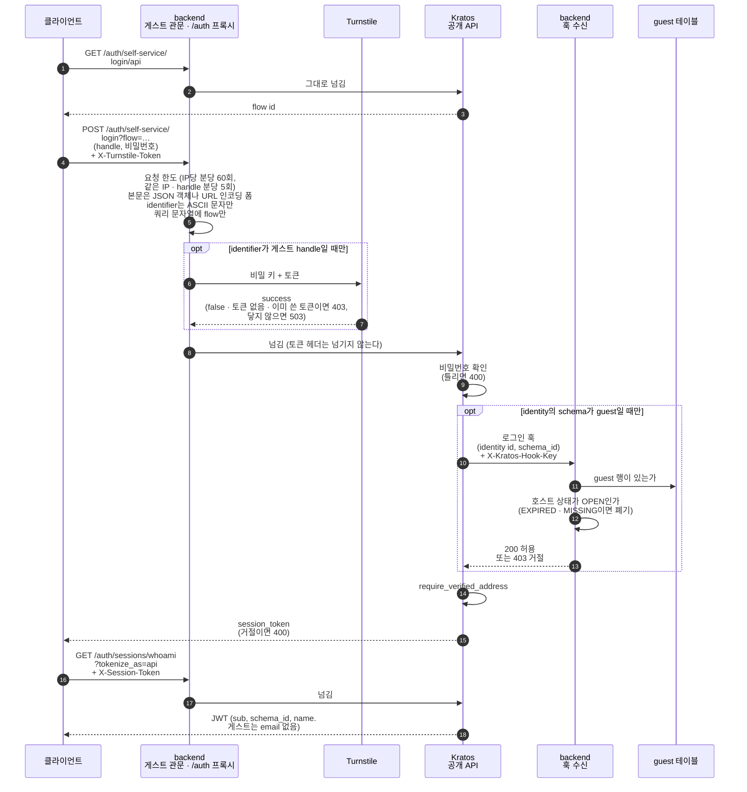
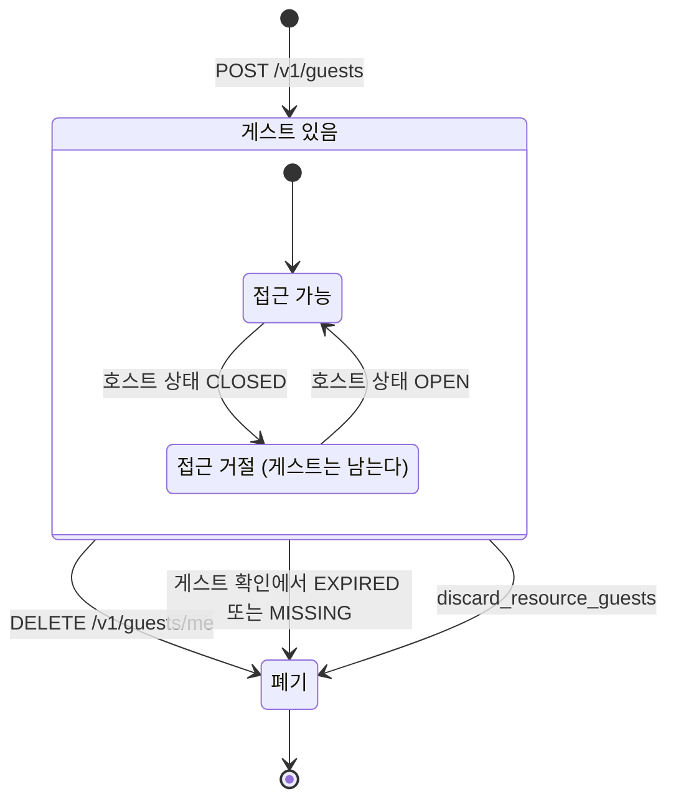
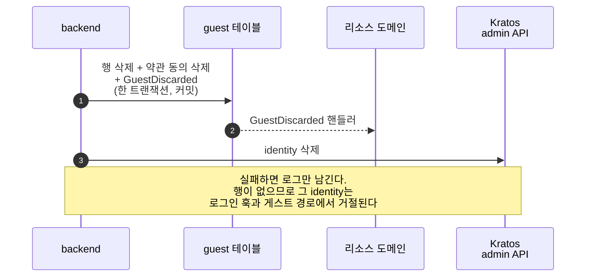
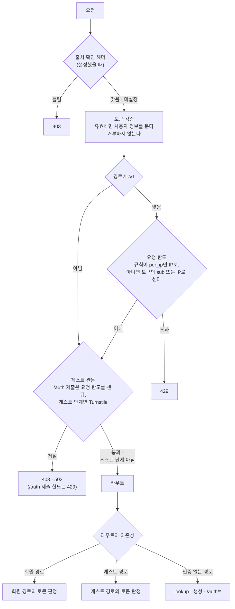
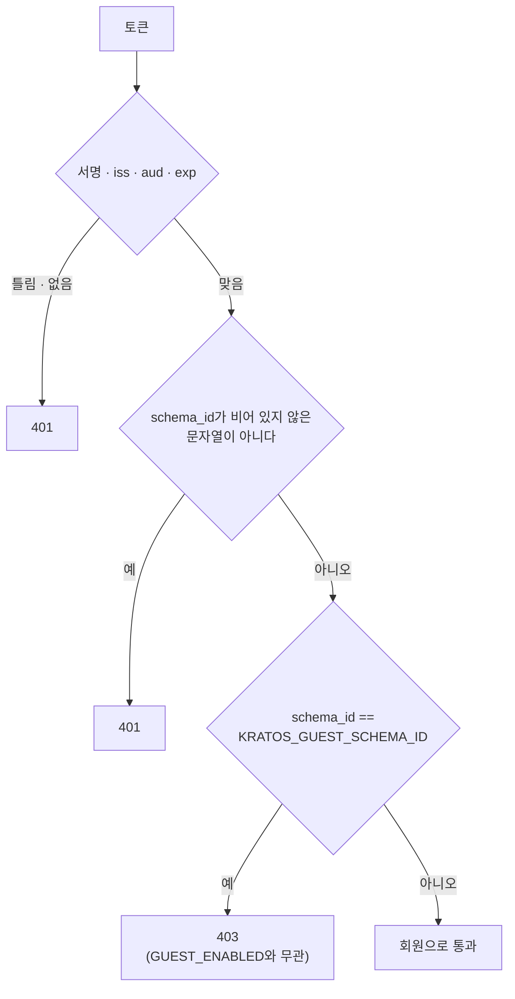
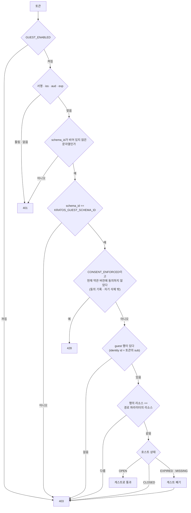
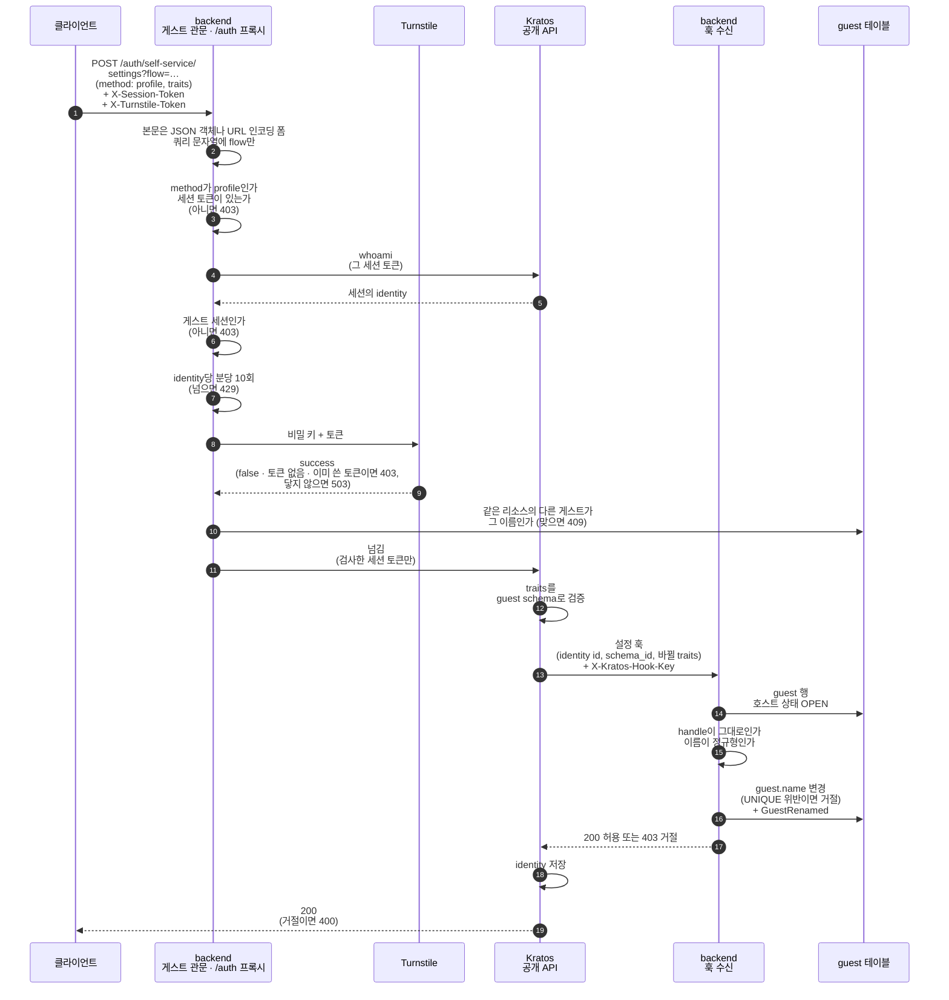
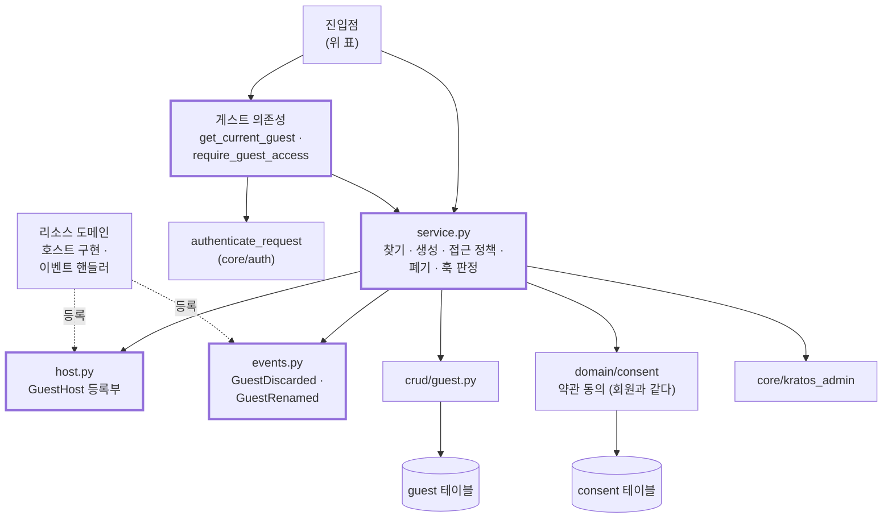

# 게스트 계정 가이드

게스트는 회원 가입 없이 리소스 하나에 들어가는 계정입니다. 이 문서는 게스트의 수명 주기, 클라이언트가 따르는 순서, 요청이 지나는 길과 지점마다의 확인, API, 그리고 리소스가 게스트를 받으려면 구현할 것을 설명합니다. 흐름 그림 아래의 표는 그 확인을 하는 코드와 그 동작을 지키는 테스트의 위치입니다. Kratos와 배포 설정은 [게스트 계정 설정 (Kratos)](../deployment/kratos-guest.ko.md)에 있습니다.

## 게스트란

게스트는 회원과 같이 Kratos가 발급하는 계정입니다. 자격 증명은 Kratos가 저장하고, 세션과 JWT도 Kratos가 발급합니다. 회원과 다른 점은 다음과 같습니다.

| | 회원 | 게스트 |
|---|---|---|
| Kratos identity schema | `default` | `KRATOS_GUEST_SCHEMA_ID` (기본 `guest`) |
| 속한 곳 | 없음 | 리소스 하나 (`resource_type`, `resource_id`) |
| 로그인 식별자 | 이메일 | 서버가 만든 `<guest_id>@guest.invalid`(`handle`). 게스트가 입력하지 않는다 |
| 이름 | 선택 | 필수. 1~50자, 같은 리소스 안에서 겹치지 않는다 |
| 수 | 제한 없음 | 리소스 하나에 100명까지 |
| 비밀번호 | Kratos 비밀번호 정책 | 비어 있지 않고 UTF-8로 72바이트 이하면 된다 |
| 이메일 인증 | 로그인에 필요 | 없음. handle을 처음부터 인증된 주소로 만든다(메일이 가지 않는 주소) |
| 만들 때 | Kratos 가입 플로우 | `POST /v1/guests` |
| 약관 동의 | `PUT /v1/users/me/consent` | 생성 요청의 `consent`. 약관 버전이 바뀌면 `PUT /v1/guests/me/consent` |
| 로그인 | Kratos 로그인 플로우 | 같은 플로우 |
| Cloudflare Turnstile | 없음 | 이름 찾기, 생성, 로그인 제출, 이름 변경, 자기 삭제마다 새 토큰(`X-Turnstile-Token` 헤더) 필요 |
| 접근 범위 | 회원 경로 전체 | 자기 리소스의 게스트 경로만 |

- 게스트 기능은 `GUEST_ENABLED=true`일 때만 켜집니다(기본 꺼짐). 꺼져 있으면 게스트 엔드포인트는 404이고, 게스트 토큰은 모든 경로에서 거부됩니다.
- 게스트를 켜려면 Cloudflare Turnstile이 필요합니다. 게스트의 모든 단계(이름 찾기, 생성, 로그인 제출, 이름 변경, 자기 삭제)가 토큰을 요구합니다([Turnstile 토큰](#turnstile-토큰)). 약관 동의 기록(`PUT /v1/guests/me/consent`)은 단계가 아니라 토큰을 받지 않습니다. `TURNSTILE_SECRET_KEY`가 없으면 서버가 뜨지 않고, Turnstile 없이 게스트를 켜는 설정은 없습니다.
- 게스트도 회원과 같은 약관(만 14세 이상, 이용약관, 개인정보처리방침)에 같은 버전(`CONSENT_VERSION`)으로 동의합니다. 동의 기록은 회원과 같은 `consent` 테이블에 Kratos identity id(JWT의 `sub`)로 두므로, 회원과 게스트는 서로의 동의로 통과하지 않습니다([약관 동의](#약관-동의--put-v1guestsmeconsent)).
- 게스트는 자기 이름만 바꿀 수 있습니다. 로그인 식별자·비밀번호 변경과 소셜 로그인 연결은 Kratos 설정 훅이 거절합니다.
- 회원 경로는 게스트 토큰을 거부합니다. `/v1/*`의 인증 경로와 GraphQL은 `403`, WebSocket은 연결을 `1008`로 닫습니다.
- 이 저장소에는 게스트를 받는 리소스가 아직 없습니다. 미팅도 호스트를 등록하지 않았습니다([리소스가 게스트를 받게 하기](#리소스가-게스트를-받게-하기)). 이 문서의 `meeting` 예시는 요청 모양을 보이기 위한 것입니다.
- 게스트를 켜도 회원 로그인의 Kratos 판정은 그대로입니다. Kratos가 로그인 훅으로 backend에 묻는 것은 게스트 로그인뿐입니다. 로그인 요청 자체는 회원과 게스트 모두 `/auth` 프록시를 지납니다.
- 게스트 JWT에는 `email` 클레임이 없고 `email_verified`는 `false`입니다. handle은 이메일로 쓰이지 않습니다.

게스트의 정보는 두 곳에 있습니다.

| 곳 | 가진 것 | 쓰는 곳 |
|----|---------|---------|
| Kratos identity | handle, 비밀번호, 이름(`traits.name`) | 로그인, 세션, JWT의 `name` |
| `guest` 테이블 | identity id, 리소스, 이름(`name`) | 이름 찾기, 이름 중복 검사, 접근 확인 |
| `consent` 테이블 | identity id, 동의한 약관 버전, 동의 시각 | 약관 동의 판정(`428`). 회원과 함께 쓴다 |

## 구성 요소와 경계

화살표의 글자는 그 구간에서 상대를 확인하는 수단입니다. 테두리가 굵은 것이 backend입니다. Kratos의 공개 API와 admin API는 같은 identity 저장소(handle, 비밀번호, 이름)를 봅니다.



| 구간 | 확인 수단 | 없거나 틀리면 |
|------|-----------|---------------|
| 클라이언트 → `POST /v1/guests/lookup`, `POST /v1/guests` | 없음(인증 없는 경로) | — |
| 클라이언트 → 게스트 경로, `DELETE /v1/guests/me`, `PUT /v1/guests/me/consent` | 게스트 JWT (`Authorization: Bearer`) | `401`/`403` |
| 클라이언트 → `/auth/*` | Kratos 세션 토큰 (`X-Session-Token`) 또는 없음(로그인 전) | Kratos가 판정 |
| 클라이언트 → 게스트 단계 (이름 찾기, 생성, 자기 삭제, 게스트 handle의 로그인 제출, 게스트 세션의 설정 제출) | Turnstile 토큰 (`X-Turnstile-Token`, 한 번만 쓸 수 있다) | `403`/`503` |
| 앞단 프록시 → backend | `ORIGIN_VERIFY_HEADER`·`ORIGIN_VERIFY_SECRET` (설정했을 때) | `403` |
| backend → Kratos admin API | 망 분리(밖에 열지 않는다) | — |
| backend → Turnstile | `TURNSTILE_SECRET_KEY` | 게스트 단계 `403`/`503` |
| Kratos → backend 훅 | `X-Kratos-Hook-Key` = `KRATOS_HOOK_API_KEY`. 출처 확인을 설정했으면 `web_hook`의 `headers`로 그 헤더도 | 훅 키 `401`, 출처 헤더 `403`. Kratos는 그 요청을 거절 |

- 게스트의 비밀번호는 backend에 저장되지 않습니다. 생성 요청에서는 backend가 받아 Kratos admin API로 넘기고, 로그인 제출에서는 `/auth` 프록시가 본문째 Kratos 공개 API로 넘깁니다.
- backend는 게스트 대신 로그인하지 않습니다. 세션 토큰과 JWT는 클라이언트가 `/auth/*`로 직접 받습니다.

## 클라이언트가 따르는 순서

게스트는 이름과 비밀번호만 입력합니다. 클라이언트는 다음 순서로 호출합니다.

1. Turnstile 위젯에서 토큰을 받아 `POST /v1/guests/lookup`으로 그 리소스에 그 이름의 게스트가 있는지 찾는다. 응답에 현재 약관 버전(`consent_version`)이 있다.
2. 없으면(`handle: null`) 게스트에게 약관 세 항목의 동의를 받고, 새 토큰으로 `POST /v1/guests`를 불러 게스트를 만든다. `consent.version`에는 1번의 `consent_version`을 넣는다. 응답에 `handle`이 있다.
3. 새 토큰으로, `handle`과 비밀번호로 회원과 같은 Kratos 로그인 플로우를 `/auth`로 호출한다.
4. 세션 토큰으로 JWT를 받아(`GET /auth/sessions/whoami?tokenize_as=api`) 게스트 경로에 쓴다.

토큰은 모두 `X-Turnstile-Token` 헤더에 넣습니다. 이름이 이미 있으면 2번을 건너뜁니다. 3번에서 비밀번호가 틀리면 Kratos가 `400`으로 거절합니다. Turnstile 토큰은 한 번만 쓸 수 있으므로 1~3번에 각각 하나가 필요하고, 다시 시도할 때마다 새 토큰을 받습니다.

게스트 경로가 `428` `ConsentRequiredError`로 답하면 약관 버전이 바뀐 것입니다. 이름 찾기로 새 `consent_version`을 받아 게스트에게 다시 동의를 받고 `PUT /v1/guests/me/consent`로 보냅니다([약관 동의](#약관-동의--put-v1guestsmeconsent)).

```http
POST /v1/guests/lookup
X-Turnstile-Token: <위젯 토큰 1>
{"resource_type": "meeting", "resource_id": "<uuid>", "name": "민수"}
→ 200 {"handle": null, "consent_version": "2026-11-13"}

POST /v1/guests
X-Turnstile-Token: <위젯 토큰 2>
{"resource_type": "meeting", "resource_id": "<uuid>", "name": "민수", "password": "1234",
 "consent": {"version": "2026-11-13", "age_over_14": true, "terms": true, "privacy": true}}
→ 201 {"guest_id": "0b9c...", "handle": "0b9c...@guest.invalid", ...}

GET  /auth/self-service/login/api
→ 200 {"id": "<flow id>", ...}

POST /auth/self-service/login?flow=<flow id>
X-Turnstile-Token: <위젯 토큰 3>
{"method": "password", "identifier": "0b9c...@guest.invalid", "password": "1234"}
→ 200 {"session_token": "ory_st_...", ...}

GET  /auth/sessions/whoami?tokenize_as=api
X-Session-Token: ory_st_...
→ 200 {"tokenized": "<JWT>", "identity": {"schema_id": "guest", ...}}
```

세션 응답의 `identity.traits`에는 `email`이 없고 `handle`과 `name`이 있습니다. 게스트인지는 `identity.schema_id`로 가립니다.

### 생성 흐름



- `handle`은 `<guest_id>@guest.invalid`이고, `guest_id`는 backend가 삽입 전에 만든 행 id입니다.
- Turnstile은 다른 확인보다 먼저입니다(2~3번, 8~9번). 그 뒤의 확인(10~14번)에서 거절돼도 토큰은 다시 쓸 수 없고, Kratos는 부르지 않습니다.
- 약관 버전 확인(11번)은 리소스·이름 확인보다 먼저입니다. 버전이 다르면 리소스가 `EXPIRED`·`MISSING`이어도 게스트를 폐기하지 않습니다.
- Kratos 호출 동안 DB 트랜잭션을 열어 두지 않습니다. 이름 중복은 17번의 UNIQUE 제약이 최종으로 막습니다. 동의 기록이 실패하면 게스트 행도 남지 않고 만든 identity를 지웁니다.

| 확인 | 코드 | 테스트 |
|------|------|--------|
| 순서 전체 | `app/domain/guest/service.py` (`lookup`, `create`) | `tests/domain/guest/test_lookup_create.py`, `test_guest_api.py` |
| 이름 정규형 | `app/domain/guest/schema/dto.py` (`normalize_guest_name`) | `tests/domain/guest/test_guest_api.py` |
| 약관 동의 | `app/domain/consent/service.py` (`check_version`, `record_consent`) | `tests/domain/guest/test_guest_api.py`, `test_lookup_create.py` |
| 100명 상한 | `service.MAX_GUESTS_PER_RESOURCE` | `tests/domain/guest/test_guest_limit.py` |
| Turnstile | `app/middleware/guest_gate.py`, `app/core/turnstile.py` | `tests/domain/guest/test_turnstile.py` |
| 동시 생성 | `guest` 테이블의 UNIQUE 제약 | `tests/domain/guest/test_name_concurrency.py` (PostgreSQL) |

### 로그인과 JWT 흐름



- 회원 로그인에서는 6~7번과 10~13번이 일어나지 않습니다. backend는 identifier가 게스트 handle(`@guest.invalid`)일 때만 토큰을 확인하고, Kratos는 게스트 identity일 때만 훅을 부릅니다(훅 본문의 `error 'cancel'`). 회원은 14번이 판정합니다.
- 게스트는 handle이 처음부터 인증된 주소라 14번을 통과합니다.
- 6~7번은 제출마다 합니다. 비밀번호가 틀려 9번에서 거절돼도 그 토큰은 다시 쓸 수 없습니다.
- 로그인 훅은 로그인 시점에만 판정합니다. 그 뒤의 게스트 경로 요청은 [게스트 경로의 토큰 판정](#게스트-경로)이 요청마다 다시 확인합니다.
- JWT의 `schema_id`는 Kratos 클레임 매퍼가 identity에서 읽습니다. identity의 schema는 본인이 바꿀 수 없습니다.

| 확인 | 코드 | 테스트 |
|------|------|--------|
| `/auth` 제출의 한도·쿼리 문자열 | `app/middleware/guest_gate.py`, `app/api/auth_proxy.py`, `app/ratelimit/config.py` | `tests/test_auth_proxy.py`, `tests/domain/guest/test_rate_limits.py` |
| 게스트 로그인 제출의 Turnstile 토큰 | `app/api/auth_proxy.py` (게스트 handle 판정), `app/middleware/guest_gate.py`, `app/core/turnstile.py` | `tests/domain/guest/test_guest_login_turnstile.py`, `test_turnstile.py` |
| 훅 키 | `app/api/kratos_hooks.py` (`_authorize`) | `tests/domain/guest/test_kratos_hooks.py` |
| 로그인 판정 | `app/domain/guest/service.py` (`login_allowed`) | `tests/domain/guest/test_hook_decisions.py`, `test_client_login.py` |
| Kratos 설정(훅 순서, 게스트만 호출, 클레임) | `dev/kratos/kratos.guest.yml`, `hook.login.jsonnet`, `api-jwt.claims.jsonnet` | `tests/domain/guest/test_kratos_config.py` |

## 수명 주기

| 단계 | 일어나는 일 |
|------|-------------|
| 생성 | `POST /v1/guests`. 현재 약관 버전에 동의했고 리소스가 게스트를 받고(`OPEN`) 그 이름이 비어 있고 게스트가 100명 미만이면 Kratos identity, 게스트 행, 약관 동의 기록을 만든다 |
| 로그인 | Kratos 로그인 플로우. Kratos 로그인 훅이 backend에 묻고, 게스트 행이 있고 리소스가 `OPEN`일 때만 세션을 만든다 |
| 이름 변경 | Kratos 설정 플로우(`method: profile`)로 `traits.name`을 바꾼다. 설정 훅이 `guest.name`을 바꾸고 `GuestRenamed` 이벤트를 낸다 |
| 약관 동의 | 약관 버전이 바뀌면 `PUT /v1/guests/me/consent`로 다시 동의한다. `CONSENT_ENFORCED`면 그때까지 동의 기록과 자기 삭제 밖의 게스트 경로가 `428`이다 |
| 자기 삭제 | `DELETE /v1/guests/me` |
| 폐기 | 아래 조건에서 게스트 행, 약관 동의 기록, Kratos identity를 지우고 `GuestDiscarded` 이벤트를 낸다 |

게스트는 다음 경우에 폐기됩니다.

- 게스트가 자기를 삭제할 때
- 게스트 확인(로그인, 게스트 경로 요청, 이름 변경, 같은 리소스의 이름 찾기·생성)에서 리소스가 `EXPIRED`나 `MISSING`일 때. 로그인·게스트 경로·이름 변경은 그 게스트를, 이름 찾기·생성은 그 리소스의 게스트 전부를 폐기한다. 호스트를 등록하지 않은 리소스 종류는 `MISSING`이다
- 리소스가 지워지면서 `discard_resource_guests`를 부를 때

폐기된 게스트의 Kratos 세션은 identity가 지워지면서 끊깁니다. 이미 받은 JWT는 만료(Kratos tokenizer `ttl`, 기본 10분)까지 서명은 유효하지만, 게스트 경로는 요청마다 게스트 행을 확인하므로 거부됩니다. Kratos identity 삭제가 실패해도 게스트 행은 지워지고, 행이 없는 게스트 identity는 로그인할 수 없습니다. 이때 identity와 그 세션은 Kratos에 남고(세션으로 받은 JWT는 게스트 경로와 회원 경로에서 거부된다), backend는 실패를 로그에 남길 뿐 다시 시도하지 않습니다. 리소스가 `EXPIRED`·`MISSING`이 된 뒤 게스트 확인이 한 번도 일어나지 않으면 그 게스트는 남아 있습니다. 주기적으로 정리하는 작업은 없습니다. 폐기된 게스트의 이름은 다시 쓸 수 있습니다.

리소스가 `CLOSED`인 동안 게스트는 남지만 로그인, 이름 찾기, 생성, 이름 변경은 거절됩니다. 자기 삭제는 됩니다.

### 상태와 폐기 순서



게스트 확인은 로그인 훅, 설정 훅, 게스트 경로 요청, 같은 리소스의 이름 찾기·생성입니다. 호스트 상태는 저장하지 않고 확인할 때마다 리소스에 묻습니다.

폐기는 다음 순서입니다.



| 폐기 뒤 | 동작 |
|---------|------|
| Kratos 세션 | identity가 지워지면 바로 끊긴다 |
| 이미 받은 JWT | 만료(tokenizer `ttl`, 기본 10분)까지 서명은 유효하다. 게스트 경로는 행이 없어 `403`, 회원 경로는 `schema_id`로 `403` |
| 이름 | 다시 쓸 수 있다 |
| 약관 동의 기록 | 게스트 행과 함께 지운다 |

| 확인 | 코드 | 테스트 |
|------|------|--------|
| 접근 정책과 폐기 | `app/domain/guest/service.py` (`check_access`, `discard_guest`, `discard_resource_guests`) | `tests/domain/guest/test_policy.py` |
| 폐기할 때 약관 동의 삭제 | `app/domain/guest/service.py` (`_delete_guest_row`, `_delete_resource_guest_rows`) | `tests/domain/guest/test_consent.py` |
| 호스트 계약 | `app/domain/guest/host.py` | `tests/domain/guest/test_policy.py` |

## 이름과 비밀번호 규칙

이름은 다음 순서로 정규형으로 바꾼 뒤 저장하고 비교합니다.

1. NFC로 정규화한다.
2. 이어진 공백 문자(탭·줄바꿈, NBSP·전각 공백 같은 다른 공백 포함)를 공백 한 칸으로 바꾸고 앞뒤 공백을 뗀다.
3. 제어·서식·대체·사용자 정의·미배정 문자(유니코드 범주 Cc, Cf, Cs, Co, Cn)가 있으면 거절한다. 폭 없는 공백(U+200B), 폭 없는 결합자(U+200D), BOM, 방향 제어 문자가 여기에 든다.
4. 길이가 1~50자가 아니면 거절한다.

- 정규형이 같으면 같은 이름입니다. `김  민수`와 `김 민수`는 같고, 대소문자는 구분합니다(`Min`과 `min`은 다른 이름).
- 결합자 없는 이모지(`🙂`, `👍🏽`, `🇰🇷`)는 쓸 수 있습니다. U+200D로 이은 이모지(가족 이모지 등)는 쓸 수 없습니다.
- 생성과 이름 찾기는 받은 이름을 정규형으로 바꿉니다. 이름 변경은 이미 정규형인 이름만 받습니다(Kratos가 저장할 값을 backend가 바꿀 수 없다).

비밀번호는 NFC로 정규화한 뒤 비어 있지 않고 UTF-8로 72바이트 이하면 받습니다. 다른 규칙은 없습니다. 로그인 때는 클라이언트가 NFC로 보냅니다.

## 요청 판정 순서

### 공통 순서

HTTP 요청이 라우트에 닿기 전에 지나는 순서입니다(`app/main.py`). `/health`는 출처 확인을 하지 않습니다.



게스트 관문은 CORS 안쪽에 있어 거절 응답에도 CORS 헤더가 붙고, preflight(`OPTIONS`)는 CORS가 먼저 답합니다.

| 확인 | 코드 | 테스트 |
|------|------|--------|
| 출처 확인 | `app/middleware/origin_verify.py` | `tests/core/test_origin_verify.py` |
| 토큰 검증 | `app/core/auth/middleware.py`, `app/core/auth/client.py` | `tests/core/` |
| 요청 한도와 `per_ip` | `app/ratelimit/middleware.py`, `app/ratelimit/config.py`, `/auth` 제출은 `app/middleware/guest_gate.py` | `tests/ratelimit/`, `tests/domain/guest/test_rate_limits.py` |
| 게스트 관문 | `app/middleware/guest_gate.py` | `tests/domain/guest/test_turnstile.py` |

### 토큰 판정

#### 회원 경로

REST의 인증 경로, GraphQL, WebSocket이 모두 `ensure_member`를 거칩니다.



#### 게스트 경로

`require_guest_access(resource_type, id_param)`을 명시한 경로만 게스트를 받습니다. 판정은 요청마다 다시 합니다. 약관 동의 확인까지는 `get_current_guest`가 하고(`DELETE /v1/guests/me`, `PUT /v1/guests/me/consent`는 여기까지), 그 뒤는 `require_guest_access`가 합니다.



| 확인 | 코드 | 테스트 |
|------|------|--------|
| `ensure_member` | `app/core/auth/dependencies.py` | `tests/core/test_auth_guest_token.py` |
| `schema_id` 읽기 | `app/core/auth/model.py` (`CurrentUser.from_claims`, `is_guest`) | `tests/core/test_auth_guest_token.py` |
| 게스트 의존성 | `app/domain/guest/dependencies.py` | `tests/domain/guest/test_dependencies.py` |
| 약관 동의 (`428`, 허용 경로 `GUEST_CONSENT_ALLOWED_ROUTES`) | `app/domain/guest/dependencies.py` (`get_current_guest`) | `tests/domain/guest/test_consent.py` |
| 행·리소스·호스트 상태 | `app/domain/guest/service.py` (`authorize`, `check_access`) | `tests/domain/guest/test_policy.py` |
| 모든 경로가 게스트 토큰을 거부하는지 | 경로 전체 | `tests/domain/guest/test_route_guard.py` (받는 경로는 허용 목록에 올린다) |

### 꺼진 상태 (`GUEST_ENABLED=false`)

| 요청 | 응답 |
|------|------|
| `/v1/guests/*` | `404` |
| `/internal/kratos/hooks/*` | `404` |
| 게스트 schema의 토큰 | 모든 인증 경로에서 `403` |
| `schema_id` 클레임이 없는 토큰 | `401` (켜져 있을 때와 같다) |
| `/auth`에서 게스트 세션의 `method: profile` 제출 | `403` |
| `X-Turnstile-Token` | 확인하지 않는다 |

게스트와 상관없이 적용되는 것은 `/auth` 제출의 요청 한도, 쿼리 문자열 규칙, 식별자의 ASCII 규칙, `@guest.invalid` 주소의 인증·복구 제출 거절입니다([`/auth` 프록시](auth-proxy.ko.md#판정-순서)).

| 확인 | 테스트 |
|------|--------|
| 꺼진 상태 | `tests/domain/guest/test_guest_api.py`, `test_kratos_hooks.py`, `tests/test_auth_proxy.py` |

## API

`GUEST_ENABLED`가 꺼져 있으면 아래 경로는 모두 `404`입니다.

### Turnstile 토큰

게스트 단계마다 Cloudflare Turnstile 위젯에서 새 토큰을 받아 `X-Turnstile-Token` 헤더에 넣습니다. 확인은 backend의 게스트 관문(`app/middleware/guest_gate.py`) 한 곳에서 합니다.

| 게스트 단계 | 요청 |
|-------------|------|
| 이름 찾기 | `POST /v1/guests/lookup` |
| 생성 | `POST /v1/guests` |
| 자기 삭제 | `DELETE /v1/guests/me` |
| 로그인 | `/auth` 로그인 제출 중 `identifier`가 게스트 handle인 것 |
| 이름 변경 | `/auth` 설정 제출 중 세션이 게스트인 것 |

- 토큰은 1~2048자이고 헤더로만 받습니다. 본문의 값은 읽지 않습니다.
- 토큰은 한 번만 받습니다. backend는 siteverify를 부르기 전에 토큰을 기록하고, 이미 기록한 토큰은 siteverify를 부르지 않고 `403`으로 거절합니다. 확인에 실패했거나 확인할 수 없었던 토큰도, 다른 단계에서 쓴 토큰도 같습니다. 기록은 토큰 유효 시간(300초)보다 조금 길게 둡니다.
- 순서는 요청 한도 → Turnstile → 그 밖의 확인(입력 규칙, 리소스 상태, 이름 중복, 게스트 수, 게스트 JWT 판정) → Kratos입니다. 요청 한도에 걸린 요청은 Turnstile을 부르지 않고, Turnstile에서 거절된 요청은 Kratos에 닿지 않습니다.
- `X-Turnstile-Token`은 Kratos에 넘기지 않습니다.
- 약관 동의 기록(`PUT /v1/guests/me/consent`)은 게스트 단계가 아니라 토큰을 받지 않습니다.
- `GUEST_ENABLED`가 꺼져 있으면 확인하지 않습니다.

| 결과 | `/v1/guests/*` (`error_type`) | `/auth` (`error.id`) |
|------|-------------------------------|----------------------|
| 토큰이 없거나, 2048자를 넘거나, Turnstile이 받지 않았거나, 이미 쓴 토큰이다 | `403` `GuestVerificationFailedError` | `403` `guest_verification_failed` |
| Turnstile을 확인할 수 없다 | `503` `GuestServiceUnavailableError` | `503` `guest_verification_unavailable` |

### 이름 찾기 — `POST /v1/guests/lookup`

인증이 필요 없습니다. Kratos를 부르지 않습니다. `X-Turnstile-Token` 헤더에 토큰이 필요합니다.

```json
{
  "resource_type": "meeting",
  "resource_id": "6f1c2a9e-3b4d-4e5f-8a7b-9c0d1e2f3a4b",
  "name": "민수"
}
```

응답 (200): 그 이름의 게스트가 있으면 `handle`이 `"<guest_id>@guest.invalid"`, 없으면 `null`입니다. `consent_version`은 현재 약관 시행일(`CONSENT_VERSION`)이고, 생성과 동의 기록에 그대로 보냅니다.

```json
{"handle": null, "consent_version": "2026-11-13"}
```

| 상태 | 뜻 |
|------|----|
| `200` | 찾았거나(`handle`) 없다(`null`). 어느 쪽이든 `consent_version`이 있다 |
| `403` | 리소스가 없거나, 지금 게스트를 받지 않거나, 게스트 기간이 끝났다. 세 경우 응답이 같다 (`GuestEntryRefusedError`) |
| `403` | Turnstile 토큰을 받지 않았다 (`GuestVerificationFailedError`) |
| `503` | Turnstile을 확인할 수 없다 (`GuestServiceUnavailableError`) |
| `422` | 입력 규칙 위반 |
| `429` | IP당 분당 100회를 넘었다 |

### 생성 — `POST /v1/guests`

인증이 필요 없습니다. `X-Turnstile-Token` 헤더에 토큰이 필요합니다.

```json
{
  "resource_type": "meeting",
  "resource_id": "6f1c2a9e-3b4d-4e5f-8a7b-9c0d1e2f3a4b",
  "name": "민수",
  "password": "1234",
  "consent": {"version": "2026-11-13", "age_over_14": true, "terms": true, "privacy": true}
}
```

| 필드 | 규칙 |
|------|------|
| `resource_type` | 리소스 종류 (`meeting` 등) |
| `resource_id` | 리소스 UUID |
| `name` | [이름 규칙](#이름과-비밀번호-규칙) |
| `password` | [비밀번호 규칙](#이름과-비밀번호-규칙) |
| `consent` | 회원 동의(`PUT /v1/users/me/consent`)와 같은 모양. `version`은 이름 찾기의 `consent_version`, `age_over_14`·`terms`·`privacy`(만 14세 이상, 이용약관, 개인정보처리방침)는 모두 `true` |

응답 (201):

```json
{
  "guest_id": "0b9c6d1e-...",
  "handle": "0b9c6d1e-...@guest.invalid",
  "resource_type": "meeting",
  "resource_id": "6f1c2a9e-3b4d-4e5f-8a7b-9c0d1e2f3a4b"
}
```

서버는 Turnstile 토큰, 입력 규칙(동의 세 항목 포함), 약관 버전, 리소스 상태, 이름 중복, 게스트 수 순으로 확인합니다. Turnstile 뒤의 확인에서 거절돼도 그 토큰은 다시 쓸 수 없습니다. 약관 동의는 게스트 행과 한 트랜잭션으로 기록합니다.

| 상태 | `error_type` | 뜻 |
|------|--------------|----|
| `201` | | 만들었다 |
| `409` | `ConsentVersionMismatchError` | `consent.version`이 현재 약관 시행일이 아니다. 이름 찾기의 `consent_version`으로 다시 동의를 받는다 |
| `403` | `GuestEntryRefusedError` | 리소스가 없거나, 지금 게스트를 받지 않거나, 게스트 기간이 끝났다 |
| `409` | `GuestNameTakenError` | 이 리소스에 같은 이름의 게스트가 있다 |
| `409` | `GuestLimitReachedError` | 이 리소스에 게스트가 이미 100명이다 |
| `403` | `GuestVerificationFailedError` | Turnstile 토큰을 받지 않았다. 위젯에서 새 토큰을 받아 다시 보낸다 |
| `503` | `GuestServiceUnavailableError` | Turnstile 확인 서버나 Kratos에 닿지 않는다. 게스트는 만들어지지 않는다 |
| `422` | | 입력 규칙 위반. `consent`가 없거나 세 항목 중 하나라도 빠졌거나 `true`가 아니다 |
| `429` | | IP당 분당 100회를 넘었다 (이름 찾기와 따로 센다) |

### 로그인과 JWT

회원과 같은 경로입니다(`/auth`는 Kratos 공개 API 프록시, [`/auth` 프록시](auth-proxy.ko.md)).

```http
GET  /auth/self-service/login/api
POST /auth/self-service/login?flow=<flow id>
     X-Turnstile-Token: <위젯 토큰>
     {"method": "password", "identifier": "<handle>", "password": "<비밀번호>"}
GET  /auth/sessions/whoami?tokenize_as=api
     X-Session-Token: ory_st_...
```

- 로그인 제출의 `identifier`가 게스트 handle이면 `X-Turnstile-Token` 헤더의 토큰을 확인한 뒤 Kratos에 넘깁니다. 헤더가 없거나 Turnstile이 받지 않았거나 이미 쓴 토큰이면 `403` `guest_verification_failed`, 확인할 수 없으면 `503` `guest_verification_unavailable`이고 Kratos에 넘기지 않습니다. 토큰은 제출마다 새로 받습니다.
- `identifier`(`password_identifier` 포함, JSON 키는 대소문자 구분 없이)는 Kratos가 식별자를 찾을 때처럼 앞뒤의 ASCII 공백을 떼고 소문자로 바꾼 값이 `@guest.invalid`로 끝나면 게스트 handle로 봅니다.
- `identifier`에 ASCII 밖의 문자가 있으면 토큰을 확인하지 않고 `400` `invalid_identifier`입니다.
- `identifier`를 둘 이상 보내거나(`password_identifier` 포함) 본문이 프록시가 값을 읽는 형식([본문 형식](auth-proxy.ko.md#판정-순서))이 아니면 `400` `invalid_request_body`입니다.
- 비밀번호가 틀리면 Kratos가 `400`(메시지 `id` `4000006`)으로 거절합니다. 메시지 `id`는 Kratos 응답 본문의 `ui.messages[].id`입니다.
- 게스트 행이 없거나 리소스가 `OPEN`이 아니면 로그인 훅이 거절해 `400`(메시지 `id` `4000001`)입니다.
- JWT 클레임에는 `sub`(게스트의 Kratos identity id), `schema_id`(게스트 schema id), `name`이 있고 `email`은 없습니다. 이후 요청에는 `Authorization: Bearer <JWT>`를 붙입니다.
- 로그인 제출은 같은 IP에서 같은 handle로 분당 5회, `/auth`로 가는 GET 밖의 요청과 제출 경로로 가는 GET은 IP당 분당 60회입니다. 회원의 로그인·가입·코드 제출도 같은 한도를 받습니다.

### 이름 변경

Kratos 설정 플로우를 `/auth` 프록시로 씁니다. `traits.handle`은 현재 값 그대로 보내야 합니다.

```http
GET  /auth/self-service/settings/api
X-Session-Token: ory_st_...

POST /auth/self-service/settings?flow=<flow id>
X-Session-Token: ory_st_...
X-Turnstile-Token: <위젯 토큰>
Content-Type: application/json

{"method": "profile", "traits": {"handle": "<현재 handle>", "name": "철수"}}
```

| 상태 | 뜻 |
|------|----|
| `200` | 바뀌었다. 이후 이름 찾기는 새 이름을 따른다 |
| `409` `guest_name_taken` | 같은 리소스의 다른 게스트가 그 이름이다 (프록시가 Kratos에 넘기기 전에 답한다) |
| `403` `guest_verification_failed` | Turnstile 토큰을 받지 않았다 ([Turnstile 토큰](#turnstile-토큰)) |
| `503` `guest_verification_unavailable` | Turnstile을 확인할 수 없다 |
| `400` 메시지 `id` `4000001` | 설정 훅이 거절했다: 이름이 정규형이 아니거나, `handle`이 다르거나, 리소스가 `OPEN`이 아니거나, 그 사이 다른 게스트가 그 이름을 가졌다 |
| `403` | `method`가 `profile`이 아니다 (`password`, `oidc` 등). Kratos 설정 훅도 다시 거절한다 |
| `400` `invalid_request_body` | 본문이 프록시가 값을 읽는 형식이 아니다. JSON 객체(`traits`는 객체)나 URL 인코딩 폼(`traits.name`처럼 점으로 이은 필드)만 받는다 ([본문 형식](auth-proxy.ko.md#판정-순서)) |

- 지금 이름과 같은 이름으로 바꾸는 요청은 받고, 아무것도 바꾸지 않습니다.
- 이름 중복은 `guest` 테이블의 UNIQUE 제약이 막습니다. 요청이 `/auth` 프록시를 거치지 않아도 같습니다.
- 훅이 허용한 뒤 Kratos가 이름 저장에 실패하면 `guest.name`(찾기·중복 기준)과 Kratos의 `traits.name`(JWT의 `name`)이 다음 이름 변경까지 다릅니다.

#### 이름 변경 흐름



- `method`가 `password`·`oidc`인 게스트의 설정 제출은 프록시에서 `403`이고, Kratos에 직접 닿아도 그 메서드의 설정 훅이 거절합니다.
- 10번은 빠른 응답을 위한 조회이고, 이름 중복을 최종으로 막는 것은 16번의 UNIQUE 제약입니다.
- 16번이 끝난 뒤 18번이 실패하면 `guest.name`과 Kratos의 `traits.name`이 다음 이름 변경까지 다릅니다.
- 게스트 세션의 설정 제출은 `method`와 상관없이 Turnstile 토큰을 확인합니다.

| 확인 | 코드 | 테스트 |
|------|------|--------|
| 프록시의 게스트 처리 | `app/api/auth_proxy.py` (`_settings_rejection`), `service.name_taken_by_other` | `tests/domain/guest/test_rename_proxy.py`, `tests/test_auth_proxy.py` |
| Turnstile | `app/middleware/guest_gate.py` | `tests/domain/guest/test_turnstile.py` |
| 설정 판정 | `app/domain/guest/service.py` (`settings_change_allowed`) | `tests/domain/guest/test_hook_decisions.py`, `test_kratos_hooks.py` |
| 동시 이름 변경·생성 | `guest` 테이블의 UNIQUE 제약 | `tests/domain/guest/test_name_concurrency.py` (PostgreSQL) |

### 자기 삭제 — `DELETE /v1/guests/me`

게스트 JWT와 `X-Turnstile-Token` 헤더의 토큰이 필요합니다. Turnstile 확인이 JWT 판정보다 먼저입니다. 응답은 `204`이고, 새 토큰으로 다시 불러도 `204`입니다. 회원 토큰은 `403`, 토큰이 없거나 `schema_id` 클레임이 없으면 `401`입니다. 현재 약관 버전에 동의하지 않았어도 부를 수 있습니다.

### 약관 동의 — `PUT /v1/guests/me/consent`

게스트 JWT가 필요합니다. Turnstile 토큰은 받지 않습니다. 본문은 회원의 `PUT /v1/users/me/consent`와 같습니다.

```json
{"version": "2026-11-13", "age_over_14": true, "terms": true, "privacy": true}
```

| 상태 | `error_type` | 뜻 |
|------|--------------|----|
| `204` | | 기록했다. 같은 버전에 다시 동의해도 `204`이고 처음 기록을 둔다 |
| `409` | `ConsentVersionMismatchError` | `version`이 현재 약관 시행일이 아니다 |
| `422` | | 세 항목 중 하나라도 빠졌거나 `true`가 아니다 |
| `403` | `GuestAccessDeniedError` | 게스트 행이 없다(폐기된 게스트). 회원 토큰도 `403` |
| `401` | | 토큰이 없거나 `schema_id` 클레임이 없다 |

`CONSENT_ENFORCED`(기본 켜짐)면 현재 약관 버전에 동의하지 않은 게스트는 이 경로와 `DELETE /v1/guests/me` 밖의 게스트 경로가 `428` `ConsentRequiredError`(`message: "consent_required"`)입니다. 회원의 `428`과 같은 응답입니다. 현재 버전은 이름 찾기의 `consent_version`으로 받습니다. 약관 버전(`CONSENT_VERSION`)을 바꾸면 모든 게스트가 다시 동의해야 합니다.

| 확인 | 코드 | 테스트 |
|------|------|--------|
| 동의 기록과 `428` | `app/api/v1/guests.py`, `app/domain/guest/service.py` (`record_consent`, `consent_pending`), `app/domain/guest/dependencies.py` | `tests/domain/guest/test_consent.py` |
| 동의 판정·기록 (회원과 같다) | `app/domain/consent/service.py` | `tests/domain/consent/test_service.py` |

### `/auth` 프록시가 받지 않는 게스트 관련 요청

| 요청 | 응답 |
|------|------|
| 인증·복구 제출의 `email`이 `@guest.invalid`로 끝난다 | `400` `address_not_accepted` |
| 게스트 handle의 로그인 제출이나 게스트 세션의 설정 제출에 `X-Turnstile-Token`이 없거나, Turnstile이 받지 않거나, 이미 쓴 토큰이다 (`GUEST_ENABLED`) | `403` `guest_verification_failed` |
| 게스트 handle의 로그인 제출이나 게스트 세션의 설정 제출인데 Turnstile을 확인할 수 없다 (`GUEST_ENABLED`) | `503` `guest_verification_unavailable` |
| 로그인 제출에 `identifier`가 둘 이상이다 (`GUEST_ENABLED`) | `400` `invalid_request_body` |
| 로그인·가입·설정·인증·복구 제출(GET 밖)의 본문이 프록시가 값을 읽는 형식이 아니다 (읽을 수 없거나 키가 겹치는 본문 포함, [본문 형식](auth-proxy.ko.md#판정-순서)) | `400` `invalid_request_body` |
| 로그인·가입·설정·인증·복구 제출(GET 포함)의 쿼리 문자열에 `flow` 밖의 값이 있다 (인증 GET은 `flow`·`code` 밖) | `400` `invalid_request_body` |
| 로그인·가입·인증·복구 제출의 식별자(`identifier`, `traits.email`, `email`)에 ASCII 밖의 문자가 있다 | `400` `invalid_identifier` |
| Kratos로 보낼 URL을 만들 수 없다 (퍼센트 인코딩을 푼 경로나 쿼리 문자열의 제어 문자, 65536자를 넘는 URL) | `400` `invalid_request_url` |

프록시가 요청을 넘기는 방식과 판정 순서 전체는 [`/auth` 프록시](auth-proxy.ko.md)에 있습니다.

## 리소스가 게스트를 받게 하기

게스트 도메인(`app/domain/guest/`)은 리소스 도메인을 import하지 않습니다. 리소스가 게스트 도메인에 자기를 등록합니다.

### 1. 호스트 계약 구현과 등록

리소스 종류마다 `GuestHost`를 구현해 `register_guest_host`로 등록합니다. 등록하지 않은 리소스 종류는 `MISSING`으로 봅니다.

| `GuestHostStatus` | 뜻 | 접근 정책 |
|-------------------|----|-----------|
| `OPEN` | 리소스가 있고, 게스트를 받으며, 게스트 기간 안이다 | 허용 |
| `CLOSED` | 리소스가 있지만 지금은 게스트를 받지 않는다 | 거부, 게스트는 남는다 |
| `EXPIRED` | 게스트 기간이 끝났다 | 거부, 게스트를 폐기한다 |
| `MISSING` | 리소스가 없다 | 거부, 게스트를 폐기한다 |

```python
# 예시: 미팅이 게스트를 받는다면 (이 저장소에는 없는 파일이고, accepts_guests·guest_period_over도 예시다)
# app/domain/meeting/guest_host.py
from uuid import UUID

from sqlmodel import Session

from app.domain.guest.host import GuestHostStatus, register_guest_host
from app.models.visibility import ResourceType


class MeetingGuestHost:
    def guest_status(self, session: Session, resource_id: UUID) -> GuestHostStatus:
        meeting = session.get(Meeting, resource_id)
        if meeting is None:
            return GuestHostStatus.MISSING
        if meeting.guest_period_over():
            return GuestHostStatus.EXPIRED
        if not meeting.accepts_guests:
            return GuestHostStatus.CLOSED
        return GuestHostStatus.OPEN


def register() -> None:
    register_guest_host(ResourceType.MEETING, MeetingGuestHost())
```

- `guest_status`는 읽기만 하고 세션을 커밋하지 않습니다.
- 등록은 앱 시작 때 한 번 합니다(이벤트 핸들러 등록과 같은 자리). 테스트는 `register_guest_host`·`unregister_guest_host`로 가짜 호스트를 둡니다(`tests/domain/guest/conftest.py`).

### 2. 게스트 경로

게스트를 받는 경로는 `require_guest_access`를 명시합니다. 회원 의존성(`get_current_user` 등)은 게스트를 받지 않습니다.

```python
from fastapi import Depends

from app.domain.guest.dependencies import require_guest_access
from app.domain.guest.model import Guest
from app.models.visibility import ResourceType


@router.get("/meetings/{meeting_id}/guest-view")
async def guest_view(guest: Guest = Depends(require_guest_access(ResourceType.MEETING, "meeting_id"))):
    ...
```

- 토큰이 게스트 토큰이고, 게스트 행이 있고, 그 행의 리소스가 경로 파라미터의 리소스와 같고, 접근 정책이 허용할 때만 통과합니다. 아니면 `403`입니다. 토큰이 없거나 `schema_id` 클레임이 없으면 `401`이고, `GUEST_ENABLED`가 꺼져 있으면 토큰과 상관없이 `403`입니다.
- 게스트를 받는 경로는 회원 게이트(`get_current_user_synced`)가 걸린 `/v1` 인증 라우터 밖에 둡니다.
- 새 경로가 게스트 토큰을 거부하지 않으면 `tests/domain/guest/test_route_guard.py`가 실패합니다. 게스트를 받는 경로는 그 테스트의 허용 목록에 올립니다.

### 3. 이벤트

게스트 이벤트는 `app/domain/guest/events.py`에 있습니다. `owner_id`는 게스트의 Kratos identity id이고, 리소스는 `resource_type`·`resource_id`로 자기 리소스인지 가립니다.

| 이벤트 | 언제 | 리소스가 할 일 |
|--------|------|----------------|
| `GuestDiscarded` | 게스트 행을 지운 뒤, 같은 트랜잭션 | 그 게스트에 대해 저장한 것을 지운다 |
| `GuestRenamed(name)` | `guest.name`을 바꾼 뒤, 같은 트랜잭션. Kratos가 바뀐 이름을 저장하기 직전이다 | 표시하는 이름을 바꾼다 |

핸들러는 `@register(GuestDiscarded)`로 등록하고, 모듈을 `app/shared/messagebus.py`의 `register_handlers`에 더합니다([도메인 이벤트](../development/domain-events.ko.md)).

### 4. 리소스를 지울 때

리소스 삭제를 커밋한 뒤 게스트를 모두 폐기합니다. 부르지 않아도 다음 게스트 확인에서 `MISSING`으로 폐기되지만, 그때까지 게스트 행과 Kratos identity가 남습니다.

```python
from app.domain.guest.service import discard_resource_guests

await discard_resource_guests(ResourceType.MEETING, meeting_id)
```

## 객체 의존성

게스트 도메인(`app/domain/guest/`)으로 들어오는 곳은 다섯입니다.

| 진입점 | 쓰는 것 |
|--------|---------|
| 게스트 관문 (`middleware/guest_gate.py`) | 게스트 예외(Turnstile 거절 응답). Turnstile은 `core/turnstile` |
| `/v1/guests/*` (`api/v1/guests.py`) | 서비스(찾기·생성·폐기·약관 동의 기록), 게스트 의존성(`DELETE /v1/guests/me`, `PUT /v1/guests/me/consent`) |
| Kratos 훅 수신 (`api/kratos_hooks.py`) | 서비스(로그인·설정 판정) |
| `/auth` 프록시 (`api/auth_proxy.py`) | 서비스(이름 중복 조회) |
| 리소스의 게스트 경로 | 게스트 의존성 |

그 안쪽의 의존성입니다. 화살표는 "쓴다"이고, 테두리가 굵은 것이 게스트 도메인입니다.



- 게스트 도메인은 리소스 도메인을 import하지 않습니다. 리소스가 호스트와 이벤트 핸들러를 등록하고(점선), 게스트 도메인은 등록부를 통해서만 리소스의 상태를 묻습니다.
- 토큰 검증은 회원과 같은 `authenticate_request`를 씁니다. 그 뒤 회원 판정(`ensure_member`) 대신 게스트 판정으로 갑니다([인증 가이드](auth.ko.md)).
- Kratos에 닿는 곳은 둘입니다. 게스트 도메인은 admin API(`kratos_admin`)로 identity를 만들고 지우고, 공개 API는 `/auth` 프록시만 부릅니다.
- DB는 `service.py`가 자기 세션으로 `crud/guest.py`와 약관 동의 서비스(`domain/consent`)를 통해서만 씁니다. 게스트 의존성의 약관 동의 확인도 `service.py`(`consent_pending`)를 거칩니다.

## 제한

- 이름은 리소스 안에서 겹치지 않고, 대소문자를 구분합니다.
- 이름 찾기와 생성은 각각 IP당 분당 100회, `/auth` 제출은 IP당 분당 60회이고 로그인 제출은 같은 IP·handle로 분당 5회입니다(`app/ratelimit/config.py`). 요청에 토큰이 있어도 IP로 셉니다. 이름 변경(설정 제출)은 IP로 세지 않고 게스트 identity당 분당 10회입니다.
- 한도는 backend 인스턴스의 메모리에서 셉니다. 인스턴스가 여럿이면 인스턴스마다 따로 셉니다. 같은 IP를 쓰는 사용자들(NAT, 사무실)은 IP 한도를 함께 씁니다.
- 게스트 비밀번호에는 길이 규칙이 없고 handle은 이름 찾기로 받을 수 있으므로, 게스트 로그인 시도는 Turnstile 확인과 `/auth` 제출 한도가 제한합니다. 둘 다 backend에서 하므로 Kratos 공개 API는 backend 뒤에만 둡니다([`/auth` 프록시](auth-proxy.ko.md#kratos-공개-api를-backend-뒤에-두기)).
- Turnstile 토큰의 사용 기록도 backend 인스턴스의 메모리에 있어 인스턴스마다 따로입니다. Cloudflare siteverify도 같은 토큰을 두 번 통과시키지 않습니다.
- 게스트는 비밀번호를 바꾸거나 찾을 수 없습니다. 비밀번호를 잊으면 그 이름으로 다시 들어갈 수 없고, 다른 이름으로 새 게스트를 만듭니다.
- 리소스 하나의 게스트는 100명까지입니다(`MAX_GUESTS_PER_RESOURCE`). 수는 넣기 전에 세므로, 100명 경계에서 동시에 만들면 동시 요청 수만큼 넘을 수 있습니다. 폐기된 게스트의 자리는 다시 쓸 수 있고, 가득 찬 리소스에서도 이름 찾기·로그인·이름 변경은 됩니다.
- IP당 한도는 backend가 접속 주소를 바르게 알 때만 지켜집니다([접속 주소와 요청 한도](../deployment/kratos-guest.ko.md#12-접속-주소와-요청-한도)).

## 관련 코드

| 위치 | 내용 |
|------|------|
| `app/domain/guest/service.py` | 이름 찾기, 생성, 접근 정책, 폐기, Kratos 훅 판정 |
| `app/domain/guest/schema/dto.py` | 요청·응답, 이름 정규형 |
| `app/domain/guest/host.py` | 호스트 계약 |
| `app/domain/guest/dependencies.py` | 게스트 경로 의존성 |
| `app/models/guest.py` | `guest` 테이블 |
| `app/domain/consent/`, `app/models/consent.py` | 약관 동의 판정·기록·삭제와 `consent` 테이블 (회원과 함께 쓴다) |
| `app/api/v1/guests.py` | `/v1/guests/*` |
| `app/api/kratos_hooks.py` | Kratos 훅 수신 |
| `app/api/auth_proxy.py` | `/auth` 프록시의 게스트 처리 ([`/auth` 프록시](auth-proxy.ko.md)) |
| `app/middleware/guest_gate.py` | 게스트 관문: 게스트 단계 표, Turnstile 토큰 읽기·확인·거절 응답, `/auth` 제출 한도 |
| `app/core/turnstile.py` | Turnstile siteverify 호출, 토큰 사용 기록 |
| `app/core/auth/dependencies.py` | `ensure_member` (회원 경로의 게스트 거부) |
| `tests/domain/guest/` | 테스트 |
