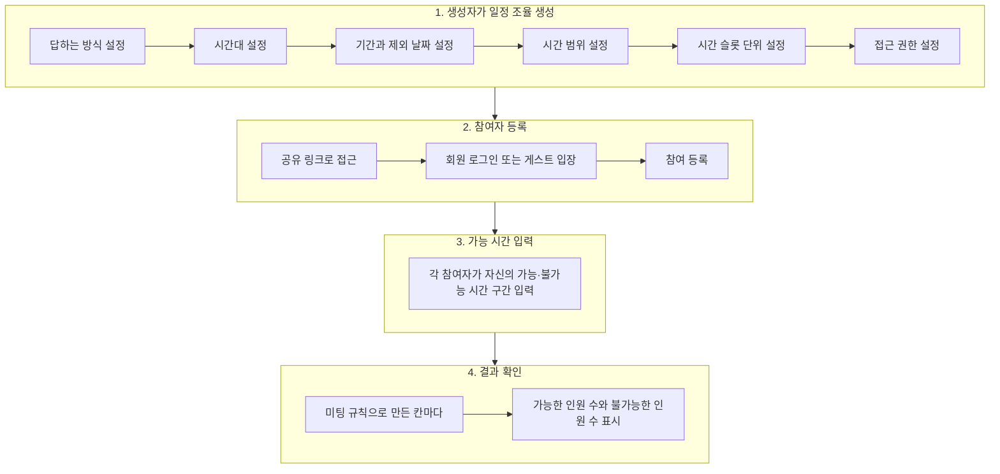

# Meeting (일정 조율) API 가이드 (프론트엔드 개발자용)

> **최종 업데이트**: 2026-11-17

## 개요

Meeting(일정 조율) API는 여러 참여자가 공통으로 가능한 시간대를 찾아 회의 일정을 조율하는 기능을 제공합니다.

### 주요 기능



### 접근 권한

| 레벨 | 설명 |
|------|------|
| `public` | 링크(미팅 id)를 아는 누구나 로그인 없이 미팅 정보와 결과를 볼 수 있다. 참여와 참여자별 가능 시간은 회원이나 그 미팅의 게스트만. 미팅 목록은 자기 미팅만 돌려주므로 다른 회원의 목록에는 나오지 않는다 |
| `allowed_emails` | 허용된 이메일/도메인 사용자만 접근 가능 |
| `private` | 생성자만 접근 가능 (기본값) |

미팅 경로를 부르는 쪽은 회원, 그 미팅의 [게스트](#게스트-계정), 로그인하지 않은 방문자입니다.

| 경로 | 로그인하지 않은 방문자 | 회원 | 그 미팅의 게스트 |
|------|------------------------|------|------------------|
| `GET /v1/meetings/{id}`, `GET /v1/meetings/{id}/result` | `public`이면 볼 수 있다 | 접근 권한이 있으면 | 게스트 상태가 `OPEN`이면 |
| `GET /v1/meetings/{id}/availability` | `401` | 접근 권한이 있으면 | 게스트 상태가 `OPEN`이면 |
| `POST /v1/meetings/{id}/participate`, `PUT /v1/meetings/{id}/availability` | `401` | 접근 권한이 있으면 | 게스트 상태가 `OPEN`이면 |
| `POST /v1/meetings`, `GET /v1/meetings`, `PATCH`·`DELETE /v1/meetings/{id}`, `DELETE /v1/meetings/{id}/participants/{participant_id}` | `401` | 회원 (수정·삭제·참여자 빼기는 생성자만) | `403` |

- 접근할 수 없는 미팅은 없는 미팅과 같은 `404` `MeetingNotFoundError`를 받습니다. 회원은 조회, 참여 등록, 가능 시간 조회·설정, 결과 조회가 모두 같고, 수정·삭제·참여자 빼기는 생성자만 할 수 있어 다른 회원에게는 같은 `404`입니다([공개 범위 가이드](./visibility.ko.md#접근-제어-규칙)).
- 로그인하지 않은 방문자도 `public`이 아니거나 생성자가 탈퇴를 신청한(휴면) 미팅은 없는 미팅과 같은 `404`입니다.
- 로그인하지 않은 방문자의 `401`은 미팅이 있든 없든 같습니다.
- 토큰을 보냈는데 검증에 실패하면 로그인하지 않은 방문자로 보지 않고 `401`입니다.
- 로그인하지 않은 방문자와 게스트의 응답에는 회원의 sub가 없습니다. 미팅의 `owner_id`와 참여자의 `user_id`가 `null`입니다. 참여자 이름과 참여자별 가능 시간은 로그인하지 않은 방문자에게 보이지 않고, 결과의 칸마다 인원 수와 참여자 수(`participant_count`)만 보입니다.

### 게스트 계정

[게스트 계정](./guest.ko.md)은 회원 가입 없이 리소스 하나에 속한 계정입니다. 미팅은 게스트를 받는 리소스입니다. 게스트를 만들 때 `resource_type: "meeting"`, `resource_id`에 미팅 id를 보냅니다.

미팅의 게스트 상태는 요청마다 미팅에서 읽습니다(`app/domain/meeting/guest_host.py`).

| 게스트 상태 | 미팅 | 게스트 |
|-------------|------|--------|
| `OPEN` | `allow_guests`가 `true`이고, 공개 범위가 `public`이고, 생성자가 휴면 계정이 아니고, 게스트 기간 안이다 | 이름 찾기·생성·로그인과 위 표의 게스트 경로를 쓴다 |
| `CLOSED` | `allow_guests`가 `false`이거나, 공개 범위가 `public`이 아니거나, 생성자가 휴면 계정이다 | 모두 `403`. 게스트와 참여자·가능 시간은 남고, `OPEN`으로 돌아오면 그대로 쓴다 |
| `EXPIRED` | 게스트 기간이 끝났다 | `403`이고 게스트를 폐기한다 |
| `MISSING` | 미팅이 없다 (삭제, 생성자 파기) | `403`이고 게스트를 폐기한다 |

- 게스트 기간은 미팅 `timezone`으로 `end_date` + 31일 0시 전까지(`end_date`가 끝난 뒤 30일)입니다. 예: `Asia/Seoul`, `end_date` `2026-01-10`이면 `2026-02-10T00:00:00+09:00`부터 `EXPIRED`입니다. `end_date`를 바꾸면 기간도 바뀝니다. `EXPIRED`는 `CLOSED`보다 먼저 판정합니다.
- 게스트 허용(`allow_guests`)은 공개 범위가 `public`일 때만 `true`로 바꿀 수 있습니다. 새 미팅은 공개 범위 설정이 없어(`private`) 생성 요청에 `true`를 보내면 `422`입니다. 만든 뒤 공개 범위를 `public`으로 정하고 `PATCH`로 켭니다. 켠 뒤 공개 범위를 바꿔도 값은 그대로이고 게스트는 `CLOSED`입니다.
- 미팅을 지우면 삭제를 커밋한 뒤 그 미팅의 게스트를 모두 폐기합니다. 생성자가 파기되면 미팅이 지워지고, 같은 하루 한 번 실행이 그 게스트를 폐기합니다([게스트 수명 주기](./guest.ko.md#수명-주기)).
- 게스트가 폐기되면(자기 삭제 포함) 그 게스트의 참여자와 가능 시간이 함께 지워집니다. 생성자가 게스트 참여자를 빼면 그 게스트를 폐기합니다([참여자 빼기](#참여자-빼기)).
- 게스트 참여자의 표시 이름은 게스트 이름입니다. 게스트가 이름을 바꾸면 참여자 표시 이름도 바뀝니다.
- 게스트 토큰의 판정 순서(`GUEST_ENABLED`, 약관 동의 `428`, 게스트 행, 미팅, 게스트 상태)는 [게스트 경로의 토큰 판정](./guest.ko.md#게스트-경로)과 같습니다. 다른 미팅의 게스트도 `403`입니다. 미팅 경로는 Turnstile 토큰을 받지 않습니다.

---

## 데이터 모델

### 시간 규칙

- 모든 구간은 반열린 구간 `[start, end)`입니다. 끝 시각은 포함하지 않습니다.
- 미팅의 `start_date`, `end_date`, `excluded_dates`, `start_time`, `end_time`은 미팅 `timezone`(IANA 이름, 예: `Asia/Seoul`)의 벽시계 값입니다.
- 미팅 날짜는 `start_date`~`end_date`에서 `excluded_dates`를 뺀 날입니다. 첫날과 마지막 날은 언제나 미팅 날짜입니다.
- 미팅의 `end_time`이 `00:00:00`이면 다음 날 00:00, 곧 하루의 끝입니다. 하루 전체는 `start_time: "00:00:00"`, `end_time: "00:00:00"`입니다.
- 가능 시간(TimeSlot)은 칸이 아니라 시각 구간이고, 종류(`kind`)가 가능(`available`) 또는 불가능(`unavailable`)입니다. 받은 구간을 UTC로 바꿔 그대로 저장하고, 미팅의 날짜·하루 범위·시간 단위와 맞추거나 나누거나 합치지 않습니다.
- 칸(그리드)은 결과 조회에서만 쓰입니다. 미팅 규칙으로 칸을 만들고, 칸마다 그 칸을 모두 덮는 가능 구간을 가진 참여자 수와 불가능 구간을 가진 참여자 수를 셉니다.

### 답하는 방식 (mode)

`mode`는 참여자가 미팅에 답하는 방식이고, 프론트엔드는 이 값으로 화면을 정합니다. 다른 필드로 방식을 짐작하지 않습니다.

| `mode` | 참여자가 고르는 것 | 미팅 규칙 |
|--------|--------------------|-----------|
| `hourly` | 미팅 날짜와 하루 범위 안의 시간 | 기간은 7일 이하 (`end_date - start_date <= 6`) |
| `daily` | 미팅 날짜. 하루 전체가 한 답 | 하루 범위는 하루 전체 (`start_time`, `end_time` 모두 `00:00:00`) |
| `weekly` | 요일 (매주 반복) | 기간은 정확히 7일, `excluded_dates`는 빈 목록, 하루 범위는 하루 전체 |

- 세 방식 모두 가능 시간은 같은 시각 구간으로 저장하고 결과도 같은 칸으로 셉니다. `time_slot_minutes`도 방식과 상관없이 씁니다.
- `weekly` 미팅의 요일은 7일 기간의 각 날짜입니다. 요일에 답하면 기간 안에서 그 요일인 날짜에 구간을 넣습니다.
- `mode`를 바꿔도 저장된 날짜와 참여자의 가능 시간은 바뀌지 않습니다. 수정 결과가 바뀐 방식의 규칙을 지켜야 합니다([일정 조율 수정](#일정-조율-수정)).

### Meeting (일정 조율)

```typescript
interface Meeting {
  id: string;                    // UUID
  owner_id: string | null;       // 생성자 ID. 로그인하지 않은 방문자와 게스트에게는 null
  title: string;                 // 제목
  description?: string;          // 설명
  start_date: string;            // 시작 날짜 (YYYY-MM-DD, timezone 기준). 언제나 미팅 날짜
  end_date: string;              // 종료 날짜 (YYYY-MM-DD, timezone 기준, 포함). 언제나 미팅 날짜
  excluded_dates: string[];      // 기간에서 빼는 날짜 (YYYY-MM-DD, 오름차순)
  timezone: string;              // IANA 시간대 이름 (예: "Asia/Seoul")
  mode: MeetingMode;             // 답하는 방식: "hourly" | "daily" | "weekly"
  start_time: string;            // 하루 시작 시간 (HH:MM:SS, timezone 기준)
  end_time: string;              // 하루 종료 시간 (HH:MM:SS, 포함하지 않음, "00:00:00"이면 하루의 끝)
  time_slot_minutes: number;     // 결과 그리드의 칸 길이 (분)
  allow_guests: boolean;         // 게스트를 받는지
  created_at: string;            // 생성 시간 (ISO 8601)
  updated_at: string;            // 수정 시간 (ISO 8601)
  visibility_level?: string;     // 접근권한 레벨
  is_shared: boolean;            // 공유된 리소스인지
}
```

### Participant (참여자)

```typescript
interface Participant {
  id: string;                    // UUID
  meeting_id: string;            // 일정 조율 ID
  user_id?: string | null;       // 회원 참여자의 사용자 ID. 게스트 참여자와 게스트가 받는 응답에서는 null
  display_name: string;          // 표시 이름. 게스트 참여자는 게스트 이름
  created_at: string;            // 등록 시간
  is_owner: boolean;             // 미팅 생성자의 참여자인지
  is_guest: boolean;             // 게스트 참여자인지
}
```

### TimeSlot (가능 시간)

```typescript
interface TimeSlot {
  id: string;                    // UUID
  participant_id: string;        // 참여자 ID
  start_time: string;            // 시작 시각 (ISO 8601)
  end_time: string;              // 끝 시각 (ISO 8601, 포함하지 않음)
  kind: TimeSlotKind;            // "available"(가능) | "unavailable"(불가능)
}
```

### AvailabilityCell (결과 그리드의 칸)

```typescript
// 결과 조회 시 반환되는 칸. 시작 시각 순
interface AvailabilityCell {
  start_time: string;  // 칸 시작 시각 (ISO 8601)
  end_time: string;    // 칸 끝 시각 (ISO 8601, 포함하지 않음)
  count: number;              // 이 칸을 모두 덮는 가능(available) 구간을 가진 참여자 수
  unavailable_count: number;  // 이 칸을 모두 덮는 불가능(unavailable) 구간을 가진 참여자 수
}

// 예시 (Asia/Seoul 미팅, 09:00–10:00, 30분, ?timezone=Asia/Seoul)
const grid: AvailabilityCell[] = [
  { start_time: "2024-02-05T09:00:00+0900", end_time: "2024-02-05T09:30:00+0900", count: 3, unavailable_count: 0 },
  { start_time: "2024-02-05T09:30:00+0900", end_time: "2024-02-05T10:00:00+0900", count: 2, unavailable_count: 1 },
  { start_time: "2024-02-06T09:00:00+0900", end_time: "2024-02-06T09:30:00+0900", count: 0, unavailable_count: 2 },
];
```

---

## API 엔드포인트

### 일정 조율 관리

#### 일정 조율 생성

**POST /v1/meetings**

```typescript
// Request
interface MeetingCreate {
  title: string;
  description?: string;
  mode: MeetingMode;            // "hourly" | "daily" | "weekly" (필수)
  start_date: string;           // "2024-02-01"
  end_date: string;             // "2024-02-07"
  excluded_dates?: string[];    // [] (기본값). ["2024-02-03", "2024-02-04"]이면 그날을 뺀다
  timezone: string;             // "Asia/Seoul" (필수)
  start_time: string;           // "09:00:00"
  end_time: string;             // "18:00:00", 하루의 끝까지면 "00:00:00"
  time_slot_minutes?: number;   // 30 (기본값)
  allow_guests?: boolean;       // false (기본값). true는 422 (새 미팅은 공개 범위가 private)
}
// 공개 범위는 만든 뒤 PUT /v1/visibility/meeting/{id}로 정한다

// Response: Meeting
```

**예시:**

```json
{
  "title": "팀 회의 일정 조율",
  "description": "다음 주 회의 일정을 조율합니다",
  "mode": "hourly",
  "start_date": "2024-02-01",
  "end_date": "2024-02-07",
  "excluded_dates": ["2024-02-03", "2024-02-04"],
  "timezone": "Asia/Seoul",
  "start_time": "09:00:00",
  "end_time": "18:00:00",
  "time_slot_minutes": 30
}
```

**입력 제한** (어기면 422):

| 필드 | 규칙 |
|------|------|
| `title` | 앞뒤 공백을 뺀 1–200자 (앞뒤 공백은 빼고 저장) |
| `description` | 2000자 이하 |
| `mode` | 필수. `hourly`, `daily`, `weekly` 중 하나. 방식의 [미팅 규칙](#답하는-방식-mode)을 지켜야 한다 |
| `start_date`, `end_date` | `start_date <= end_date <= start_date + 3개월`. 3개월 뒤 같은 날이 없으면 그 달 말일 (예: 2024-11-30 → 2025-02-28) |
| `excluded_dates` | `start_date`보다 뒤이고 `end_date`보다 앞인 날짜만(첫날·마지막 날은 뺄 수 없다), 중복 불가. 오름차순으로 저장 |
| `timezone` | 필수. IANA 시간대 이름 (예: `Asia/Seoul`, `America/New_York`, `UTC`). `+09:00` 같은 오프셋 문자열은 받지 않음 |
| `start_time`, `end_time` | `start_time < end_time`, 또는 `end_time`이 `00:00:00`(하루의 끝) |
| `time_slot_minutes` | 5–1440이면서 하루 범위 이하. 하루 범위는 `end_time - start_time`이고, `end_time`이 `00:00:00`이면 24:00까지 |
| `allow_guests` | `false`만 받는다. `true`는 `422` `InvalidMeetingError` ([게스트 계정](#게스트-계정)) |

하루 전체를 한 칸으로 쓰려면 `start_time: "00:00:00"`, `end_time: "00:00:00"`, `time_slot_minutes: 1440`을 보냅니다.
목록에 없는 필드는 읽지 않습니다.

#### 일정 조율 목록 조회 (내 것만)

**GET /v1/meetings**

쿼리 파라미터:
- `timezone` (optional): 타임존 (예: `+09:00`, `Asia/Seoul`)

```typescript
// Response: Meeting[]
```

#### 일정 조율 상세 조회

**GET /v1/meetings/{meeting_id}**

인증 선택. 로그인하지 않은 방문자와 게스트는 `public` 미팅을 보고, 응답의 `owner_id`는 `null`입니다([접근 권한](#접근-권한)).

쿼리 파라미터:
- `timezone` (optional): 타임존

```typescript
// Response: Meeting
```

#### 일정 조율 수정

**PATCH /v1/meetings/{meeting_id}**

```typescript
// Request
interface MeetingUpdate {
  title?: string;
  description?: string;
  mode?: MeetingMode;
  start_date?: string;
  end_date?: string;
  excluded_dates?: string[];
  timezone?: string;
  start_time?: string;
  end_time?: string;
  time_slot_minutes?: number;
  allow_guests?: boolean;
}

// Response: Meeting
```

보내지 않은 필드는 저장된 값을 씁니다. `mode`·`excluded_dates`·`timezone`·`allow_guests`에 `null`을 보내면 422이고, 그 밖의 필드(`description` 제외)에 `null`을 보내면 무시합니다. 제외 날짜를 모두 없애려면 `excluded_dates: []`를 보냅니다.
`allow_guests: true`는 공개 범위가 `public`일 때만 받습니다. 아니면 `422` `InvalidMeetingError`이고 미팅을 바꾸지 않습니다(같이 보낸 다른 필드도). `false`는 언제든 받습니다.
미팅을 수정해도(`mode`를 바꿔도) 저장된 가능 시간은 바뀌지 않습니다. 결과 그리드만 새 규칙(시간대·날짜·제외 날짜·하루 범위·시간 단위)으로 다시 만들어집니다.
저장된 값에 수정 내용을 합친 미팅이 생성의 입력 제한이나 방식의 규칙을 어기면 422를 반환하고 미팅을 바꾸지 않습니다
(예: `start_time`만 저장된 `end_time` 이후로 바꾸는 경우, 기간을 바꿔 저장된 제외 날짜가 첫날·마지막 날이 되거나 기간 밖으로 나가는 경우,
`hourly` 미팅의 기간을 8일 이상으로 늘리는 경우). 기간과 제외 날짜, 방식과 기간·하루 범위처럼 함께 맞춰야 하는 값은 한 요청에 보냅니다.
방식의 규칙은 규칙이 읽는 필드(`mode`, `start_date`, `end_date`, `excluded_dates`, `start_time`, `end_time`) 중 하나라도 저장된 값과 달라질 때만 봅니다. 저장된 값과 같은 값을 보내면 바꾼 것으로 보지 않습니다.
그래서 방식의 규칙을 어기는 저장된 미팅(규칙보다 먼저 만든 미팅)도 `title`, `description`, `timezone`, `time_slot_minutes`, `allow_guests`만 바꾸는 수정은 받고, 규칙이 읽는 필드를 바꾸는 수정은 결과가 규칙을 지킬 때만 받습니다. 입력 제한(제외 날짜는 기간 안쪽, 날짜·시간 순서, 시간 단위, 기간 3개월)은 모든 수정에서 봅니다.

#### 일정 조율 삭제

**DELETE /v1/meetings/{meeting_id}**

```typescript
// Response: 204 No Content
```

삭제를 커밋한 뒤 그 미팅의 게스트를 모두 폐기합니다.

---

### 참여자 관리

#### 참여자 등록

**POST /v1/meetings/{meeting_id}/participate**

```typescript
// Request
interface ParticipantCreate {
  display_name: string;
}

// Response: Participant
```

**예시:**

```json
{
  "display_name": "홍길동"
}
```

- 미팅마다 회원당·게스트당 참여자는 한 명입니다. 처음 등록하면 **201**과 새 참여자를 반환합니다.
- 이미 참여한 회원이 다시 등록하면 **200**과 기존 참여자를 반환하고, `display_name`을 보낸 값으로 바꿉니다. `id`와 입력한 가능 시간은 그대로입니다. 회원 참여자의 이름 변경은 이 요청으로 합니다.
- 게스트 참여자의 `display_name`은 보낸 값과 상관없이 게스트 이름입니다. 다시 등록하면 **200**과 기존 참여자를 반환합니다. 이름은 [게스트 이름 변경](./guest.ko.md#이름-변경)으로 바꾸고, 바꾸면 참여자 이름도 바뀝니다. 본문은 회원과 같은 규칙으로 검사합니다.
- `display_name`은 앞뒤 공백을 뺀 1–50자이고 제어 문자(줄바꿈·탭 포함)는 쓸 수 없습니다 (어기면 422). 한글·이모지는 쓸 수 있고, 길이는 유니코드 코드 포인트 수로 셉니다.
- 응답의 `is_owner`는 미팅 생성자의 참여자인지, `is_guest`는 게스트 참여자인지입니다.

#### 참여자 빼기

**DELETE /v1/meetings/{meeting_id}/participants/{participant_id}**

```typescript
// Response: 200
{ "ok": true }
```

- 생성자만 뺄 수 있고, 자기 참여자도 뺄 수 있습니다. 다른 회원은 미팅에 접근할 수 있어도 없는 미팅과 같은 `404` `MeetingNotFoundError`입니다. 게스트 토큰은 `403`, 토큰이 없으면 `401`입니다.
- 그 미팅의 참여자가 아니거나 이미 뺀 참여자는 `404` `MeetingParticipantNotFoundError`입니다.
- 참여자와 그 가능 시간이 지워져 결과의 `participant_count`와 칸의 인원 수에서 빠집니다.
- 뺀 회원은 다시 참여 등록할 수 있고, 새 참여자(`id`가 다르고 가능 시간이 없다)가 됩니다.
- 게스트 참여자를 빼면 그 게스트를 폐기합니다. 게스트 자기 삭제와 같이 게스트 행과 Kratos identity를 지우고(identity 삭제가 실패하면 로그만 남긴다), 그 게스트의 토큰은 게스트 경로에서 `403`입니다([게스트 수명 주기](./guest.ko.md#수명-주기)). 게스트 상태가 `OPEN`이 아니어도 뺄 수 있습니다.

---

### 가능 시간 관리

#### 가능 시간 설정/업데이트

**PUT /v1/meetings/{meeting_id}/availability**

쿼리 파라미터:
- `participant_id` (required): 참여자 ID. 본인의 참여자만 설정할 수 있고(게스트는 자기 게스트 참여자), 다른 회원·게스트의 참여자 ID는 없는 참여자 ID와 같은 `404` `MeetingParticipantNotFoundError`입니다
- `timezone` (optional): 응답 시각의 시간대

```typescript
// Request
interface TimeSlotCreate {
  start_time: string;          // ISO 8601 시각. 오프셋이 없으면 UTC
  end_time: string;            // ISO 8601 시각, 포함하지 않음
  kind?: TimeSlotKind;         // "available"(기본값) | "unavailable"
}

// Request Body: TimeSlotCreate[]

// Response: TimeSlot[]
```

**예시:**

```json
[
  {
    "start_time": "2024-02-02T09:00:00+09:00",
    "end_time": "2024-02-02T12:00:00+09:00"
  },
  {
    "start_time": "2024-02-05T14:07:00+09:00",
    "end_time": "2024-02-06T10:00:00+09:00"
  },
  {
    "start_time": "2024-02-06T13:00:00+09:00",
    "end_time": "2024-02-06T15:00:00+09:00",
    "kind": "unavailable"
  }
]
```

**응답 예시** (`?timezone=Asia/Seoul`):

```json
[
  { "id": "uuid-1", "participant_id": "uuid-p", "start_time": "2024-02-02T09:00:00+0900", "end_time": "2024-02-02T12:00:00+0900", "kind": "available" },
  { "id": "uuid-2", "participant_id": "uuid-p", "start_time": "2024-02-05T14:07:00+0900", "end_time": "2024-02-06T10:00:00+0900", "kind": "available" },
  { "id": "uuid-3", "participant_id": "uuid-p", "start_time": "2024-02-06T13:00:00+0900", "end_time": "2024-02-06T15:00:00+0900", "kind": "unavailable" }
]
```

- 요청 목록이 그 참여자의 가능 시간 전체가 됩니다.
- 구간은 받은 그대로(UTC로 바꿔서) 저장합니다. 미팅의 날짜·하루 범위·칸 경계에 맞는지 검사하지 않고, 칸으로 나누거나 겹치는 구간을 합치지도 않습니다. 여러 날에 걸친 구간도 한 행입니다.
- `end_time`이 `start_time`보다 뒤가 아니면 422입니다.
- `kind`를 보내지 않은 구간은 `available`입니다. `available`·`unavailable` 밖의 값은 422입니다.
- 한 요청 안에서 `available` 구간과 `unavailable` 구간이 겹치면 422입니다(저장된 가능 시간은 그대로). 맞닿는 것(앞 구간의 끝 = 뒤 구간의 시작)은 받습니다. 같은 종류의 구간끼리는 겹쳐도 받습니다.
- 한 요청의 구간 수는 두 종류를 합쳐 미팅의 칸 수까지입니다 (넘으면 422, 저장된 가능 시간은 그대로).
  칸 수 = 미팅 날짜 수(기간의 날 수 - `excluded_dates` 수) × 하루 범위(분) ÷ `time_slot_minutes`, 올림.
  예: 5일 × 09:00–18:00 / 30분 = 90, 하루 × 00:00–00:00 / 30분 = 48.
- 같은 구간을 여러 번 보내면 보낸 만큼 저장되고, 개수 제한에도 그만큼 셉니다.

#### 전체 가능 시간 조회

**GET /v1/meetings/{meeting_id}/availability**

쿼리 파라미터:
- `timezone` (optional): 타임존

```typescript
// Response
interface AvailabilityRead {
  participant: Participant;
  time_slots: TimeSlot[];
}

// Response: AvailabilityRead[]
```

참여자의 `created_at`과 가능 시간의 `start_time`·`end_time`을 `timezone` 쿼리의 시간대로 반환합니다. 가능 시간마다 `kind`가 있습니다.
로그인이 필요합니다(로그인하지 않은 방문자는 `401`). 게스트가 받는 응답에서는 모든 참여자의 `user_id`가 `null`이고, 역할은 `is_owner`·`is_guest`로 가립니다. 휴면 회원의 참여자는 빠집니다.

---

### 결과 조회

#### 공통 가능 시간 분석

**GET /v1/meetings/{meeting_id}/result**

쿼리 파라미터:
- `timezone` (optional): 응답 시각의 시간대. 칸을 만드는 데는 쓰지 않습니다

인증 선택. 로그인하지 않은 방문자와 게스트는 `public` 미팅의 결과를 보고, `meeting.owner_id`는 `null`입니다.

```typescript
// Response
interface MeetingResult {
  meeting: Meeting;
  participant_count: number;   // 참여자 수. 휴면 회원 제외, 가능 시간을 넣지 않은 참여자 포함
  availability_grid: AvailabilityCell[];
}
```

`participant_count`는 누가 부르든 같습니다.

칸은 미팅의 시간대에서 만듭니다.

- 미팅 날짜(`start_date`~`end_date`에서 `excluded_dates`를 뺀 날)마다 `start_time`부터 `end_time`(`00:00:00`이면 다음 날 00:00)까지를 실제 시각으로 바꾸고, 그 사이를 `time_slot_minutes`마다 나눕니다. 하루 범위가 나누어떨어지지 않으면 마지막 칸은 하루 범위의 끝에서 끝납니다. 제외 날짜에는 칸이 없습니다.
- 일광 절약 시간이 바뀌는 날도 칸은 이어지는 실제 시각입니다. 예: `America/New_York` 2024-03-10의 00:00–00:00 / 60분은 23칸이고, 01:00 칸 다음은 03:00 칸입니다.
- `count`: 한 참여자의 `available` 구간을 합친 구간이 칸을 모두 덮으면 그 칸에서 한 명으로 셉니다. 예: 09:00–09:15와 09:15–09:30을 함께 보낸 참여자는 09:00–09:30 칸에 셉니다. 칸의 일부만 덮으면 세지 않고, 겹치거나 같은 구간을 여러 번 보내도 한 번만 셉니다.
- `unavailable_count`: `unavailable` 구간을 같은 방법으로 셉니다. 한 참여자의 두 종류 구간은 겹치지 않으므로 한 칸에서 한 참여자는 많아야 한쪽에 들어갑니다. 어느 구간도 칸을 모두 덮지 않은 참여자는 어느 쪽에도 들어가지 않습니다.
- 칸 밖의 가능 시간은 결과에 나타나지 않습니다.

**응답 예시** (`?timezone=Asia/Seoul`):

```json
{
  "meeting": {
    "id": "uuid-here",
    "title": "팀 회의 일정 조율",
    "start_date": "2024-02-02",
    "end_date": "2024-02-05",
    "excluded_dates": ["2024-02-03", "2024-02-04"],
    "timezone": "Asia/Seoul",
    "mode": "hourly",
    "start_time": "09:00:00",
    "end_time": "10:00:00",
    "time_slot_minutes": 30,
    "allow_guests": false
  },
  "participant_count": 3,
  "availability_grid": [
    { "start_time": "2024-02-02T09:00:00+0900", "end_time": "2024-02-02T09:30:00+0900", "count": 3, "unavailable_count": 0 },
    { "start_time": "2024-02-02T09:30:00+0900", "end_time": "2024-02-02T10:00:00+0900", "count": 2, "unavailable_count": 1 },
    { "start_time": "2024-02-05T09:00:00+0900", "end_time": "2024-02-05T09:30:00+0900", "count": 2, "unavailable_count": 0 },
    { "start_time": "2024-02-05T09:30:00+0900", "end_time": "2024-02-05T10:00:00+0900", "count": 0, "unavailable_count": 2 }
  ]
}
```

---

## TypeScript 타입 정의

```typescript
// ===== 열거형 =====
type MeetingMode = "hourly" | "daily" | "weekly";
type TimeSlotKind = "available" | "unavailable";

// ===== 접근권한 설정 =====
interface VisibilitySettings {
  level: "private" | "public" | "allowed_emails";
  allowed_emails?: string[];    // ALLOWED_EMAILS 레벨에서만
  allowed_domains?: string[];   // ALLOWED_EMAILS 레벨에서만
}

// ===== Meeting 타입 =====
interface Meeting {
  id: string;
  owner_id: string | null;
  title: string;
  description?: string;
  start_date: string;
  end_date: string;
  excluded_dates: string[];
  timezone: string;
  mode: MeetingMode;
  start_time: string;
  end_time: string;
  time_slot_minutes: number;
  allow_guests: boolean;
  created_at: string;
  updated_at: string;
  visibility_level?: string;
  is_shared: boolean;
}

interface MeetingCreate {
  title: string;
  description?: string;
  mode: MeetingMode;
  start_date: string;
  end_date: string;
  excluded_dates?: string[];
  timezone: string;
  start_time: string;
  end_time: string;
  time_slot_minutes?: number;
  allow_guests?: boolean;
}

interface MeetingUpdate {
  title?: string;
  description?: string;
  mode?: MeetingMode;
  start_date?: string;
  end_date?: string;
  excluded_dates?: string[];
  timezone?: string;
  start_time?: string;
  end_time?: string;
  time_slot_minutes?: number;
  allow_guests?: boolean;
}

// ===== Participant 타입 =====
interface Participant {
  id: string;
  meeting_id: string;
  user_id?: string | null;
  display_name: string;
  created_at: string;
  is_owner: boolean;
  is_guest: boolean;
}

interface ParticipantCreate {
  display_name: string;
}

// ===== TimeSlot 타입 =====
interface TimeSlot {
  id: string;
  participant_id: string;
  start_time: string;  // ISO 8601
  end_time: string;    // ISO 8601, 포함하지 않음
  kind: TimeSlotKind;
}

interface TimeSlotCreate {
  start_time: string;  // ISO 8601, 오프셋이 없으면 UTC
  end_time: string;
  kind?: TimeSlotKind; // 기본값 "available"
}

// ===== 결과 타입 =====
interface AvailabilityCell {
  start_time: string;  // ISO 8601
  end_time: string;    // ISO 8601, 포함하지 않음
  count: number;
  unavailable_count: number;
}

interface AvailabilityRead {
  participant: Participant;
  time_slots: TimeSlot[];
}

interface MeetingResult {
  meeting: Meeting;
  participant_count: number;
  availability_grid: AvailabilityCell[];
}
```

---

## 사용 시나리오

### 1. 일정 조율 생성 및 공유

```typescript
// 일정 조율 생성
async function createMeeting(data: MeetingCreate): Promise<Meeting> {
  const response = await fetch('/v1/meetings', {
    method: 'POST',
    headers: { 'Content-Type': 'application/json' },
    body: JSON.stringify(data),
  });
  
  if (!response.ok) {
    throw new Error('Failed to create meeting');
  }
  
  return response.json();
}

// 사용 예시
const meeting = await createMeeting({
  title: "프로젝트 킥오프 미팅",
  description: "전체 팀원이 참석 가능한 시간을 찾습니다",
  mode: "hourly",
  start_date: "2024-02-05",
  end_date: "2024-02-09",  // hourly는 7일 이하
  excluded_dates: ["2024-02-07"],
  timezone: "Asia/Seoul",
  start_time: "09:00:00",
  end_time: "18:00:00",
  time_slot_minutes: 60,
});

// 공개 범위 설정 (회사 이메일만 허용)
await fetch(`/v1/visibility/meeting/${meeting.id}`, {
  method: 'PUT',
  headers: { 'Content-Type': 'application/json' },
  body: JSON.stringify({ level: "allowed_emails", allowed_domains: ["company.com"] }),
});

// 공유 링크 생성
const shareUrl = `${window.location.origin}/meetings/${meeting.id}`;
```

### 2. 참여자 등록 및 시간 입력

```typescript
// 참여자 등록
async function registerParticipant(
  meetingId: string,
  displayName: string
): Promise<Participant> {
  const response = await fetch(`/v1/meetings/${meetingId}/participate`, {
    method: 'POST',
    headers: { 'Content-Type': 'application/json' },
    body: JSON.stringify({ display_name: displayName }),
  });
  
  return response.json();
}

// 가능 시간 설정
async function setAvailability(
  meetingId: string,
  participantId: string,
  timeSlots: TimeSlotCreate[]
): Promise<TimeSlot[]> {
  const response = await fetch(
    `/v1/meetings/${meetingId}/availability?participant_id=${participantId}`,
    {
      method: 'PUT',
      headers: { 'Content-Type': 'application/json' },
      body: JSON.stringify(timeSlots),
    }
  );
  
  return response.json();
}

// 사용 예시
const participant = await registerParticipant(meeting.id, "홍길동");

await setAvailability(meeting.id, participant.id, [
  { start_time: "2024-02-05T09:00:00+09:00", end_time: "2024-02-05T12:00:00+09:00" },
  { start_time: "2024-02-05T14:00:00+09:00", end_time: "2024-02-05T17:00:00+09:00", kind: "unavailable" },
  { start_time: "2024-02-06T10:00:00+09:00", end_time: "2024-02-06T15:00:00+09:00" },
]);
```

### 3. 결과 확인

```typescript
async function getMeetingResult(meetingId: string, timezone: string): Promise<MeetingResult> {
  const params = new URLSearchParams({ timezone });
  const response = await fetch(`/v1/meetings/${meetingId}/result?${params}`);
  return response.json();
}

// 사용 예시
const result = await getMeetingResult(meeting.id, meeting.timezone);

// 가장 많은 사람이 가능한 칸 찾기
function findBestSlots(grid: AvailabilityCell[], minParticipants: number = 1) {
  return grid
    .filter((cell) => cell.count >= minParticipants)
    .sort((a, b) => b.count - a.count);
}

const bestSlots = findBestSlots(result.availability_grid, 2);
console.log("2명 이상 가능한 시간대:", bestSlots);
```

---

## UI/UX 가이드라인

### 시간 그리드 표시

```
┌─────────────────────────────────────────────────────────────────────┐
│  2024년 2월                                                         │
├─────────┬─────────┬─────────┬─────────┬─────────┬─────────┬────────┤
│         │ 월(5)   │ 화      │ 수(7)   │ 목      │ 금(2)   │ 토     │
├─────────┼─────────┼─────────┼─────────┼─────────┼─────────┼────────┤
│ 09:00   │ ███ 3   │         │ ███ 3   │         │ ██ 2    │        │
│ 09:30   │ ███ 3   │         │ ███ 3   │         │ ██ 2    │        │
│ 10:00   │ ██ 2    │         │ ████ 4  │         │ █ 1     │        │
│ 10:30   │ ██ 2    │         │ ████ 4  │         │ █ 1     │        │
│ 11:00   │ █ 1     │         │ ███ 3   │         │ ░ 0     │        │
│ 11:30   │ █ 1     │         │ ███ 3   │         │ ░ 0     │        │
│ ...     │ ...     │         │ ...     │         │ ...     │        │
└─────────┴─────────┴─────────┴─────────┴─────────┴─────────┴────────┘

범례: ████ 모든 참여자 가능  ░░░ 아무도 불가능
```

### 방식별 화면

- `hourly`: 위처럼 미팅 날짜 × 하루 범위의 칸 그리드입니다. 제외 날짜는 칸이 없습니다.
- `daily`: 미팅 날짜를 고르는 달력입니다. 한 날짜의 답은 그날 00:00부터 다음 날 00:00까지의 구간 하나로 보내면 그날의 모든 칸에 셉니다.
- `weekly`: 7일 기간의 날짜를 요일로 보여 줍니다. 요일의 답은 기간 안에서 그 요일인 날짜의 하루 전체 구간입니다.
- 세 방식 모두 참여자는 가능(`available`)과 불가능(`unavailable`)을 고를 수 있고, 결과의 `unavailable_count`로 안 되는 사람 수를 보여 줄 수 있습니다.

### 색상 가이드

| 상태 | 색상 | 설명 |
|------|------|------|
| 모든 참여자 가능 | 🟢 진한 녹색 | count == 총 참여자 수 |
| 대부분 가능 | 🟡 연한 녹색 | count >= 총 참여자 수 * 0.7 |
| 일부 가능 | 🟠 노란색 | count >= 총 참여자 수 * 0.3 |
| 소수 가능 | 🔴 연한 빨간색 | count > 0 |
| 불가능 | ⚪ 회색 | count == 0 |

`unavailable_count`는 그 칸이 안 된다고 답한 참여자 수입니다. `participant_count - count - unavailable_count`는 그 칸에 답하지 않은 참여자 수입니다.

### 참여자 선택 UI

```typescript
// 시간 슬롯 선택 컴포넌트 예시
function TimeSlotSelector({
  meeting,
  participantId,
  onSave,
}: {
  meeting: Meeting;
  participantId: string;
  onSave: (slots: TimeSlotCreate[]) => void;
}) {
  const [selectedSlots, setSelectedSlots] = useState<Set<string>>(new Set());

  // 클릭 또는 드래그로 시간 선택
  const handleSlotClick = (date: string, time: string) => {
    const key = `${date}_${time}`;
    const newSlots = new Set(selectedSlots);
    
    if (newSlots.has(key)) {
      newSlots.delete(key);
    } else {
      newSlots.add(key);
    }
    
    setSelectedSlots(newSlots);
  };

  // 선택한 시간을 시각 구간(TimeSlotCreate)으로 변환. 칸에 맞출 필요는 없다
  const convertToTimeSlots = (): TimeSlotCreate[] => {
    // ... 선택을 [start, end) 구간 목록으로 바꾸는 로직
  };

  return (
    <div className="time-grid">
      {/* 날짜별 시간 그리드 렌더링 */}
    </div>
  );
}
```

---

## 에러 처리

### 에러 코드

| 코드 | 상황 | 설명 |
|------|------|------|
| `401` | 인증 필요 | 토큰이 유효하지 않다. 로그인이 필요한 경로([접근 권한](#접근-권한))에 토큰이 없다 |
| `403` | 게스트 토큰 | 다른 미팅의 게스트, 게스트 상태가 `OPEN`이 아님, 폐기된 게스트, 회원만 쓰는 미팅 경로 ([게스트 계정](#게스트-계정)) |
| `404` | 찾을 수 없음 | 존재하지 않거나 접근할 수 없는 일정 조율, 없거나 본인 것이 아닌 참여자, 참여자 빼기에서 그 미팅의 참여자가 아닌 참여자 |
| `422` | 입력 규칙 위반 | 필수 필드 누락, 잘못된 날짜·제외 날짜, 방식의 규칙 위반, 미팅 입력 제한·수정 결과 위반, 가능 구간과 불가능 구간이 겹침, 알 수 없는 `timezone`, `display_name` 규칙 위반, 가능 시간의 끝이 시작보다 뒤가 아님, 가능 시간 수가 칸 수 초과, 공개 범위가 `public`이 아닌데 `allow_guests: true` |
| `429` | 요청 한도 초과 | [레이트 리밋](../development/rate-limit.ko.md) |

요청 본문 하나만 보고 판단하는 422는 FastAPI 검증 오류 형식(`detail` 배열)입니다.
저장된 미팅과 함께 판단하는 422(수정 결과 위반·`allow_guests` `InvalidMeetingError`, 슬롯 수 초과 `TooManyTimeSlotsError`)는 `error_type`과 `message`가 있는 공통 오류 형식입니다.

### 에러 응답 예시

`404`는 아래 모양입니다. 존재하지 않는 일정 조율과 접근할 수 없는 일정 조율은 `error_id`·`timestamp`·`path` 밖의 값이 같습니다.

```json
{
  "error_id": "0f2c6f0e-...",
  "status_code": 404,
  "error_type": "MeetingNotFoundError",
  "message": "Meeting not found",
  "timestamp": "2026-01-01T00:00:00Z",
  "path": "/v1/meetings/6f1c2a9e-..."
}
```

요청 본문 하나만 보고 판단하는 `422`는 어느 필드가 왜 거절됐는지를 `detail` 목록으로 줍니다.

```json
{
  "detail": [
    {
      "type": "missing",
      "loc": ["body", "title"],
      "msg": "Field required"
    }
  ]
}
```

### 에러 처리 예시

```typescript
async function handleMeetingError(response: Response): Promise<never> {
  const error = await response.json();

  switch (response.status) {
    case 401:
      throw new Error('로그인이 필요합니다');
    case 404:
      throw new Error('일정 조율을 찾을 수 없습니다');
    case 422:
      throw new Error(`입력을 확인해 주세요: ${error.detail?.[0]?.msg ?? error.message ?? ''}`);
    default:
      throw new Error(error.message || '알 수 없는 오류가 발생했습니다');
  }
}
```

---

## 주의사항

### 1. 시간 형식

- 날짜: `YYYY-MM-DD` (예: `2024-02-01`)
- 미팅의 하루 시간: `HH:MM:SS` (예: `09:00:00`), 미팅 `timezone`의 벽시계 값
- 가능 시간·결과 칸·`created_at` 등 시각: ISO 8601 (예: `2024-02-02T09:00:00+0900`)

### 2. 타임존

- 미팅의 날짜·제외 날짜·하루 시간은 미팅 `timezone`으로 해석합니다.
- 가능 시간은 UTC 시각으로 저장합니다. 요청 시각에 오프셋이 없으면 UTC로 읽습니다.
- `timezone` 쿼리 파라미터는 응답의 시각(`created_at`, `updated_at`, 가능 시간, 결과 칸)을 그 시간대로 바꿔 보여 줄 뿐이고, 결과 칸을 만드는 데는 쓰지 않습니다. 지정하지 않으면 UTC(`+0000`)로 반환합니다.
- 예: `?timezone=+09:00` 또는 `?timezone=Asia/Seoul`

### 3. 접근 권한

- `ALLOWED_EMAILS` 레벨에서는 로그인이 필수입니다
- `PUBLIC` 레벨은 로그인 없이 미팅 정보와 결과를 볼 수 있습니다. 참여자별 가능 시간, 참여, 가능 시간 설정은 회원이나 그 미팅의 게스트만 합니다
- 게스트는 `allow_guests`가 켜진 `PUBLIC` 미팅에만 들어갑니다([게스트 계정](#게스트-계정))

### 4. 참여자 식별

- 회원의 참여자는 `user_id`가 설정됩니다. 게스트의 참여자는 `user_id`가 `null`이고 `is_guest`가 `true`입니다
- 미팅마다 같은 회원·같은 게스트의 참여자는 하나입니다. 다시 등록하면 기존 참여자를 200으로 반환합니다
- 생성자의 참여자는 `is_owner`가 `true`입니다. 게스트 참여자는 언제나 `false`입니다

### 5. 시간 슬롯 업데이트

- `PUT /availability`는 기존 가능 시간(두 종류 모두)을 **전체 교체**합니다
- 부분 업데이트가 아니라 전체 목록을 보내야 합니다

---

## 관련 문서

- [Visibility API 가이드](./visibility.ko.md) - 접근 권한 관리
- [Auth API 가이드](./auth.ko.md) - 인증
