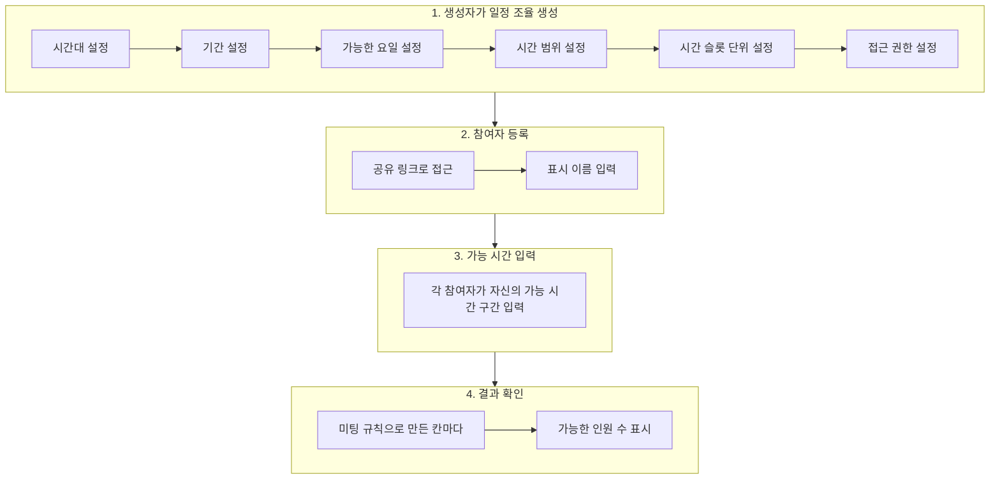

# Meeting (일정 조율) API 가이드 (프론트엔드 개발자용)

> **최종 업데이트**: 2026-11-14

## 개요

Meeting(일정 조율) API는 여러 참여자가 공통으로 가능한 시간대를 찾아 회의 일정을 조율하는 기능을 제공합니다.

### 주요 기능



### 접근 권한

| 레벨 | 설명 |
|------|------|
| `public` | 링크를 아는 모든 사용자 접근 가능 |
| `allowed_emails` | 허용된 이메일/도메인 사용자만 접근 가능 |
| `private` | 생성자만 접근 가능 (기본값) |

---

## 데이터 모델

### 시간 규칙

- 모든 구간은 반열린 구간 `[start, end)`입니다. 끝 시각은 포함하지 않습니다.
- 미팅의 `start_date`, `end_date`, `available_days`, `start_time`, `end_time`은 미팅 `timezone`(IANA 이름, 예: `Asia/Seoul`)의 벽시계 값입니다.
- 미팅의 `end_time`이 `00:00:00`이면 다음 날 00:00, 곧 하루의 끝입니다. 하루 전체는 `start_time: "00:00:00"`, `end_time: "00:00:00"`입니다.
- 가능 시간(TimeSlot)은 칸이 아니라 시각 구간입니다. 받은 구간을 UTC로 바꿔 그대로 저장하고, 미팅의 날짜·요일·하루 범위·시간 단위와 맞추거나 나누거나 합치지 않습니다.
- 칸(그리드)은 결과 조회에서만 쓰입니다. 미팅 규칙으로 칸을 만들고, 칸마다 그 칸을 모두 덮는 가능 시간을 가진 참여자 수를 셉니다.

### Meeting (일정 조율)

```typescript
interface Meeting {
  id: string;                    // UUID
  owner_id: string;              // 생성자 ID
  title: string;                 // 제목
  description?: string;          // 설명
  start_date: string;            // 시작 날짜 (YYYY-MM-DD, timezone 기준)
  end_date: string;              // 종료 날짜 (YYYY-MM-DD, timezone 기준, 포함)
  timezone: string;              // IANA 시간대 이름 (예: "Asia/Seoul")
  available_days: number[];      // 가능한 요일 (0=월, 1=화, ..., 6=일)
  start_time: string;            // 하루 시작 시간 (HH:MM:SS, timezone 기준)
  end_time: string;              // 하루 종료 시간 (HH:MM:SS, 포함하지 않음, "00:00:00"이면 하루의 끝)
  time_slot_minutes: number;     // 결과 그리드의 칸 길이 (분)
  created_at: string;            // 생성 시간 (ISO 8601)
  updated_at: string;            // 수정 시간 (ISO 8601)
  visibility_level?: string;     // 접근권한 레벨
  is_shared: boolean;            // 공유된 리소스인지
}
```

### Participant (참여자)

```typescript
interface Participant {
  id: string;                    // UUID
  meeting_id: string;            // 일정 조율 ID
  user_id?: string;              // 사용자 ID (로그인한 경우)
  display_name: string;          // 표시 이름
  created_at: string;            // 등록 시간
}
```

### TimeSlot (가능 시간)

```typescript
interface TimeSlot {
  id: string;                    // UUID
  participant_id: string;        // 참여자 ID
  start_time: string;            // 시작 시각 (ISO 8601)
  end_time: string;              // 끝 시각 (ISO 8601, 포함하지 않음)
}
```

### AvailabilityCell (결과 그리드의 칸)

```typescript
// 결과 조회 시 반환되는 칸. 시작 시각 순
interface AvailabilityCell {
  start_time: string;  // 칸 시작 시각 (ISO 8601)
  end_time: string;    // 칸 끝 시각 (ISO 8601, 포함하지 않음)
  count: number;       // 이 칸을 모두 덮는 가능 시간을 가진 참여자 수
}

// 예시 (Asia/Seoul 미팅, 09:00–10:00, 30분, ?timezone=Asia/Seoul)
const grid: AvailabilityCell[] = [
  { start_time: "2024-02-05T09:00:00+0900", end_time: "2024-02-05T09:30:00+0900", count: 3 },
  { start_time: "2024-02-05T09:30:00+0900", end_time: "2024-02-05T10:00:00+0900", count: 2 },
  { start_time: "2024-02-06T09:00:00+0900", end_time: "2024-02-06T09:30:00+0900", count: 0 },
];
```

---

## API 엔드포인트

### 일정 조율 관리

#### 일정 조율 생성

**POST /v1/meetings**

```typescript
// Request
interface MeetingCreate {
  title: string;
  description?: string;
  start_date: string;           // "2024-02-01"
  end_date: string;             // "2024-02-07"
  timezone: string;             // "Asia/Seoul" (필수)
  available_days: number[];     // [0, 2, 4] = 월, 수, 금
  start_time: string;           // "09:00:00"
  end_time: string;             // "18:00:00", 하루의 끝까지면 "00:00:00"
  time_slot_minutes?: number;   // 30 (기본값)
  visibility?: VisibilitySettings;
}

// Response: Meeting
```

**예시:**

```json
{
  "title": "팀 회의 일정 조율",
  "description": "다음 주 회의 일정을 조율합니다",
  "start_date": "2024-02-01",
  "end_date": "2024-02-07",
  "timezone": "Asia/Seoul",
  "available_days": [0, 2, 4],
  "start_time": "09:00:00",
  "end_time": "18:00:00",
  "time_slot_minutes": 30,
  "visibility": {
    "level": "allowed_emails",
    "allowed_emails": ["alice@company.com", "bob@company.com"],
    "allowed_domains": ["company.com"]
  }
}
```

**입력 제한** (어기면 422):

| 필드 | 규칙 |
|------|------|
| `title` | 앞뒤 공백을 뺀 1–200자 (앞뒤 공백은 빼고 저장) |
| `description` | 2000자 이하 |
| `start_date`, `end_date` | `start_date <= end_date <= start_date + 3개월`. 3개월 뒤 같은 날이 없으면 그 달 말일 (예: 2024-11-30 → 2025-02-28) |
| `timezone` | 필수. IANA 시간대 이름 (예: `Asia/Seoul`, `America/New_York`, `UTC`). `+09:00` 같은 오프셋 문자열은 받지 않음 |
| `available_days` | 0–6 정수 1개 이상, 중복 불가 |
| `start_time`, `end_time` | `start_time < end_time`, 또는 `end_time`이 `00:00:00`(하루의 끝) |
| `time_slot_minutes` | 5–1440이면서 하루 범위 이하. 하루 범위는 `end_time - start_time`이고, `end_time`이 `00:00:00`이면 24:00까지 |

하루 전체를 한 칸으로 쓰려면 `start_time: "00:00:00"`, `end_time: "00:00:00"`, `time_slot_minutes: 1440`을 보냅니다.

#### 일정 조율 목록 조회 (내 것만)

**GET /v1/meetings**

쿼리 파라미터:
- `timezone` (optional): 타임존 (예: `+09:00`, `Asia/Seoul`)

```typescript
// Response: Meeting[]
```

#### 일정 조율 상세 조회

**GET /v1/meetings/{meeting_id}**

쿼리 파라미터:
- `timezone` (optional): 타임존

```typescript
// Response: Meeting
```

#### 일정 조율 수정

**PATCH /v1/meetings/{meeting_id}**

```typescript
// Request
interface MeetingUpdate {
  title?: string;
  description?: string;
  start_date?: string;
  end_date?: string;
  timezone?: string;
  available_days?: number[];
  start_time?: string;
  end_time?: string;
  time_slot_minutes?: number;
}

// Response: Meeting
```

보내지 않은 필드는 저장된 값을 씁니다. `timezone`에 `null`을 보내면 422이고, `description`·`timezone` 외의 필드에 `null`을 보내면 무시합니다.
미팅을 수정해도 저장된 가능 시간은 바뀌지 않습니다. 결과 그리드만 새 규칙(시간대·날짜·하루 범위·시간 단위)으로 다시 만들어집니다.
저장된 값에 수정 내용을 합친 미팅이 생성의 입력 제한을 어기면 422를 반환하고 미팅을 바꾸지 않습니다
(예: `start_time`만 저장된 `end_time` 이후로 바꾸는 경우).

#### 일정 조율 삭제

**DELETE /v1/meetings/{meeting_id}**

```typescript
// Response: 204 No Content
```

---

### 참여자 관리

#### 참여자 등록

**POST /v1/meetings/{meeting_id}/participate**

```typescript
// Request
interface ParticipantCreate {
  display_name: string;
}

// Response: Participant
```

**예시:**

```json
{
  "display_name": "홍길동"
}
```

- 미팅마다 사용자당 참여자는 한 명입니다. 처음 등록하면 **201**과 새 참여자를 반환합니다.
- 이미 참여한 사용자가 다시 등록하면 **200**과 기존 참여자를 반환하고, `display_name`을 보낸 값으로 바꿉니다. `id`와 입력한 가능 시간은 그대로입니다. 참여자 이름 변경은 이 요청으로 합니다.
- `display_name`은 앞뒤 공백을 뺀 1–50자이고 제어 문자(줄바꿈·탭 포함)는 쓸 수 없습니다 (어기면 422). 한글·이모지는 쓸 수 있고, 길이는 유니코드 코드 포인트 수로 셉니다.

---

### 가능 시간 관리

#### 가능 시간 설정/업데이트

**PUT /v1/meetings/{meeting_id}/availability**

쿼리 파라미터:
- `participant_id` (required): 참여자 ID
- `timezone` (optional): 응답 시각의 시간대

```typescript
// Request
interface TimeSlotCreate {
  start_time: string;          // ISO 8601 시각. 오프셋이 없으면 UTC
  end_time: string;            // ISO 8601 시각, 포함하지 않음
}

// Request Body: TimeSlotCreate[]

// Response: TimeSlot[]
```

**예시:**

```json
[
  {
    "start_time": "2024-02-02T09:00:00+09:00",
    "end_time": "2024-02-02T12:00:00+09:00"
  },
  {
    "start_time": "2024-02-05T14:07:00+09:00",
    "end_time": "2024-02-06T10:00:00+09:00"
  }
]
```

- 요청 목록이 그 참여자의 가능 시간 전체가 됩니다.
- 구간은 받은 그대로(UTC로 바꿔서) 저장합니다. 미팅의 날짜·요일·하루 범위·칸 경계에 맞는지 검사하지 않고, 칸으로 나누거나 겹치는 구간을 합치지도 않습니다. 여러 날에 걸친 구간도 한 행입니다.
- `end_time`이 `start_time`보다 뒤가 아니면 422입니다.
- 한 요청의 구간 수는 미팅의 칸 수까지입니다 (넘으면 422, 저장된 가능 시간은 그대로).
  칸 수 = 기간 안에서 `available_days`에 해당하는 날 수 × 하루 범위(분) ÷ `time_slot_minutes`, 올림.
  예: 5일 × 09:00–18:00 / 30분 = 90, 하루 × 00:00–00:00 / 30분 = 48. 기간 안에 해당하는 날이 없으면 칸 수는 0이라 빈 목록만 받습니다.
- 같은 구간을 여러 번 보내면 보낸 만큼 저장되고, 개수 제한에도 그만큼 셉니다.

#### 전체 가능 시간 조회

**GET /v1/meetings/{meeting_id}/availability**

쿼리 파라미터:
- `timezone` (optional): 타임존

```typescript
// Response
interface AvailabilityRead {
  participant: Participant;
  time_slots: TimeSlot[];
}

// Response: AvailabilityRead[]
```

참여자의 `created_at`과 가능 시간의 `start_time`·`end_time`을 `timezone` 쿼리의 시간대로 반환합니다.

---

### 결과 조회

#### 공통 가능 시간 분석

**GET /v1/meetings/{meeting_id}/result**

쿼리 파라미터:
- `timezone` (optional): 응답 시각의 시간대. 칸을 만드는 데는 쓰지 않습니다

```typescript
// Response
interface MeetingResult {
  meeting: Meeting;
  availability_grid: AvailabilityCell[];
}
```

칸은 미팅의 시간대에서 만듭니다.

- `start_date`~`end_date` 중 요일이 `available_days`에 있는 날마다 `start_time`부터 `end_time`(`00:00:00`이면 다음 날 00:00)까지를 실제 시각으로 바꾸고, 그 사이를 `time_slot_minutes`마다 나눕니다. 하루 범위가 나누어떨어지지 않으면 마지막 칸은 하루 범위의 끝에서 끝납니다.
- 일광 절약 시간이 바뀌는 날도 칸은 이어지는 실제 시각입니다. 예: `America/New_York` 2024-03-10의 00:00–00:00 / 60분은 23칸이고, 01:00 칸 다음은 03:00 칸입니다.
- 한 참여자의 가능 시간을 합친 구간이 칸을 모두 덮으면 그 칸에서 한 명으로 셉니다. 예: 09:00–09:15와 09:15–09:30을 함께 보낸 참여자는 09:00–09:30 칸에 셉니다. 칸의 일부만 덮으면 세지 않고, 겹치거나 같은 구간을 여러 번 보내도 한 번만 셉니다.
- 칸 밖의 가능 시간은 결과에 나타나지 않습니다.

**응답 예시** (`?timezone=Asia/Seoul`):

```json
{
  "meeting": {
    "id": "uuid-here",
    "title": "팀 회의 일정 조율",
    "start_date": "2024-02-02",
    "end_date": "2024-02-05",
    "timezone": "Asia/Seoul",
    "available_days": [0, 4],
    "start_time": "09:00:00",
    "end_time": "10:00:00",
    "time_slot_minutes": 30
  },
  "availability_grid": [
    { "start_time": "2024-02-02T09:00:00+0900", "end_time": "2024-02-02T09:30:00+0900", "count": 3 },
    { "start_time": "2024-02-02T09:30:00+0900", "end_time": "2024-02-02T10:00:00+0900", "count": 2 },
    { "start_time": "2024-02-05T09:00:00+0900", "end_time": "2024-02-05T09:30:00+0900", "count": 2 },
    { "start_time": "2024-02-05T09:30:00+0900", "end_time": "2024-02-05T10:00:00+0900", "count": 0 }
  ]
}
```

---

## TypeScript 타입 정의

```typescript
// ===== 요일 상수 =====
const DAY_OF_WEEK = {
  MONDAY: 0,
  TUESDAY: 1,
  WEDNESDAY: 2,
  THURSDAY: 3,
  FRIDAY: 4,
  SATURDAY: 5,
  SUNDAY: 6,
} as const;

const DAY_LABELS: Record<number, string> = {
  0: "월",
  1: "화",
  2: "수",
  3: "목",
  4: "금",
  5: "토",
  6: "일",
};

// ===== 접근권한 설정 =====
interface VisibilitySettings {
  level: "private" | "public" | "allowed_emails";
  allowed_emails?: string[];    // ALLOWED_EMAILS 레벨에서만
  allowed_domains?: string[];   // ALLOWED_EMAILS 레벨에서만
}

// ===== Meeting 타입 =====
interface Meeting {
  id: string;
  owner_id: string;
  title: string;
  description?: string;
  start_date: string;
  end_date: string;
  timezone: string;
  available_days: number[];
  start_time: string;
  end_time: string;
  time_slot_minutes: number;
  created_at: string;
  updated_at: string;
  visibility_level?: string;
  is_shared: boolean;
}

interface MeetingCreate {
  title: string;
  description?: string;
  start_date: string;
  end_date: string;
  timezone: string;
  available_days: number[];
  start_time: string;
  end_time: string;
  time_slot_minutes?: number;
  visibility?: VisibilitySettings;
}

interface MeetingUpdate {
  title?: string;
  description?: string;
  start_date?: string;
  end_date?: string;
  timezone?: string;
  available_days?: number[];
  start_time?: string;
  end_time?: string;
  time_slot_minutes?: number;
}

// ===== Participant 타입 =====
interface Participant {
  id: string;
  meeting_id: string;
  user_id?: string;
  display_name: string;
  created_at: string;
}

interface ParticipantCreate {
  display_name: string;
}

// ===== TimeSlot 타입 =====
interface TimeSlot {
  id: string;
  participant_id: string;
  start_time: string;  // ISO 8601
  end_time: string;    // ISO 8601, 포함하지 않음
}

interface TimeSlotCreate {
  start_time: string;  // ISO 8601, 오프셋이 없으면 UTC
  end_time: string;
}

// ===== 결과 타입 =====
interface AvailabilityCell {
  start_time: string;  // ISO 8601
  end_time: string;    // ISO 8601, 포함하지 않음
  count: number;
}

interface AvailabilityRead {
  participant: Participant;
  time_slots: TimeSlot[];
}

interface MeetingResult {
  meeting: Meeting;
  availability_grid: AvailabilityCell[];
}
```

---

## 사용 시나리오

### 1. 일정 조율 생성 및 공유

```typescript
// 일정 조율 생성
async function createMeeting(data: MeetingCreate): Promise<Meeting> {
  const response = await fetch('/v1/meetings', {
    method: 'POST',
    headers: { 'Content-Type': 'application/json' },
    body: JSON.stringify(data),
  });
  
  if (!response.ok) {
    throw new Error('Failed to create meeting');
  }
  
  return response.json();
}

// 사용 예시
const meeting = await createMeeting({
  title: "프로젝트 킥오프 미팅",
  description: "전체 팀원이 참석 가능한 시간을 찾습니다",
  start_date: "2024-02-01",
  end_date: "2024-02-14",
  timezone: "Asia/Seoul",
  available_days: [0, 1, 2, 3, 4],  // 월-금
  start_time: "09:00:00",
  end_time: "18:00:00",
  time_slot_minutes: 60,
  visibility: {
    level: "allowed_emails",
    allowed_domains: ["company.com"],  // 회사 이메일만 허용
  },
});

// 공유 링크 생성
const shareUrl = `${window.location.origin}/meetings/${meeting.id}`;
```

### 2. 참여자 등록 및 시간 입력

```typescript
// 참여자 등록
async function registerParticipant(
  meetingId: string,
  displayName: string
): Promise<Participant> {
  const response = await fetch(`/v1/meetings/${meetingId}/participate`, {
    method: 'POST',
    headers: { 'Content-Type': 'application/json' },
    body: JSON.stringify({ display_name: displayName }),
  });
  
  return response.json();
}

// 가능 시간 설정
async function setAvailability(
  meetingId: string,
  participantId: string,
  timeSlots: TimeSlotCreate[]
): Promise<TimeSlot[]> {
  const response = await fetch(
    `/v1/meetings/${meetingId}/availability?participant_id=${participantId}`,
    {
      method: 'PUT',
      headers: { 'Content-Type': 'application/json' },
      body: JSON.stringify(timeSlots),
    }
  );
  
  return response.json();
}

// 사용 예시
const participant = await registerParticipant(meeting.id, "홍길동");

await setAvailability(meeting.id, participant.id, [
  { start_time: "2024-02-02T09:00:00+09:00", end_time: "2024-02-02T12:00:00+09:00" },
  { start_time: "2024-02-02T14:00:00+09:00", end_time: "2024-02-02T17:00:00+09:00" },
  { start_time: "2024-02-05T10:00:00+09:00", end_time: "2024-02-05T15:00:00+09:00" },
]);
```

### 3. 결과 확인

```typescript
async function getMeetingResult(meetingId: string, timezone: string): Promise<MeetingResult> {
  const params = new URLSearchParams({ timezone });
  const response = await fetch(`/v1/meetings/${meetingId}/result?${params}`);
  return response.json();
}

// 사용 예시
const result = await getMeetingResult(meeting.id, meeting.timezone);

// 가장 많은 사람이 가능한 칸 찾기
function findBestSlots(grid: AvailabilityCell[], minParticipants: number = 1) {
  return grid
    .filter((cell) => cell.count >= minParticipants)
    .sort((a, b) => b.count - a.count);
}

const bestSlots = findBestSlots(result.availability_grid, 2);
console.log("2명 이상 가능한 시간대:", bestSlots);
```

---

## UI/UX 가이드라인

### 시간 그리드 표시

```
┌─────────────────────────────────────────────────────────────────────┐
│  2024년 2월                                                         │
├─────────┬─────────┬─────────┬─────────┬─────────┬─────────┬────────┤
│         │ 월(5)   │ 화      │ 수(7)   │ 목      │ 금(2)   │ 토     │
├─────────┼─────────┼─────────┼─────────┼─────────┼─────────┼────────┤
│ 09:00   │ ███ 3   │         │ ███ 3   │         │ ██ 2    │        │
│ 09:30   │ ███ 3   │         │ ███ 3   │         │ ██ 2    │        │
│ 10:00   │ ██ 2    │         │ ████ 4  │         │ █ 1     │        │
│ 10:30   │ ██ 2    │         │ ████ 4  │         │ █ 1     │        │
│ 11:00   │ █ 1     │         │ ███ 3   │         │ ░ 0     │        │
│ 11:30   │ █ 1     │         │ ███ 3   │         │ ░ 0     │        │
│ ...     │ ...     │         │ ...     │         │ ...     │        │
└─────────┴─────────┴─────────┴─────────┴─────────┴─────────┴────────┘

범례: ████ 모든 참여자 가능  ░░░ 아무도 불가능
```

### 색상 가이드

| 상태 | 색상 | 설명 |
|------|------|------|
| 모든 참여자 가능 | 🟢 진한 녹색 | count == 총 참여자 수 |
| 대부분 가능 | 🟡 연한 녹색 | count >= 총 참여자 수 * 0.7 |
| 일부 가능 | 🟠 노란색 | count >= 총 참여자 수 * 0.3 |
| 소수 가능 | 🔴 연한 빨간색 | count > 0 |
| 불가능 | ⚪ 회색 | count == 0 |

### 참여자 선택 UI

```typescript
// 시간 슬롯 선택 컴포넌트 예시
function TimeSlotSelector({
  meeting,
  participantId,
  onSave,
}: {
  meeting: Meeting;
  participantId: string;
  onSave: (slots: TimeSlotCreate[]) => void;
}) {
  const [selectedSlots, setSelectedSlots] = useState<Set<string>>(new Set());

  // 클릭 또는 드래그로 시간 선택
  const handleSlotClick = (date: string, time: string) => {
    const key = `${date}_${time}`;
    const newSlots = new Set(selectedSlots);
    
    if (newSlots.has(key)) {
      newSlots.delete(key);
    } else {
      newSlots.add(key);
    }
    
    setSelectedSlots(newSlots);
  };

  // 선택한 시간을 시각 구간(TimeSlotCreate)으로 변환. 칸에 맞출 필요는 없다
  const convertToTimeSlots = (): TimeSlotCreate[] => {
    // ... 선택을 [start, end) 구간 목록으로 바꾸는 로직
  };

  return (
    <div className="time-grid">
      {/* 날짜별 시간 그리드 렌더링 */}
    </div>
  );
}
```

---

## 에러 처리

### 에러 코드

| 코드 | 상황 | 설명 |
|------|------|------|
| `400` | 잘못된 요청 | 필수 필드 누락, 잘못된 날짜 형식 등 |
| `401` | 인증 필요 | 로그인이 필요한 작업 |
| `403` | 접근 거부 | 권한이 없는 리소스 접근 |
| `404` | 찾을 수 없음 | 존재하지 않는 일정 조율 |
| `422` | 입력 제한 위반 | 미팅 입력 제한·수정 결과 위반, 알 수 없는 `timezone`, `display_name` 규칙 위반, 가능 시간의 끝이 시작보다 뒤가 아님, 가능 시간 수가 칸 수 초과 |

요청 본문 하나만 보고 판단하는 422는 FastAPI 검증 오류 형식(`detail` 배열)입니다.
저장된 미팅과 함께 판단하는 422(수정 결과 위반 `InvalidMeetingError`, 슬롯 수 초과 `TooManyTimeSlotsError`)는 `error_type`과 `message`가 있는 공통 오류 형식입니다.

### 에러 응답 예시

```json
// 403 Forbidden - 접근 권한 없음
{
  "detail": "You don't have permission to access this meeting"
}

// 404 Not Found - 존재하지 않음
{
  "detail": "Meeting not found"
}

// 400 Bad Request - 잘못된 요일
{
  "detail": "available_days must contain integers 0-6"
}
```

### 에러 처리 예시

```typescript
async function handleMeetingError(response: Response): Promise<never> {
  const error = await response.json();
  
  switch (response.status) {
    case 400:
      throw new Error(`잘못된 요청: ${error.detail}`);
    case 401:
      throw new Error('로그인이 필요합니다');
    case 403:
      throw new Error('이 일정 조율에 접근할 권한이 없습니다');
    case 404:
      throw new Error('일정 조율을 찾을 수 없습니다');
    default:
      throw new Error(error.detail || '알 수 없는 오류가 발생했습니다');
  }
}
```

---

## 주의사항

### 1. 요일 인덱스

요일은 **0부터 시작**합니다 (Python의 `weekday()` 방식):

| 인덱스 | 요일 |
|--------|------|
| 0 | 월요일 |
| 1 | 화요일 |
| 2 | 수요일 |
| 3 | 목요일 |
| 4 | 금요일 |
| 5 | 토요일 |
| 6 | 일요일 |

### 2. 시간 형식

- 날짜: `YYYY-MM-DD` (예: `2024-02-01`)
- 미팅의 하루 시간: `HH:MM:SS` (예: `09:00:00`), 미팅 `timezone`의 벽시계 값
- 가능 시간·결과 칸·`created_at` 등 시각: ISO 8601 (예: `2024-02-02T09:00:00+0900`)

### 3. 타임존

- 미팅의 날짜·요일·하루 시간은 미팅 `timezone`으로 해석합니다.
- 가능 시간은 UTC 시각으로 저장합니다. 요청 시각에 오프셋이 없으면 UTC로 읽습니다.
- `timezone` 쿼리 파라미터는 응답의 시각(`created_at`, `updated_at`, 가능 시간, 결과 칸)을 그 시간대로 바꿔 보여 줄 뿐이고, 결과 칸을 만드는 데는 쓰지 않습니다. 지정하지 않으면 UTC(`+0000`)로 반환합니다.
- 예: `?timezone=+09:00` 또는 `?timezone=Asia/Seoul`

### 4. 접근 권한

- `ALLOWED_EMAILS` 레벨에서는 로그인이 필수입니다
- `PUBLIC` 레벨에서도 현재는 로그인이 필요합니다 (추후 비인증 접근 지원 예정)

### 5. 참여자 식별

- 로그인한 사용자의 참여자는 `user_id`가 설정됩니다
- 미팅마다 같은 `user_id`의 참여자는 하나입니다. 다시 등록하면 기존 참여자를 200으로 반환합니다

### 6. 시간 슬롯 업데이트

- `PUT /availability`는 기존 가능 시간을 **전체 교체**합니다
- 부분 업데이트가 아니라 전체 목록을 보내야 합니다

---

## 관련 문서

- [Visibility API 가이드](./visibility.ko.md) - 접근 권한 관리
- [Auth API 가이드](./auth.ko.md) - 인증
