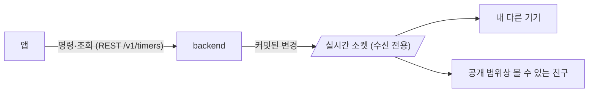
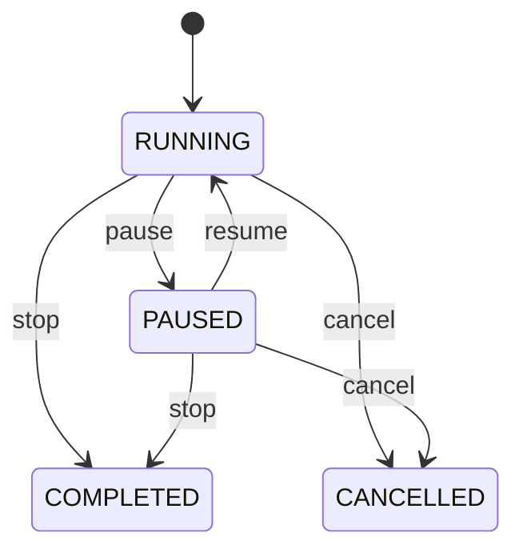

# Timer API 가이드 (프론트엔드 개발자용)

## 개요

Timer API는 **일정(Schedule)**, **할 일(Todo)**, 또는 **독립적으로** 타이머를 생성하고 관리할 수 있습니다.

### 핵심 개념

| 개념 | 설명 |
|------|------|
| **Timer** | 시간 측정 세션. Schedule, Todo, 또는 둘 다에 연결 가능. 독립 타이머도 가능. |
| **Schedule** | 캘린더 일정. 타이머를 통해 작업 시간 측정 가능. |
| **Todo** | 할 일 항목. 타이머를 통해 작업 시간 측정 가능. |

### 명령과 실시간 수신



- 생성·일시정지·재개·완료·취소·수정·삭제와 조회는 모두 **REST**입니다. 명령 응답에 바뀐 타이머가 들어 있습니다.
- 커밋된 변경은 **수신 전용 WebSocket**으로 내 다른 기기와 친구에게 전달됩니다 (아래 "실시간 수신").

---

## 데이터 모델

### Timer

```typescript
interface Timer {
  id: string;                   // UUID
  schedule_id?: string;         // Schedule ID (Optional)
  todo_id?: string;             // Todo ID (Optional)
  title?: string;               // 타이머 제목
  description?: string;         // 타이머 설명
  allocated_duration: number;   // 할당 시간 (초 단위)
  elapsed_time: number;         // 누적 경과 시간 (초, 저장값). RUNNING이면 클라이언트가 now - started_at을 더해 표시
  status: TimerStatus;          // 상태
  started_at?: string;          // 시작 시간 (ISO 8601)
  paused_at?: string;           // 마지막 일시정지 시간 (ISO 8601)
  ended_at?: string;            // 종료 시간 (ISO 8601)
  pause_history: PauseEvent[];  // 일시정지/재개 이력
  created_at: string;           // 생성 시간 (ISO 8601)
  updated_at: string;           // 수정 시간 (ISO 8601)
  schedule?: Schedule;          // Schedule 정보
  todo?: Todo;                  // Todo 정보
  tags: Tag[];                  // 연결된 태그 목록
  owner_id?: string;            // 소유자 ID
  visibility_level?: VisibilityLevel;  // 접근권한 레벨 (설정 없으면 null)
  is_shared: boolean;           // 공유된 타이머인지
}

type TimerStatus = 
  | "RUNNING"    // 실행 중
  | "PAUSED"     // 일시정지
  | "COMPLETED"  // 완료
  | "CANCELLED"; // 취소됨

interface PauseEvent {
  action: "start" | "pause" | "resume" | "stop" | "cancel" | "expire";
  at: string;           // ISO 8601 시간
  elapsed?: number;     // 경과 시간 (pause, stop, cancel, expire 시)
}
```

!!! note "연결 리소스 삭제 시 타이머 동작 — `linked_timer_policy`"
    연결 타이머가 있는 Todo·Schedule을 삭제할 때는 `linked_timer_policy`를 함께 보내야 합니다
    (**서버 기본값 없음**, 누락 시 `422`). 연결 타이머가 없으면 생략할 수 있습니다.

    | 값 | 동작 | 실시간 이벤트 |
    |----|------|---------------|
    | `delete` | 타이머 삭제 (접근권한 설정도 함께 정리) | `timer.deleted` |
    | `unlink` | 연결만 해제 (`todo_id`/`schedule_id` → `null`). 독립 타이머로 남고, 실행 중이면 계속 실행됩니다 | `timer.updated` (`action: update`) |

    - Todo 쪽 흐름(마감 제거, Todo 삭제의 `linked_schedule_policy=delete`)이 투영 일정을 지우면
      그 일정에 걸린 타이머는 묻지 않고 `schedule_id`만 `null`이 됩니다 (`timer.updated`).
      삭제되는 Todo에도 연결된 타이머는 그 Todo의 `linked_timer_policy`만 따릅니다.
    - 반복 일정의 마지막 인스턴스를 지워 원본이 삭제될 때는 생략하면 `unlink`입니다.
    - 태그 그룹 삭제로 지워지는 Todo의 타이머는 `unlink`됩니다.

!!! note "연결 Todo와 상태 연동"
    타이머는 연결된 Todo의 집중 세션입니다. 타이머를 끝내면 Todo도 끝나고, Todo의 상태가 바뀌면
    그 Todo의 RUNNING·PAUSED 타이머에 반영됩니다.

    | 변경 | 결과 |
    |------|------|
    | 타이머 완료 (`stop`) | 연결 Todo → `DONE` |
    | 타이머 취소 (`cancel`) | 연결 Todo → `CANCELLED` |
    | Todo → `DONE` | 타이머 완료 (`timer.updated`, `action: stop`) |
    | Todo → `CANCELLED` | 타이머 취소 (`timer.updated`, `action: cancel`) |
    | Todo → `UNSCHEDULED`·`SCHEDULED` (재오픈, 마감 설정·제거 포함) | 타이머는 그대로이고 `updated_at`만 바뀝니다 (`timer.updated`, `action: update`) |

    - 이미 `DONE`·`CANCELLED`인 Todo는 타이머가 끝나도 바뀌지 않습니다. 완료한 Todo에 연결된 타이머를 취소해도 Todo는 `DONE`으로 남습니다.
    - 타이머를 끝내 Todo가 `DONE`·`CANCELLED`가 되면 같은 Todo의 다른 RUNNING·PAUSED 타이머도 함께 완료·취소됩니다.
    - 명령 응답에 `include_todo=true`를 주면 바뀐 Todo 상태가 응답에 들어 있습니다.

### pause_history 예시

```json
[
  { "action": "start", "at": "2026-01-28T10:00:00Z" },
  { "action": "pause", "at": "2026-01-28T10:30:00Z", "elapsed": 1800 },
  { "action": "resume", "at": "2026-01-28T10:35:00Z" },
  { "action": "pause", "at": "2026-01-28T10:50:00Z", "elapsed": 2700 },
  { "action": "resume", "at": "2026-01-28T11:00:00Z" },
  { "action": "stop", "at": "2026-01-28T11:30:00Z", "elapsed": 4500 }
]
```

---

### elapsed_time 계산 규칙

`elapsed_time`은 **저장된 누적값**입니다. 서버는 조회할 때 값을 바꾸지 않고, `pause`·`stop` 같은 상태 전이 때만 실행 중이던 구간을 더해 저장합니다. 따라서 RUNNING 타이머의 화면 표시는 클라이언트가 계산합니다.

```typescript
function displayElapsed(timer: Timer, now: Date = new Date()): number {
  if (timer.status !== 'RUNNING' || !timer.started_at) return timer.elapsed_time;
  const running = Math.floor((now.getTime() - new Date(timer.started_at).getTime()) / 1000);
  return Math.min(timer.allocated_duration, timer.elapsed_time + Math.max(0, running));
}
```

- `started_at`은 마지막 `resume` 시각으로 갱신되므로 위 식이 그대로 맞습니다.
- 매 렌더마다 다시 계산하세요. "1초마다 +1"로 누적하면 백그라운드 탭에서 틀어집니다.
- PAUSED·COMPLETED·CANCELLED는 `elapsed_time`을 그대로 씁니다.
- `elapsed_time`은 `allocated_duration`을 넘지 않습니다 (아래 "만료").

### 만료

RUNNING 타이머는 `expires_at = started_at + (allocated_duration - elapsed_time)`초에 만료됩니다. 서버는 그 시각에 아무 일도 하지 않고(이벤트도 없음), 만료된 타이머를 다음과 같이 다룹니다.

| 상황 | 동작 |
|------|------|
| 조회 (`GET /v1/timers`, `/active`, `/{id}` 등) | 응답에서만 만료 표현으로 보입니다. DB 행은 RUNNING 그대로입니다 |
| 명령 (`pause`·`resume`·`stop`·`cancel`·`PATCH`) | 처리 전에 행에 만료 표현을 확정하고 `timer.updated`(`action: expire`)를 보냅니다 |

만료 표현: `status: "PAUSED"`, `elapsed_time = allocated_duration`, `paused_at = expires_at`, `pause_history`에 `{ "action": "expire", "at": expires_at, "elapsed": allocated_duration }`.

- `pause`: 만료된 타이머는 만료 표현으로 `200`을 반환합니다 (이미 만료로 멈춘 타이머도 같음). 이때 이벤트는 `expire` 하나입니다. 사용자가 멈춘 PAUSED 타이머의 `pause`는 지금처럼 `400`입니다.
- `resume`: `elapsed_time`이 `allocated_duration`에 닿은 타이머는 `400`입니다. `PATCH /v1/timers/{id}`로 `allocated_duration`을 먼저 늘립니다.
- `stop`·`cancel`: 만료를 확정한 뒤 처리합니다. 결과의 `elapsed_time`은 `allocated_duration`이고, 이벤트는 `expire` 다음에 `stop`·`cancel`이 옵니다.
- 사용자가 멈춘 PAUSED 타이머는 시간이 지나도 만료되지 않습니다.
- `status` 필터(`GET /v1/timers?status=...`)와 활성 타이머 조회는 저장된 상태로 고릅니다. 아직 확정되지 않은 만료 타이머는 `status=RUNNING`에 걸리지만 응답 본문은 `PAUSED`입니다.

---

## REST API

### Base URL

```
/v1
```

명령 엔드포인트는 모두 다음 쿼리 파라미터를 받고, 응답은 `Timer`입니다.

| 파라미터 | 타입 | 기본값 | 설명 |
|---------|------|--------|------|
| `include_schedule` | boolean | false | Schedule 정보 포함 |
| `include_todo` | boolean | false | Todo 정보 포함 |
| `tag_include_mode` | string | none | 태그 포함 모드 |
| `timezone` | string | UTC | 응답 시각의 타임존 (`pause_history[].at` 포함). 실시간 이벤트와 맞추려면 `UTC` |

상태 전이가 맞지 않으면 **400**, 타이머가 없거나 내 것이 아니면 **404**입니다.

### 타이머 생성

```http
POST /v1/timers
Content-Type: application/json

{
  "allocated_duration": 3600,
  "title": "작업 타이머",
  "description": "프로젝트 작업",
  "schedule_id": "uuid-or-null",
  "todo_id": "uuid-or-null",
  "tag_ids": ["tag-uuid-1"]
}
```

**201 Created**. 생성과 동시에 RUNNING으로 시작합니다.

| 필드 | 타입 | 필수 | 설명 |
|------|------|------|------|
| `allocated_duration` | number | ✅ | 할당 시간 (초 단위, 양수 필수) |
| `title` | string | ❌ | 타이머 제목 |
| `description` | string | ❌ | 타이머 설명 |
| `schedule_id` | UUID | ❌ | Schedule ID |
| `todo_id` | UUID | ❌ | Todo ID |
| `tag_ids` | UUID[] | ❌ | 태그 ID 리스트 |

- `todo_id`만 주면 그 Todo의 첫 Schedule이, `schedule_id`만 주면 그 Schedule의 원본 Todo가 함께 연결됩니다.

### 타이머 일시정지

```http
PATCH /v1/timers/{timer_id}/pause
```

RUNNING → PAUSED. 실행 중이던 구간을 `elapsed_time`에 더해 저장합니다.

### 타이머 재개

```http
PATCH /v1/timers/{timer_id}/resume
```

PAUSED → RUNNING. `started_at`을 재개 시각으로 바꿉니다.

### 타이머 완료

```http
POST /v1/timers/{timer_id}/stop
```

RUNNING·PAUSED → COMPLETED. RUNNING이었다면 실행 중이던 구간을 더해 저장합니다. 연결 Todo는 `DONE`이 됩니다 ("연결 Todo와 상태 연동").

### 타이머 취소

```http
POST /v1/timers/{timer_id}/cancel
```

RUNNING·PAUSED → CANCELLED. 실행 중이던 구간은 `elapsed_time`에 더하지 않습니다. 연결 Todo는 `CANCELLED`가 됩니다.

### 타이머 목록 조회

```http
GET /v1/timers
```

**Query Parameters:**

| 파라미터 | 타입 | 기본값 | 설명 |
|---------|------|--------|------|
| `scope` | string | mine | 조회 범위: mine, shared, all |
| `status` | string[] | - | 상태 필터 (RUNNING, PAUSED, COMPLETED, CANCELLED) |
| `type` | string | - | 타입 필터: independent, schedule, todo |
| `start_date` | datetime | - | 시작 날짜 필터 |
| `end_date` | datetime | - | 종료 날짜 필터 |
| `include_schedule` | boolean | false | Schedule 정보 포함 |
| `include_todo` | boolean | false | Todo 정보 포함 |
| `tag_include_mode` | string | none | 태그 포함 모드 |
| `timezone` | string | UTC | 타임존 |

### 현재 활성 타이머 조회

```http
GET /v1/timers/active
```

활성 타이머가 없으면 **404 Not Found** 반환

### 타이머 상세 조회

```http
GET /v1/timers/{timer_id}
```

### 타이머 메타데이터 업데이트

```http
PATCH /v1/timers/{timer_id}
Content-Type: application/json

{
  "title": "업데이트된 제목",
  "description": "업데이트된 설명",
  "tag_ids": ["tag-uuid"],
  "allocated_duration": 5400
}
```

보낸 필드만 바꿉니다. `allocated_duration`은 현재 `elapsed_time`보다 커야 하고, 아니면 `422`(`AllocatedDurationTooShortError`)입니다. 만료된 타이머는 이 요청이 만료를 먼저 확정하므로 늘린 뒤 `resume`할 수 있습니다. 실행 중인 타이머는 값만 바뀌고 계속 실행됩니다.

### 타이머 삭제

```http
DELETE /v1/timers/{timer_id}
```

---

## 실시간 수신 (WebSocket)

소켓은 **수신 전용**입니다. 명령은 보내지 않습니다. 프로토콜 전체는 [WebSocket API](../api/websocket.md)를 참고하세요.

### 연결

**중요: 보안상 JWT는 반드시 `Sec-WebSocket-Protocol` 헤더로 전달해야 합니다.**

```javascript
const ws = new WebSocket(
  'wss://your-domain.com/v1/ws/timers',  // cloudflare 모드는 /realtime/ws
  ['authorization.bearer.' + jwtToken]
);
```

- 연결 직후 `connected` 메시지가 옵니다. 타이머 목록은 오지 않으므로 **연결·재연결 직후 REST로 다시 조회**합니다.
- 클라이언트가 보낼 수 있는 메시지는 문자열 `ping`뿐이고 서버는 `pong`으로 답합니다.

### 중요: CORS 설정

WebSocket 연결이 작동하려면 **백엔드 서버의 `CORS_ALLOWED_ORIGINS` 환경변수에 WebSocket URL을 반드시 추가**해야 합니다:

=== "개발 환경"
    ```bash
    CORS_ALLOWED_ORIGINS=http://localhost:3000,http://localhost:8000,http://127.0.0.1:3000,http://127.0.0.1:8000,ws://localhost:8000,ws://127.0.0.1:8000
    ```

=== "프로덕션 환경"
    ```bash
    CORS_ALLOWED_ORIGINS=https://example.com,https://app.example.com,wss://api.example.com
    ```

!!! tip "팁"
    `ws://`는 HTTP용, `wss://`는 HTTPS용입니다. 프로덕션에서는 반드시 `wss://`를 사용하세요.

### 이벤트

```json
{
  "id": "6f1c0c1e-8a53-4d6e-9d0a-2b1f5f0c9a11",
  "type": "timer.updated",
  "from_user": "<행위자 sub>",
  "timestamp": "2026-11-06T10:30:00+0000",
  "payload": {
    "action": "pause",
    "actor_name": "홍길동",
    "timer": { /* TimerData (UTC) */ }
  }
}
```

`payload.timer`는 `TimerData`(`app/domain/timer/schema/ws.py`)입니다. [Timer](#timer)와 달리 `schedule`·`todo`·`tags`·`visibility_level`·`is_shared`가 없고 `owner_id`는 항상 있습니다.

| `type` | `action` | 발생 |
|--------|----------|------|
| `timer.created` | `start` | 생성 |
| `timer.updated` | `pause`, `resume`, `stop`, `cancel`, `update`, `expire` | 상태 전이, 메타데이터 수정, 연결된 Todo·Schedule 삭제로 연결 해제 (`update`), 연결 Todo의 상태 변경 (`stop`·`cancel`·`update`), 명령이 만료를 확정 (`expire`, "만료") |
| `timer.deleted` | `delete` | 삭제, 연결된 Todo·Schedule과 함께 삭제 (`timer`는 `null`, `payload.timer_id`로 식별) |

한 요청에서 같은 타이머의 `update`가 여러 번 생기면 마지막 상태로 하나만 옵니다. `expire`는 이 규칙과 별개로 그 요청의 다른 이벤트보다 먼저 옵니다.

이벤트를 받는 사람은 **소유자 본인**(명령을 보낸 기기 포함)과, 타이머 공개 범위가 `FRIENDS`·`PUBLIC`이면 소유자의 친구 전원, `SELECTED_FRIENDS`이면 허용 목록에 있는 친구입니다.

### 반영 규칙

- `id`로 중복을 버립니다.
- `payload.timer.updated_at`이 가진 값보다 이전이면 버리고, 같거나 나중이면 반영합니다. 이벤트의 시각은 REST 응답(`timezone=UTC`)과 같은 형식이므로 REST 응답에도 같은 규칙을 씁니다.
- `timer.deleted`를 받은 타이머의 이전 이벤트는 버립니다.
- 이벤트의 `payload.timer`는 타이머 자체 필드만 담습니다. 관계 필드(`schedule`, `todo`, `tags`, `visibility_level`, `is_shared`)는 REST 응답에만 있습니다.
- 이벤트는 가진 타이머를 **덮어쓰지 않고 자체 필드만 갱신**합니다. 관계 필드는 가진 값을 유지합니다.
- 이벤트의 `schedule_id`·`todo_id`가 가진 값과 다르면 가진 `schedule`·`todo`는 더 이상 맞지 않으므로 버리고(`null`), `GET /v1/timers/{id}`로 다시 받습니다. 링크는 `PATCH /v1/timers/{id}`(`action: update` 이벤트)로 바뀌고, 연결된 일정·할 일이 삭제될 때는 `linked_timer_policy`에 따라 `unlink`면 링크가 `null`인 `action: update` 이벤트, `delete`면 `timer.deleted`가 옵니다.
- `action: update` 이벤트는 태그(`tag_ids`) 변경을 담지 못하므로 링크가 같아도 같은 GET으로 다시 받습니다.
- 가진 적 없는 타이머의 이벤트(다른 기기에서 만든 `timer.created` 등)는 자체 필드로 넣고 같은 GET으로 관계 필드를 채웁니다.
- 이 GET과 명령·목록 응답은 모두 REST `Timer`(`TimerRead`)이고, 관계 필드는 `include_schedule`·`include_todo`·`tag_include_mode`(기본 `none`)를 줄 때만 채워집니다 (빼면 `schedule`·`todo`는 `null`, `tags`는 `[]`). REST 응답은 가진 타이머를 통째로 바꾸므로 모든 타이머 REST 호출에 같은 값을 붙입니다.
- REST 응답(다시 받은 GET 포함)과 이벤트 모두에 `updated_at` 비교와 `timer.deleted` 규칙을 그대로 적용합니다.
- 친구 알림은 `from_user`가 내 `sub`가 아닌 이벤트로 띄웁니다. 표시명은 `payload.actor_name`입니다.

---

## TypeScript 타입 정의

```typescript
// ============================================================
// Enums
// ============================================================

export type TimerStatus = "RUNNING" | "PAUSED" | "COMPLETED" | "CANCELLED";
export type TimerAction = "start" | "pause" | "resume" | "stop" | "cancel" | "update" | "delete" | "expire";
export type TimerEventType = "timer.created" | "timer.updated" | "timer.deleted";

// ============================================================
// Timer Types
// ============================================================

export interface PauseEvent {
  action: "start" | "pause" | "resume" | "stop" | "cancel" | "expire";
  at: string;
  elapsed?: number;
}

export interface Timer {
  id: string;
  schedule_id?: string;
  todo_id?: string;
  title?: string;
  description?: string;
  allocated_duration: number;
  elapsed_time: number;
  status: TimerStatus;
  started_at?: string;
  paused_at?: string;
  ended_at?: string;
  pause_history: PauseEvent[];
  created_at: string;
  updated_at: string;
  schedule?: Schedule;
  todo?: Todo;
  tags: Tag[];
  owner_id?: string;
  visibility_level?: VisibilityLevel;
  is_shared: boolean;
}

// 이벤트의 payload.timer: 관계 필드가 없고 owner_id는 항상 있음
export type TimerData = Omit<Timer, 'schedule' | 'todo' | 'tags' | 'visibility_level' | 'is_shared'> & {
  owner_id: string;
};

export interface TimerCreate {
  schedule_id?: string;
  todo_id?: string;
  title?: string;
  description?: string;
  allocated_duration: number;
  tag_ids?: string[];
}

// ============================================================
// 실시간 이벤트
// ============================================================

export interface TimerEventPayload {
  action: TimerAction;
  actor_name: string | null;
  timer: TimerData | null;  // timer.deleted에서 null
  timer_id?: string;        // timer.deleted에만
}

export interface ServerMessage {
  id: string;
  type: TimerEventType | "connected";
  from_user: string | null;
  timestamp: string;
  payload: TimerEventPayload | Record<string, never>;
}
```

---

## 사용 예시

### REST 명령

```typescript
const API = '/v1/timers';
// 모든 호출에 같은 쿼리. 관계 필드를 빼면 응답이 가진 schedule·todo·tags를 지움
const QUERY = '?timezone=UTC&include_schedule=true&include_todo=true&tag_include_mode=timer_only';

async function call(method: string, path: string, body?: unknown): Promise<Timer> {
  const res = await fetch(`${API}${path}${QUERY}`, {
    method,
    headers: { 'Content-Type': 'application/json', Authorization: `Bearer ${token}` },
    body: body ? JSON.stringify(body) : undefined,
  });
  if (!res.ok) throw new Error(`${res.status}`);
  return res.json();
}

export const createTimer = (data: TimerCreate) => call('POST', '', data);
export const pauseTimer = (id: string) => call('PATCH', `/${id}/pause`);
export const resumeTimer = (id: string) => call('PATCH', `/${id}/resume`);
export const stopTimer = (id: string) => call('POST', `/${id}/stop`);
export const getTimer = (id: string) => call('GET', `/${id}`);
export const cancelTimer = (id: string) => call('POST', `/${id}/cancel`);
```

### 실시간 수신과 반영

```typescript
class TimerStore {
  private timers = new Map<string, Timer>();
  private seen = new Set<string>();
  private deleted = new Set<string>();

  // REST 응답: 관계 필드까지 통째로 바꿈
  apply(timer: Timer): void {
    if (this.isStale(timer)) return;
    this.timers.set(timer.id, timer);
  }

  // 이벤트: 자체 필드만 갱신하고 관계 필드는 유지
  applyEvent(timer: TimerData, action: TimerAction): void {
    if (this.isStale(timer)) return;
    const held = this.timers.get(timer.id);
    const relinked = !!held && (held.schedule_id !== timer.schedule_id || held.todo_id !== timer.todo_id);
    // 처음 보는 타이머는 GET이 채울 때까지 관계 필드가 비어 있음
    const merged: Timer = { tags: [], is_shared: false, ...held, ...timer };
    if (relinked) {
      merged.schedule = undefined;
      merged.todo = undefined;
    }
    this.timers.set(timer.id, merged);
    if (!held || relinked || action === 'update') {
      getTimer(timer.id).then((t) => this.apply(t));
    }
  }

  private isStale(timer: { id: string; updated_at: string }): boolean {
    const held = this.timers.get(timer.id);
    return this.deleted.has(timer.id) || (!!held && Date.parse(timer.updated_at) < Date.parse(held.updated_at));
  }

  onMessage(message: ServerMessage, mySub: string): void {
    if (message.type === 'connected' || this.seen.has(message.id)) return;
    this.seen.add(message.id);
    const payload = message.payload as TimerEventPayload;

    if (message.type === 'timer.deleted') {
      this.deleted.add(payload.timer_id!);
      this.timers.delete(payload.timer_id!);
    } else if (payload.timer) {
      this.applyEvent(payload.timer, payload.action);
    }
    if (message.from_user !== mySub) {
      showFriendActivity(payload.actor_name, payload.action);
    }
  }
}

function connect(store: TimerStore, token: string, mySub: string): WebSocket {
  const ws = new WebSocket('wss://your-domain.com/v1/ws/timers', [`authorization.bearer.${token}`]);
  const keepAlive = setInterval(() => ws.readyState === WebSocket.OPEN && ws.send('ping'), 45000);

  ws.onopen = async () => {
    // 연결·재연결 직후 REST로 다시 맞춤
    const res = await fetch(`${API}${QUERY}&status=RUNNING&status=PAUSED`, {
      headers: { Authorization: `Bearer ${token}` },
    });
    (await res.json()).forEach((t: Timer) => store.apply(t));
  };
  ws.onmessage = (event) => {
    if (event.data !== 'pong') store.onMessage(JSON.parse(event.data), mySub);
  };
  ws.onclose = (event) => {
    clearInterval(keepAlive);
    if (event.code === 1008) return;            // 토큰 갱신 후 다시 연결
    const delay = event.code === 4000 ? 0 : backoffWithJitter();
    setTimeout(() => connect(store, token, mySub), delay);
  };
  return ws;
}
```

---

## 주의사항

### 1. 명령은 REST, 소켓은 수신 전용

타이머 명령은 모두 REST로 보냅니다. 소켓으로 보낸 명령 메시지는 무시됩니다.
명령 응답은 커밋이 끝난 뒤에 오므로, 응답을 받은 직후 조회해도 변경이 보입니다.

### 2. 🔐 보안: JWT 전달 방법

**중요**: WebSocket 연결 시 JWT는 **반드시 `Sec-WebSocket-Protocol` 헤더**로 전달해야 합니다.

```javascript
// ✅ 올바른 방법: Sec-WebSocket-Protocol 헤더 사용
const ws = new WebSocket(
  'wss://api.example.com/v1/ws/timers',
  ['authorization.bearer.' + jwtToken]
);

// ❌ 지원 안 함: 쿼리 파라미터로 토큰 전달 (보안 위험!)
// ws://host/v1/ws/timers?token=<JWT>
```

**쿼리 파라미터로 토큰을 전달하면 안 되는 이유:**
- 서버 로그에 JWT 노출
- 브라우저 히스토리에 JWT 저장
- Referer 헤더를 통한 JWT 유출 가능
- 프록시/게이트웨이 로그에 기록됨

### 3. 멀티 플랫폼 동기화

같은 사용자가 여러 기기에서 접속한 경우:
- 한 기기에서 타이머를 일시정지하면 다른 기기에도 이벤트로 반영됩니다 (명령을 보낸 기기도 같은 이벤트를 받으므로 `id`·`updated_at` 규칙으로 중복을 거릅니다)
- 소켓이 끊긴 동안의 변경은 다시 오지 않습니다. 재연결 직후 REST로 다시 조회합니다

### 4. 친구 알림

- 친구가 타이머를 바꾸면, 그 타이머를 볼 수 있는 친구에게 `from_user`가 그 친구인 이벤트가 옵니다
- 공개 범위가 `PRIVATE`이거나 설정되지 않은 타이머는 친구에게 가지 않습니다
- 이벤트는 소켓에 연결된 동안에만 받습니다

### 5. pause_history 활용

```typescript
// 총 작업 시간 계산
function getTotalWorkTime(history: PauseEvent[]): number {
  let totalWork = 0;
  let lastStart: Date | null = null;

  for (const event of history) {
    if (event.action === 'start' || event.action === 'resume') {
      lastStart = new Date(event.at);
    } else if ((event.action === 'pause' || event.action === 'stop' || event.action === 'expire') && lastStart) {
      const endTime = new Date(event.at);
      totalWork += (endTime.getTime() - lastStart.getTime()) / 1000;
      lastStart = null;
    }
  }

  return totalWork;
}

// 일시정지 횟수 계산
function getPauseCount(history: PauseEvent[]): number {
  return history.filter(e => e.action === 'pause').length;
}
```

### 6. 연결 재시도

닫힘 코드에 따라 재연결합니다: `1008`은 토큰 갱신 후, `4000`은 바로, 그 외는 지수 백오프와 지터를 둡니다 ([Close Codes](../api/websocket.md#close-codes)).

### 7. 타이머 상태 전이



### 8. 접근권한(Visibility) 설정

타이머의 접근권한은 **별도의 REST API**로 설정합니다.
`POST /v1/timers` 본문에는 `visibility` 필드가 없으므로, 생성 후 필요한 경우에만 호출합니다.

```http
PUT /v1/visibility/timer/{timer_id}
```
```json
{
  "level": "friends"
}
```

!!! tip "권장: Lazy Visibility"
    타이머는 개인 집중 도구이므로 기본값 `PRIVATE`이 자연스럽습니다.
    생성 시점에 즉시 설정하기보다, 사용자가 "공유" 버튼을 누를 때만 호출하세요.

자세한 내용은 [Visibility API 가이드](./visibility.ko.md)를 참고하세요.

---

## API 요약

### REST API

| Method | Endpoint | 설명 |
|--------|----------|------|
| POST | `/v1/timers` | 타이머 생성 및 시작 |
| PATCH | `/v1/timers/{id}/pause` | 타이머 일시정지 |
| PATCH | `/v1/timers/{id}/resume` | 타이머 재개 |
| POST | `/v1/timers/{id}/stop` | 타이머 완료 |
| POST | `/v1/timers/{id}/cancel` | 타이머 취소 |
| GET | `/v1/timers` | 타이머 목록 조회 |
| GET | `/v1/timers/active` | 현재 활성 타이머 조회 |
| GET | `/v1/timers/{id}` | 타이머 상세 조회 |
| PATCH | `/v1/timers/{id}` | 타이머 메타데이터 업데이트 |
| DELETE | `/v1/timers/{id}` | 타이머 삭제 |
| GET | `/v1/schedules/{id}/timers` | Schedule의 타이머 조회 |
| GET | `/v1/todos/{id}/timers` | Todo의 타이머 조회 |
| PUT | `/v1/visibility/timer/{id}` | 타이머 접근권한 설정 |
| GET | `/v1/visibility/timer/{id}` | 타이머 접근권한 조회 |
| DELETE | `/v1/visibility/timer/{id}` | 타이머 접근권한 삭제 (PRIVATE 복귀) |

### WebSocket (수신 전용)

| 방향 | 메시지 | 설명 |
|------|--------|------|
| → | `ping` | 연결 유지 |
| ← | `pong` | `ping` 응답 |
| ← | `connected` | 연결 성공 |
| ← | `timer.created` | 타이머 생성됨 |
| ← | `timer.updated` | 타이머 상태·내용 바뀜 |
| ← | `timer.deleted` | 타이머 삭제됨 |

---

## 관련 문서

- [WebSocket API](../api/websocket.md) - 수신 전용 소켓 프로토콜
- [실시간 전달](../development/realtime-adapter.ko.md) - 전달 모드와 계약
- [Visibility API 가이드](./visibility.ko.md) - 접근권한 설정 상세 가이드
- [Schedule API 가이드](./schedule.ko.md) - 일정 관리
- [Todo API 가이드](./todo.ko.md) - 할 일 관리
